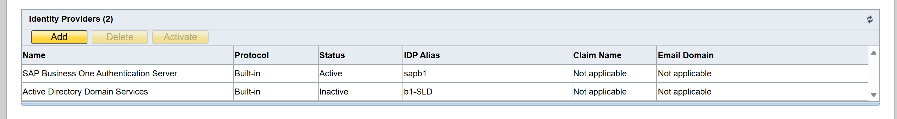

# System Requirements

Before you begin, make sure the following prerequisites are met:

* **CompuTec AppEngine** is installed. Minimum version `3.2509.1-rc-02`.
* **OIDC authentication** is enabled in **SAP Business One**.  
Here's how to check it:
  * In the **SAP SLD server**, open the **Identity Providers** tab.

    

  * Make sure that **SAP Business One Authentication Server** is active.
  