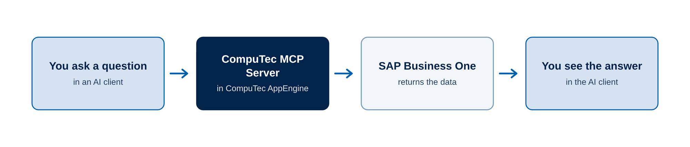

# Introduction to CompuTec MCP Server

**CompuTec MCP Server** connects AI assistants to **SAP Business One**. After you enable it, users can ask questions about their SAP Business One data in plain language, for example "Which Production Orders are late this week?", and the AI assistant answers from live data. With the right permission, the assistant can also create documents and update master data.

The Model Context Protocol (MCP) is an open standard that lets AI assistants connect to external data and tools in one common way. **CompuTec MCP Server** is part of **CompuTec AppEngine**. It makes SAP Business One objects available to any supported AI client, so you don't need to build your own integration.

## CompuTec MCP Server roles

Three roles work with **CompuTec MCP Server**. Each role has its own task and its own articles.

| Role | What this role does | Where to start |
| --- | --- | --- |
| Administrator | Enables **CompuTec MCP Server** for a company, assigns SAP Business One authorizations, and provides the connection details to users. | Enable the MCP Server for a company |
| Consultant or key user | Connects an AI client, such as Claude, and asks questions about SAP Business One data. | [Get Started with CompuTec MCP Server](./getting-started.md) |
| Developer | Builds custom MCP tools in a **CompuTec AppEngine** plugin for workflows that the built-in tools don't cover. | Build custom MCP tools |

## How it works

The AI client sends your request to **CompuTec MCP Server**. **CompuTec MCP Server** reads or changes the data in SAP Business One and returns the result to the AI client.

You ask a question in an AI client, **CompuTec MCP Server** gets the data from SAP Business One, and the AI client shows you the answer.

<!-- TODO: confirm with developers that this simplified flow is accurate. The marketing document names the Service Layer and the DI API as the SAP Business One interfaces. Decide whether to mention them. -->

## What you can do

With **CompuTec MCP Server**, you can:

- **Read SAP Business One data** – Ask about business partners, items, orders, invoices, Production Orders, batches, and more.
- **Combine data from several areas** – Ask one question that uses sales, purchasing, production, and finance data together.
- **Create and update data** – Create documents and update master data, but only for users who have the required authorization.
- **Open records in SAP Business One** – Ask the AI client to open a document or master data record in SAP Business One or in the web client.
- **Check inventory levels and approval procedures** – Get the current stock and the status of approvals.
- **Add your own tools** – Build custom MCP tools for your business workflows in a **CompuTec AppEngine** plugin.

For the complete list of tools, see the **CompuTec MCP Server built-in tools** article.

## Security and authorizations

**CompuTec MCP Server** uses the same security model as SAP Business One:

- Users log in with their own SAP Business One credentials. Sign-in uses the SAP Business One Authentication Server (OIDC).
- Users see only the data that their SAP Business One authorizations allow.
- Only users who have the **Allow MCP Server to execute modification commands** authorization can create or change data. Without it, a user can only read data.
- AI clients show the tool they are about to run. <!-- TODO: verify with developers whether approval before a tool runs depends on the AI client and its settings, and reword if so. -->

:::warning[Important]

Start with read-only users and a test company. Assign the modification authorization only after you have checked the results on test data.

:::

For the steps, see **Security and authorizations**.

## Supported AI clients

You can use **CompuTec MCP Server** with these AI clients:

- **Claude Desktop** – We recommend it for business users. It works with the Pro plan (through the developer settings) and with the Team plan or Claude for Work (through a custom connector).
- **GitHub Copilot** in Visual Studio Code – You configure it manually in the `mcp.json` file. It suits developer workflows.
- **Claude Code** – Anthropic's command-line tool, for developers who build and test **CompuTec AppEngine** plugins.

Client requirements can change, so check the vendor's documentation before you start. The configuration for each client is in the **CompuTec AppEngine Administration Panel**, in **Advanced Settings** > **MCP**.

## Before you start

Before you begin, make sure that:

- **CompuTec AppEngine** 3.2509.1-rc-02 or later is installed. [Read more](/docs/appengine/administrators-guide/requirements)
- OIDC authentication is enabled in SAP Business One, and the SAP Business One Authentication Server is active in the **Identity Providers** tab of the SAP Business One System Landscape Directory (SLD).

:::note[Info]

We recommend that you configure and test **CompuTec MCP Server** on a demo or test company first, and configure the production company only after the tests are complete.

:::

## Next steps

- **Get Started with CompuTec MCP Server** – Reach your first answer from SAP Business One data in a test company.
- **Enable the MCP Server for a company** – Administrators: turn on **CompuTec MCP Server** and set up authorizations.

:::note[Info]
Need help? [**Contact CompuTec Support**](https://support.computec.pl/).
:::
