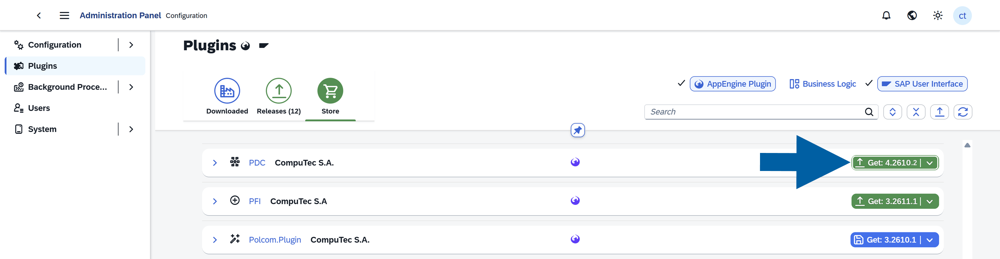
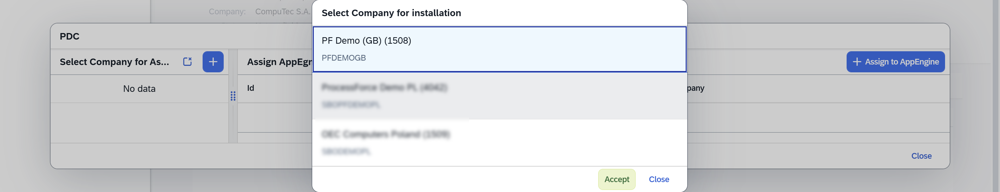
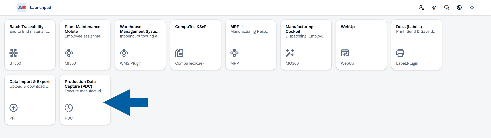
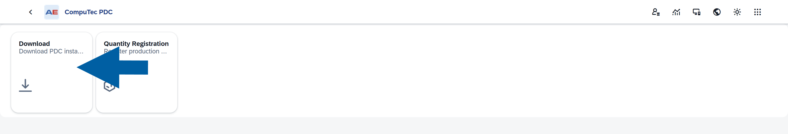
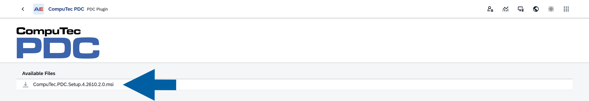
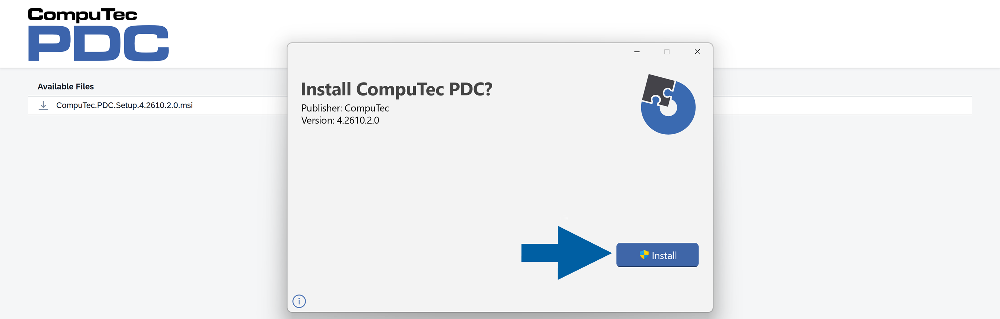
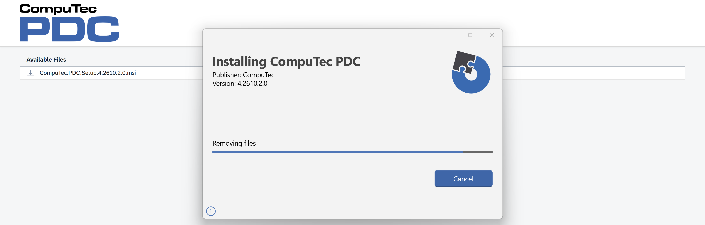

# Update CompuTec PDC

This guide describes how to upgrade CompuTec PDC when a new version is available. The **CompuTec PDC** plugin and the **CompuTec PDC** client must have the same version, so you upgrade both.

The upgrade consists of three steps:

1. **Uninstall the CompuTec PDC client** – Removes the old client from the device.
2. **Install the new version of the CompuTec PDC plugin** – Replaces the old plugin version in CompuTec AppEngine.
3. **Download and install the new CompuTec PDC client** – Installs the client that matches the new plugin version.

## Before you update

Before you begin, make sure that:

- The **CompuTec PDC** plugin and the **CompuTec PDC** client were installed as described in the [first installation guide](/docs/pdc/administrator-guide/installation/first-installation).
- You can log in to the **CompuTec AppEngine Administration Panel**.
- The new version meets the [system requirements](/docs/pdc/administrator-guide/installation/requirements).

:::warning[Important]

You must uninstall the old **CompuTec PDC** client before you install the new plugin version.

:::

## Step 1: Uninstall the CompuTec PDC client

Perform this step on each device where the **CompuTec PDC** client is installed.

To uninstall the **CompuTec PDC** client, follow these steps:

1. Close the **CompuTec PDC** client.
2. Open the list of installed applications in Windows.
3. Find **CompuTec PDC** and uninstall it.
4. Wait until the uninstallation is complete.

Done! The old **CompuTec PDC** client is removed from the device.

## Step 2: Install the new version of the CompuTec PDC plugin

To install the new plugin version, follow these steps:

1. Log in to the **CompuTec AppEngine Administration Panel**.
2. Go to **Plugins** > **Store**.
3. Find **PDC** and click **Get** next to it.

   

4. Select the company, and then select the CompuTec AppEngine instance.

   

5. In the **Installing Plugin PDC on Company** window, click **Perform Installation**.

   

6. Wait until the installation is complete, and then click **Close**.

:::note[info]

For a detailed description of each dialog, read [Step 2 of the first installation guide](/docs/pdc/administrator-guide/installation/first-installation#step-2-download-and-install-the-computec-pdc-client).

:::

Done! The new version of the **CompuTec PDC** plugin is installed and activated.

## Step 3: Download and install the new CompuTec PDC client

Perform this step on each device where you want to use CompuTec PDC.

To download and install the new **CompuTec PDC** client, follow these steps:

1. Open the **CompuTec AppEngine Launchpad** in your browser, and log in with SAP Business One.

   

2. Click the **Production Data Capture (PDC)** tile.

      

3. Click the **Download** tile.

      

4. In **Available Files**, click the `CompuTec.PDC.Setup` installation file with the `.msi` extension to download it.

      

5. Run the downloaded file.
6. In the **Install CompuTec PDC?** window, click **Install**.

      

7. Wait until the installation is complete.

      

Done! The new **CompuTec PDC** client is installed on the device.

## Verify the upgrade

To verify the upgrade, check that:

- The version of the installed **CompuTec PDC** client matches the version of the **CompuTec PDC** plugin.
- The **Production Data Capture (PDC)** tile is available on the **CompuTec AppEngine Launchpad**.
