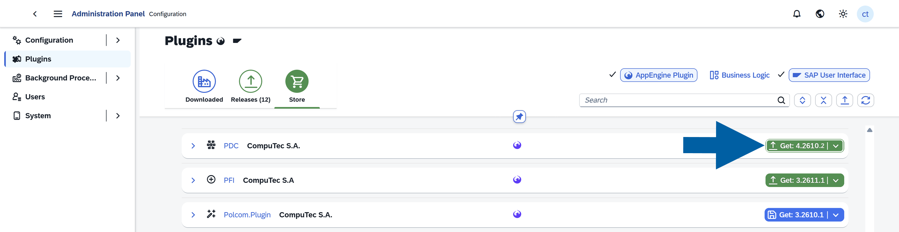
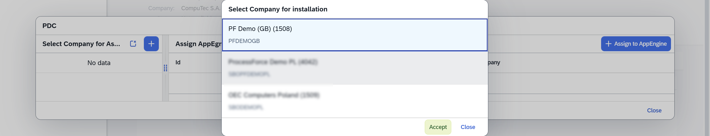
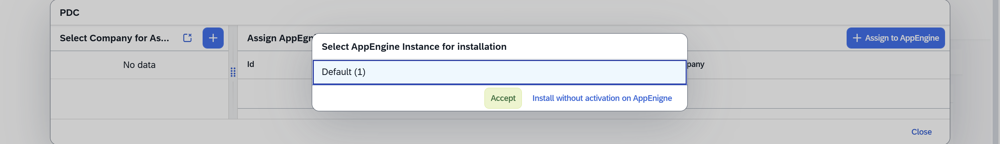
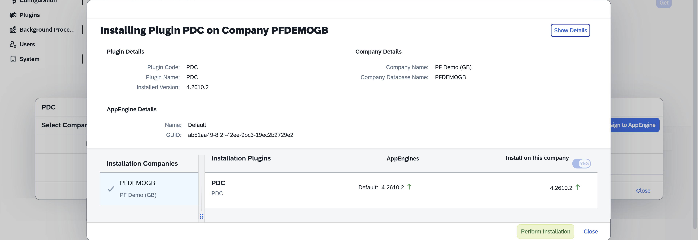
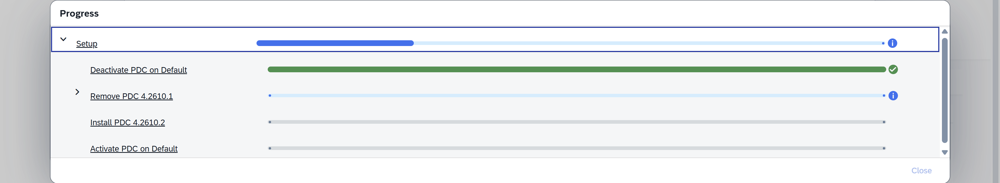
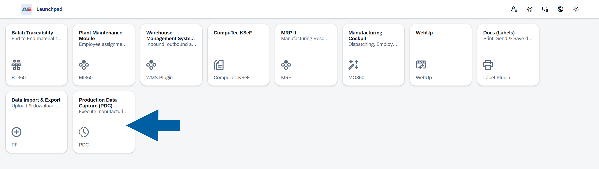
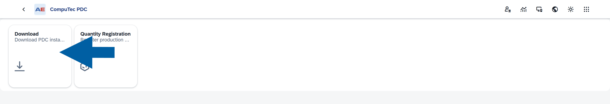
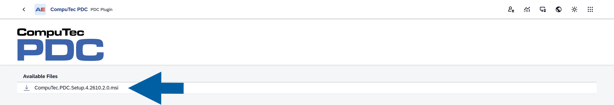
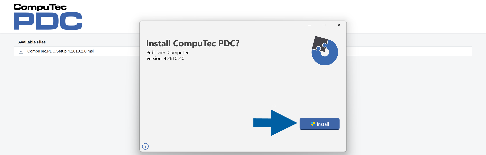
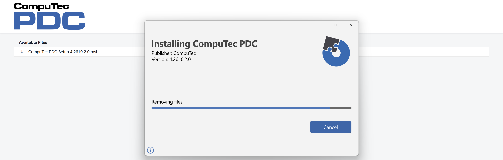

# First Installation

This guide describes how to install CompuTec PDC for the first time. CompuTec PDC consists of two parts: the **CompuTec PDC** plugin, which runs in **CompuTec AppEngine**, and the **CompuTec PDC** client, which you install on the devices where operators register production data.

The setup consists of two steps:

1. **Install the CompuTec PDC plugin** – Installs the plugin for an SAP Business One company and activates it on a CompuTec AppEngine instance.
2. **Download and install the CompuTec PDC client** – Installs the client application on a device from the **CompuTec AppEngine Launchpad**.

:::info[note]

To upgrade an existing installation, read the [**Update CompuTec PDC guide**](/docs/pdc/administrator-guide/installation/application-upgrade).

:::

## Before you start

Before you begin, make sure that:

- All hardware and software requirements are met. [Read more](/docs/pdc/administrator-guide/installation/requirements)
- **CompuTec AppEngine** is installed and configured. [Read more](/docs/appengine/administrators-guide/configuration-and-administration/installation)
- You can log in to the **CompuTec AppEngine Administration Panel**.
- You can log in to the **CompuTec AppEngine Launchpad** with an SAP Business One user.

## Step 1: Install the CompuTec PDC plugin

To install the **CompuTec PDC** plugin, follow these steps:

1. Log in to the **CompuTec AppEngine Administration Panel**.
2. Go to **Plugins** > **Store**.
3. Find **PDC** and click **Get** next to it.

   

4. In **Select Company for installation**, select the company where you want to install CompuTec PDC, and click **Accept**.

   

5. In **Select AppEngine Instance for installation**, select the CompuTec AppEngine instance on which you want to activate the plugin, and click **Accept**.

   

6. In the **Installing Plugin PDC on Company** window, make sure **Install on this company** is set to **YES**.
7. Click **Perform Installation**.

    

8. Wait until the installation is complete, and then click **Close**.

    

Done! The **CompuTec PDC** plugin is installed and activated.

## Step 2: Download and install the CompuTec PDC client

You download the **CompuTec PDC** client from the **CompuTec AppEngine Launchpad**. Perform this step on each device where you want to use CompuTec PDC.

To download and install the **CompuTec PDC** client, follow these steps:

1. Open the **CompuTec AppEngine Launchpad** in your browser.
2. Under **Choose your workspace**, select **Launchpad**.

    

3. Click **Log in with SAP Business One**.

4. On the **Launchpad**, click the **Production Data Capture (PDC)** tile.

    

5. In **CompuTec PDC**, click the **Download** tile.
    

6. In **Available Files**, click the `CompuTec.PDC.Setup` installation file with the `.msi` extension to download it.

   

7. Run the downloaded file.

8. In the **Install CompuTec PDC?** window, click **Install**.

   

9. Wait until the installation is complete.

   

Done! The **CompuTec PDC** client is installed on the device.

## Verify the installation

To verify the installation, check that:

- The **Production Data Capture (PDC)** tile is available on the **CompuTec AppEngine Launchpad**.
- The **CompuTec PDC** client is installed on the device.

## Next steps

After the installation, configure **CompuTec PDC** for your company.

See [**Configure CompuTec PDC**](/docs/pdc/administrator-guide/setting-up-the-application/overview) for the configuration process.
