# Capable to Promise (CTP)

**Capable to Promise (CTP)** helps you check whether a sales order line can be delivered on the requested date. If the date cannot be met, it calculates when the item can be ready based on material availability, lead times, and safety buffers.

Use CTP to review shortages, identify components that delay an order, and update the sales order line with the calculated ship date. Administrators set up the CTP scenario and background processing. Sales and planning teams then review individual order lines.

:::info
This guide describes **CTP** in **CompuTec MRP Plugin**. The calculated date is shown as **CTP Static Date**.
:::

## How CTP works

CTP uses one **CompuTec MRP scenario** for the company. This scenario defines the planning scope and settings, including the items, warehouses, and planning horizon.

The **CTP Scenario Runner** runs the scenario and plans open sales order lines within its scope. Between scenario runs, CTP can calculate a separate result for a line that has not yet been planned, such as a line entered after the last run.

| Sales order line state | What happens when you open CTP |
| --- | --- |
| `The line was included in the last CTP scenario run.` | The page shows **CTP Scenario Analysis**. Review the scenario's order recommendations for the supply planned for this line. |
| `The line is in scope but was not included in the last run.` | CTP calculates an individual result using the scenario's planning state. The page shows a CTP date, component quantities, and dates. |
| `An individual result has already been calculated.` | CTP displays the stored result. You can change safety buffers and recalculate it. |
| `The item is outside the scenario's scope.` | The page shows `Item Not Included in CTP Scenario`. |

The next CTP scenario run replaces individual analyses with the scenario's planning. A line that previously showed a component table can therefore show **CTP Scenario Analysis** after the next run.

### What determines the date

For an individual analysis, CTP checks the finished item and the components required at each level of its bill of materials (BOM). It uses the scenario's availability and planning information to determine what is available and what must be purchased or produced.

Dates are calculated from the lowest BOM level upwards:

- A purchased component can be ready after its lead time and safety buffer.
- A manufactured component can be ready when its components are available, plus its own lead time and safety buffer.
- The finished item's result is shown as **CTP Static Date**.

A shortage does not automatically mean that the requested date will be missed. CTP also checks when the missing quantity can be ready. Review both **Shortage / Excess** and **Deviation** to understand the result.

:::note
A safety buffer is applied at each BOM level involved in the date calculation. A company buffer of 3 days is not a single 3-day allowance added only to the finished item's date.
:::

### What CTP takes into account

| Input | How it affects the calculation |
| --- | --- |
| Sales order line | Defines the item, revision, required quantity, warehouse, and requested date. |
| Bill of materials | Defines the components and quantities needed to supply the item. |
| Material availability | Determines which quantities are available and which must be purchased or produced. |
| Lead times | Define the time needed to purchase or produce missing quantities. |
| Safety buffers | Add an allowance at each BOM level involved in the calculation. |
| Linked MRP scenario | Defines the planning scope and settings, including inventory, demand, supply, warehouses, and the planning horizon. |
| Latest scenario run | Provides the planning state used for individual CTP calculations. |

## Before you start

Make sure that:

- The [required CompuTec components](#required-components) are installed.
- The items and revisions have the BOMs and planning data needed for the calculation.
- Lead times reflect the time needed to purchase or produce the items.
- The CTP scenario includes the relevant items and warehouses.
- The scenario's end date is today or later.
- The CTP scenario has been run successfully.
- You can access the relevant CompuTec MRP pages and SAP Business One documents. Users who update ship dates also need permission to update sales orders.

CTP results depend on the scenario's planning settings and latest run. Review the planning horizon, included inventory, demand, supply, and handling of expired stock before using the results to confirm dates.

### Required components

| Component | Minimum version |
| --- | --- |
| CompuTec AppEngine | 3.2608.9 |
| CompuTec ProcessForce | 3.2609.3 |
| CompuTec MRP | 3.2610.3 |
| CompuTec MRP Business Logic | 3.2610.3 |
| Production Process Flow (PPF) plugin | 3.2605.1 |

To open CTP from the SAP Business One Web Client, the CompuTec WebUp extensions for CompuTec MRP must also be deployed.

## Set up CTP functionality

Complete this section as an administrator responsible for the company configuration.

### Step 1: Prepare the MRP scenario

1. Go to **CompuTec AppEngine Launchpad** > **MRP II** > **MRP Wizard**.

    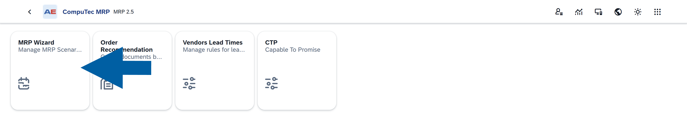

2. Open the scenario you want to use for CTP.
3. Check that **End Date** is today or later.
4. On the **Item Selection** tab, add the items and revisions to include in CTP.

    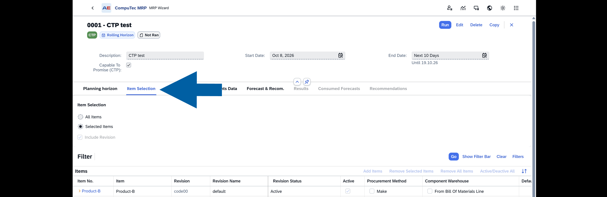

5. On the **Inventory Data** tab, add the warehouses to include in CTP.

    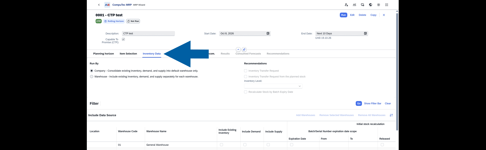

6. Review the inventory, demand, and supply settings for those warehouses.
7. Review the remaining scenario settings, including the planning horizon and document sources.
8. Save the scenario.

:::important
Add items and warehouses explicitly to the scenario's lists. Selecting **All Items** or **All Warehouses** alone does not populate the scope used by CTP.
:::

### Step 2: Select the CTP scenario and company safety buffer

1. In **SAP Business One**, go to **Administration** > **System Initialization**.
2. Open **General Settings**.
3. Select the **ProcessForce** tab.
4. Select the **MRP** tab.

    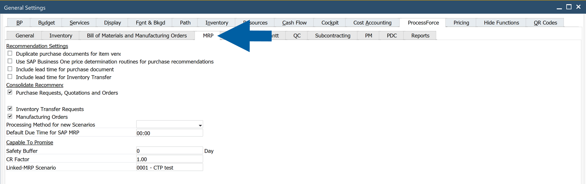

5. In the **Capable To Promise** section, select the scenario in **Linked-MRP Scenario**.
6. In **Safety Buffer**, enter the default number of buffer days. The default is `0`.
7. Save the settings.

:::info[note]
You can also assign the scenario in the **CompuTec AppEngine Launchpad** > **CompuTec MRP** by selecting **Capable To Promise (CTP)** in the scenario header. When another scenario is already assigned, confirm the change when prompted. Only one scenario can have the CTP role at a time.

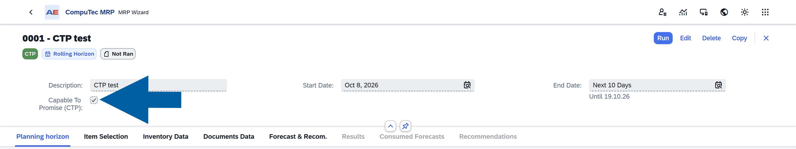

Before switching to another scenario, complete its item and warehouse lists and check its dates. After switching, verify that the intended scenario has the **CTP** badge and run it before using CTP results.
:::

### Step 3: Set item safety buffers, if needed

Use an item safety buffer when an item needs a different allowance from the company default.

1. In SAP Business One, go to **Inventory** > **Item Master Data**.
2. Open the item.
3. Select the **Planning Data** tab.

    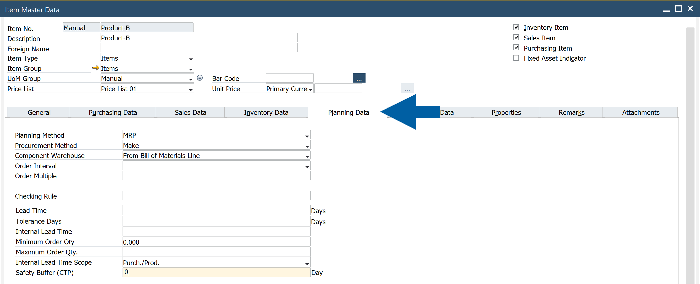

4. Enter the number of days in **Safety Buffer (CTP)**.
5. Save the changes.

:::info[note]
For revision-specific planning data, open **Item Details**, select the relevant revision on the **Planning Data** tab, and set **Safety Buffer (CTP)**.

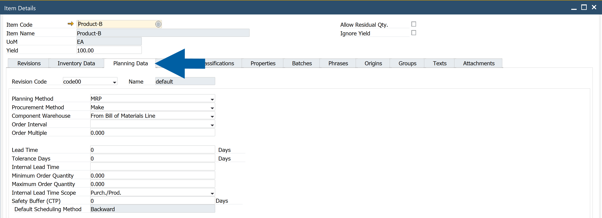
:::

When no item buffer is defined, CTP uses the company buffer. You can review the buffer actually used in the **Safety Buffer** column of an individual CTP result.

### Step 4: Set up the CTP scenario run

Use **background processing** in **CompuTec AppEngine** to keep the scenario's planning state up to date.

1. Open the **CompuTec AppEngine Administration Panel**.
2. Go to **Background Processing** > **Configuration**.
3. Find **CTP Scenario Runner** background processing job.
4. Activate the job for the company.

    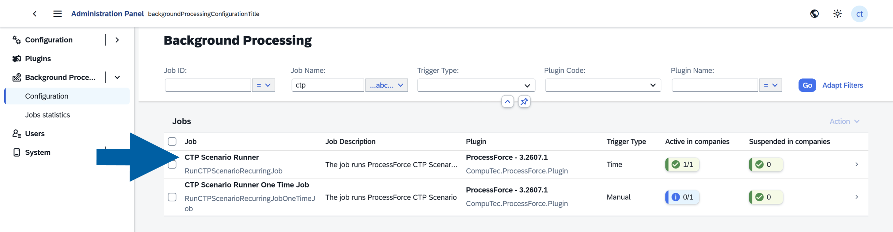

5. Review its schedule and adjust it to your planning cycle.

:::note[info]
The default schedule runs the job every day at midnight. To run the CTP scenario once, use **CTP Scenario Runner One Time Job**.
:::

Wait for the run to finish before opening CTP analyses. Use **Background Processing** > **Jobs statistics** to check job execution when troubleshooting.

After the first successful run, check that sales order lines within the scenario's scope appear in the **CTP List**.

## Open CTP for a sales order line

You can open **CTP** from **SAP Business One** or the **CompuTec AppEngine Launchpad**. If the required **CompuTec WebUp** extensions are deployed, you can also open it from the **SAP Business One Web Client**.

### From SAP Business One

1. In **SAP Business One**, open the sales order.
2. Right-click the line you want to check.
3. Select **CTP Analysis**.

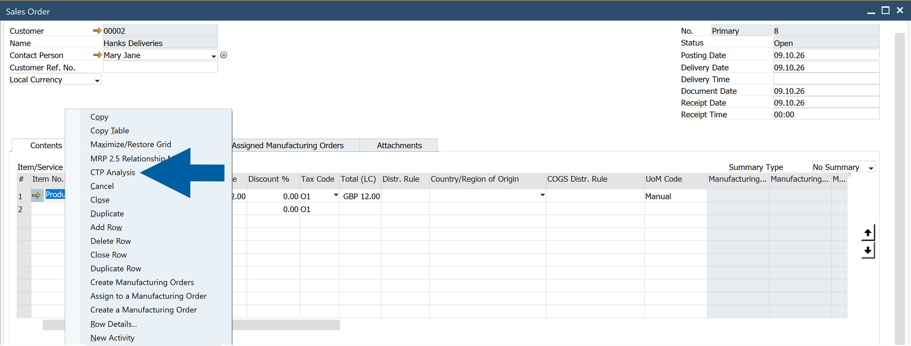

:::info[note]
The option is available when a CTP document already exists for the item's revision on at least one sales order line. If the option is missing, ask the administrator to check the scenario scope and the CTP scenario run.
:::

### From the CompuTec AppEngine Launchpad

1. In **CompuTec AppEngine Launchpad**, open the **MRP II** tile.
2. Select **CTP**.

    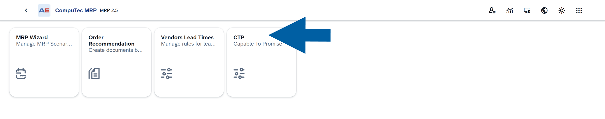

3. Select the sales order line in the **CTP List**.
4. Click **Redirect to Capable to Promise Details**.

:::note[info]
You can also open the list through **CompuTec AppEngine Launchpad** > **Analytics** > **Capable to Promise** > **CTP List**.

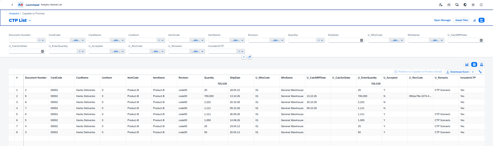
:::

### From the SAP Business One Web Client

1. In **SAP Business One Web Client**, open the sales order in view mode.
2. Select **Capable to Promise** on the line you want to check.

To view CTP lines for the whole order, select **CTP** on the sales order form.

:::info[note]
These actions depend on the deployed CompuTec WebUp extensions and existing CTP documents for the order's items. If they are unavailable, use the **CompuTec AppEngine Launchpad** or ask the administrator to check the deployment and scenario run.
:::

## Review an individual CTP result

For a line that has not yet been planned by the CTP scenario, the **CTP Results** page shows the calculated date and the components used in the analysis.

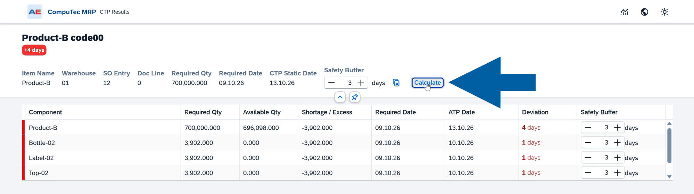

### Check the calculated date

Start with **Required Date**, **CTP Static Date**, and the deviation badge below the item code.

| Result | Meaning |
| --- | --- |
| Positive deviation, shown in red | The calculated date is later than the required date by the displayed number of days. |
| Zero deviation, shown in green | The calculated date matches the required date. |
| Negative deviation, shown in green | The calculated date is earlier than the required date. |

The deviation is calculated as **CTP date − Required Date**. For example, a required date of `October 9` and a CTP date of `October 13` give a deviation of **+4 days**.

The header also identifies the item and revision, warehouse, sales order entry (**SO Entry**), document line (**Doc Line**), and required quantity. **SO Entry** is the order's internal identifier; use **Document Number** in the CTP List to identify the customer-facing order number.

### Find shortages and late components

The component table includes the finished item and the BOM components needed for the analysis. Components at lower levels appear when those quantities need to be planned.

| Column | What to check |
| --- | --- |
| **Component** | The code of the finished item or component. |
| **Required Qty** | The quantity needed for this analysis. Component quantities reflect the BOM requirements for the quantity that needs to be supplied. |
| **Available Qty** | The quantity available to the calculation in the relevant warehouse and planning state. |
| **Shortage / Excess** | Available Qty minus Required Qty. A negative value is a shortage; a positive value is an excess. |
| **Required Date** | The date on which the item or component is needed. |
| **ATP Date** | The date on which the item or component can be ready according to the availability and lead-time calculation. |
| **Deviation** | ATP Date minus Required Date, in days. A positive value means the item or component is late. |
| **Safety Buffer** | The buffer used for the row, in days. You can change it and recalculate. |

Review rows with negative **Shortage / Excess** to find missing quantities. Then review positive **Deviation** values to find which dates cannot be met. Late rows are highlighted in red.

The **Deviation (Days)** chart shows the same date differences by component. Use it to locate delays, then check the corresponding rows for quantities and dates.

### Example: the requested date is missed

In this example, the order requires **700,000** units of Product-B on **October 9, 2026**.

- **696,098** units are available, leaving a shortage of **3,902**.
- Bottle-02, Label-02, and Top-02 each have a shortage of **3,902** and an ATP date of **October 10**.
- Product-B has a CTP date of **October 13**.
- The line is **4 days late**.

The component delays and the finished item's buffer contribute to the final date. Review supply for the missing components before confirming the revised ship date.

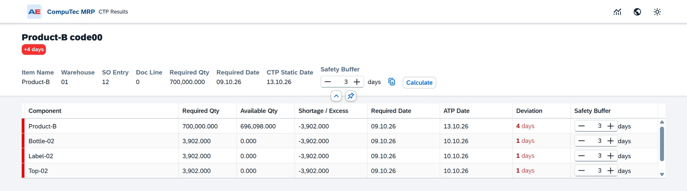

### Example: the requested date is met

For a quantity of **700** units of Product-B, the available quantity covers the requirement. The required date and CTP date are both **October 9, 2026**, and the deviation is **0 days**.

Only Product-B appears in this result because the available finished-item quantity covers the requirement.

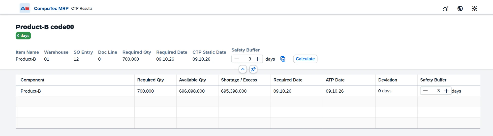

## Try different safety buffers

You can test buffers on an individual CTP result without changing the company or item settings.

### Apply one buffer to all rows

1. Enter the number of days in **Safety Buffer** in the page header.
2. Click the **Copy to Lines** icon next to the field.
3. Click **Calculate**.
4. Review the updated CTP date, component dates, and deviations.

### Change selected component buffers

1. Change **Safety Buffer** in the rows you want to test.
2. Click **Calculate**.
3. Review the updated result.

The recalculation uses the buffers entered on the page. The company and item defaults remain as configured.

In the following example, a 3-day buffer produces a CTP date of October 13 and a deviation of +4 days. Setting the buffers to 0 and recalculating changes the CTP date to October 9 and the deviation to 0 days. The shortages remain.

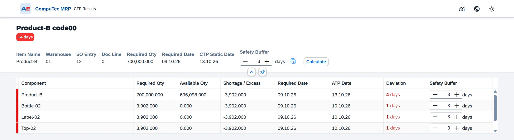

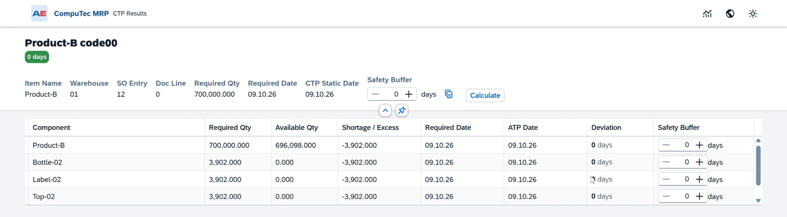

Choose a buffer that reflects the allowance your planning process needs. A smaller buffer can produce an earlier date without resolving a material shortage.

## Update the sales order ship date

After reviewing an individual result, you can write its **CTP Static Date** to the ship date of the sales order line.

1. Check that the result is for the intended sales order line.
2. Review **CTP Static Date**.
3. Click **Update Sales Order** at the bottom of the page.

    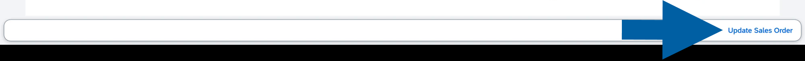

4. Click **OK** to confirm the ship-date update.

    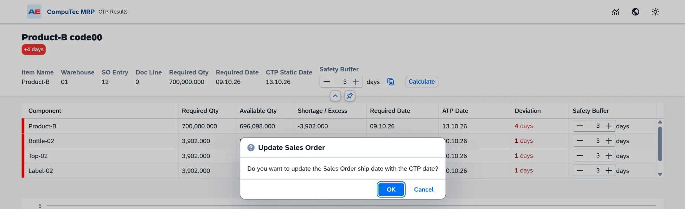

5. The page confirms that the sales order ship date was updated successfully.

    

:::info[note]
Opening an analysis or clicking **Calculate** does not update the sales order ship date. The update happens only after you confirm **Update Sales Order**.
:::

## Review lines already planned by the scenario

If a line was included in the latest CTP scenario run, its page shows:

**CTP Scenario Analysis**  
Sales Order processed in the CTP MRP scenario

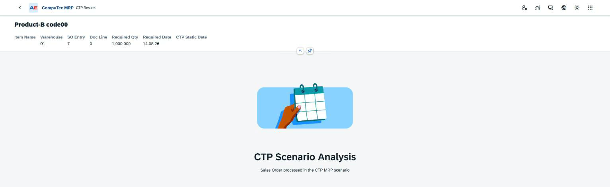

This is an expected planning state. The scenario has already planned supply for the line in its order recommendations, so the page does not show a separate component analysis or individual CTP date.

To review the planned supply, open the linked scenario's order recommendations in CompuTec MRP. An empty individual CTP date for this state does not mean that the scenario run failed.

## Use the CTP List

The **CTP List** brings together sales order lines for the items covered by the CTP scenario. Use it to find an order, check its CTP state, and open its analysis.

The order number, customer, line, item, revision, quantity, ship date, and warehouse identify the line. The following columns help distinguish its planning state:

| Column | Meaning |
| --- | --- |
| **U_CalcMRPDate** | CTP date from an individual analysis. Empty for lines planned by the CTP scenario. |
| **U_Remarks** | **CTP Scenario** identifies a line planned by the scenario run. |
| **U_Accepted** | Set to Yes for lines planned by the scenario. This value does not indicate that a customer has accepted a ship date. |
| **IncludeInCTP** | Yes when a CTP document exists for the line, either from an individual calculation or from the scenario run. |

Use the filters to find the relevant order or item. Select its row and click **Redirect to Capable to Promise Details**.

## Troubleshooting

| What you see | Meaning and next step |
| --- | --- |
| **Item Not Included in CTP Scenario** | The item is outside the scenario's item scope. Add it to the linked scenario's item list, check the warehouse scope, and run the CTP scenario. |
| **CTP Scenario Analysis** | The line was planned by the scenario. Review the scenario's order recommendations. A separate component analysis is not shown for this state. |
| **CTP Run Failed** | Read the accompanying message. Correct the reported cause and retry the calculation. If it persists, provide the message and order-line details to your administrator or Support. |
| A message says no CTP scenario was found. | Select **Linked-MRP Scenario** in General Settings or assign **Capable To Promise (CTP)** in the MRP Wizard. Verify the assignment and run the scenario. |
| **CTP Scenario is already running.** | Wait for the current run to finish before retrying. If it does not finish, ask the administrator to check the background job execution. |
| A message says the end date must be today or later. | Update the scenario's **End Date** before assigning it to CTP. |
| **CTP Analysis** is missing in SAP Business One. | Check that the item and revision are in scope and that a CTP document exists for them. Verify that the CTP scenario job has run successfully. |
| The Web Client CTP actions are missing. | Check the CompuTec WebUp extension deployment, open the order in view mode, and verify that CTP documents exist for its items. |
| A component table disappeared after a scenario run. | The line may now be planned by the scenario. Check for **CTP Scenario Analysis** and review the scenario recommendations. |
| The calculated date is unexpectedly early or late. | Review item lead times, row safety buffers, and the scenario's inventory, demand, supply, and planning-horizon settings. Check when the CTP scenario last ran. |

## Keep CTP planning up to date

For reliable day-to-day use:

- Run the CTP scenario on a schedule that matches your planning cycle.
- Review job execution if results or CTP actions are missing.
- Keep the scenario end date current.
- Update item and warehouse lists when the CTP scope changes.
- Maintain BOMs, revisions, and lead times as products and supply conditions change.
- Check the buffers used in the analysis before updating a ship date.
- Expect individual results to be replaced by scenario planning after the next CTP scenario run.
