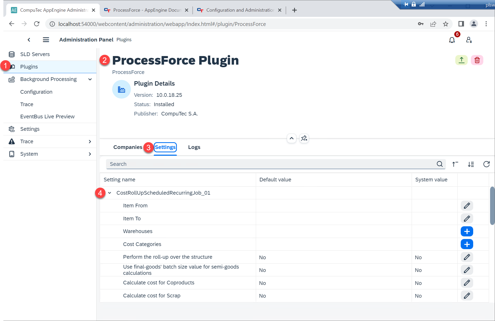
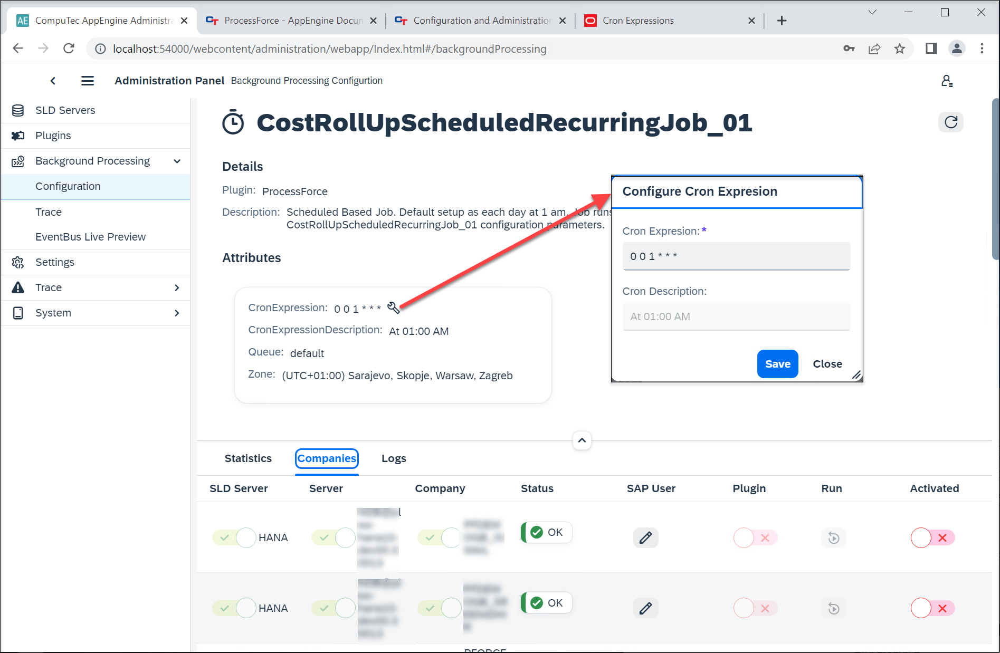

# CompuTec ProcessForce Plugin Related Jobs

CompuTec ProcessForce plugins provide background jobs that automate Cost Roll-Up, quality control, and data synchronization in SAP Business One. This article describes each job, when it runs, and which parameters you can configure.

## Before you start

Before you begin, make sure that **Background Processing** is enabled for the company. [Read more](/docs/appengine/administrators-guide/configuration-and-administration/background-processing)

## Jobs at a glance

| Job | What it does | When it runs |
| --- | --- | --- |
| `CostRollUpScheduledRecurringJob_01`, `_02`, `_03` | Performs Cost Roll-Up for selected items | Daily at 1 AM by default |
| `QCRefillBatchesAndSerialNumbersJob` | Adds new Batches and Serial Numbers to existing Quality Control Tests | When a Goods Receipt is added |
| `QCTestDocumentsGeneratorJob` | Generates Quality Control Tests | When a document is added |
| `RestoreAditionalBatchDetails` | Creates missing Batch Master Data | Every two hours |
| `RestoreItemDetailsJob` | Synchronizes the `ItemDetails` object | When item data in the `OITM` table is updated |
| `SynchronizeBillOfMaterialsJob` | Synchronizes Bill of Materials changes with SAP Business One | When a CompuTec ProcessForce Bill of Materials is updated |
| `SynchronizeManufacturingOrderJob` | Synchronizes Manufacturing Orders with Production Orders | When a Manufacturing Order is updated |
| `SynchronizeManufacturingOrdersRecursiveJob` | Synchronizes all Manufacturing Orders with Production Orders | Every 12 hours |
| `AdditionalBatchDetailsSynchronizerEB` | Synchronizes Batch Master Data updates with Additional Batch details | When Batch Master Data is updated |
| `AdditionalBatchDetailsCreatorEB` | Creates Batch Master Data for new Batches | When a Batch is created in SAP Business One |
| `ManufacturingOrderWizardRecoverJob` | Processes unfinished Manufacturing Order Wizard tasks | When CompuTec AppEngine starts |

## Cost Roll-Up scheduled recurring jobs

The `CostRollUpScheduledRecurringJob_01`, `CostRollUpScheduledRecurringJob_02`, and `CostRollUpScheduledRecurringJob_03` jobs perform Cost Roll-Up for selected items at a scheduled time. You can configure up to three separate schedules, one for each job.

- **Default cron expression**: `0 0 1 * * *` (daily at 1 AM)

### Configure the Cost Roll-Up parameters

To define the parameters of the Cost Roll-Up jobs, follow these steps:

1. Go to **Plugins** > **ProcessForce Plugin** > **Settings**.
2. Set the parameters. They match the options in the [Cost Roll-Up form](/docs/processforce/user-guide/costing-material-and-resources/cost-categories#cost-roll-up).
3. (optional) To use advanced options, such as batch-based calculations and saving Bill of Materials data, select **Perform the roll-up over structure**.

    <!-- TODO: verify alt text against the screenshot -->

:::warning[Important]

The four options from **Use final-goods' batch[…]** to **Calculate and Save Costed BOM data** work only when **Perform the roll-up over structure** is selected. CompuTec AppEngine shows these options even when the checkbox is cleared. Select **Perform the roll-up over structure** before you use them.

:::

### Change the schedule of a Cost Roll-Up job

To change when a Cost Roll-Up job runs, follow these steps:

1. Go to **Background Processing** > **Configuration**, and then select the job.
2. Enter a [cron expression](https://docs.oracle.com/cd/E12058_01/doc/doc.1014/e12030/cron_expressions.htm) that defines when the job runs.

    <!-- TODO: verify alt text and the exact field name -->

## Quality Control jobs

### QCRefillBatchesAndSerialNumbersJob

This job adds Batches and Serial Numbers to existing Quality Control Tests. When you add a Goods Receipt, the new Batches and Serial Numbers are added to Quality Control Tests that were created before this data existed in the database. Quality Control Test data stays accurate and up to date.

Details:

- **ContentType**: `59`
- **ActionType**: `A`

### QCTestDocumentsGeneratorJob

This job generates Quality Control Tests automatically when you add documents. The generation depends on your Quality Control settings.

Details:

- **ContentType**: `*`
- **ActionType**: `A`
- **Publisher**: `AppEngine`
- **PublisherApp**: `SAPB1`
- **EventType**: `SAPB1Object`

## Restore jobs

### RestoreAditionalBatchDetails

This job creates Batch Master Data for any missing Batches, so Batch data stays complete. <!-- TODO: verify job name spelling "Aditional" -->

- **Default cron expression**: `0 */2 * * *` (every two hours)

### RestoreItemDetailsJob

This job synchronizes the `ItemDetails` object when item data in the `OITM` table is updated. Item-related data stays consistent.

Details:

- **Editable**: `true`
- **ContentType**: `4` (`OITM`)
- **ActionType**: `U`

## Synchronization jobs

### SynchronizeBillOfMaterialsJob

This job synchronizes updates in CompuTec ProcessForce Bill of Materials with the matching data in SAP Business One. Bill of Materials information stays accurate and up to date.

Details:

- **Editable**: `true`
- **ContentType**: `CT_PF_OBOMCode`
- **ActionType**: `*`

### SynchronizeManufacturingOrderJob

This job synchronizes updates in Manufacturing Orders with the matching Production Orders. Order data stays accurate and consistent.

Details:

- **Editable**: `true`
- **ContentType**: `CT_PF_ManufacOrd`
- **ActionType**: `*`

### SynchronizeManufacturingOrdersRecursiveJob

This job synchronizes Manufacturing Orders with Production Orders on a schedule, so the data stays consistent even if a single update was missed. <!-- TODO: confirm the purpose with developers -->

- **Default cron expression**: `0 */12 * * *` (every 12 hours)

## Additional Batch Details jobs

### AdditionalBatchDetailsSynchronizerEB

This job synchronizes updates in Batch Master Data with the Additional Batch details in SAP Business One. Batch data stays consistent across both systems.

Details:

- **ContentType**: `CT_PF_AdditonalBatch` <!-- TODO: verify spelling "Additonal" -->
- **ActionType**: `U`
- **Publisher**: `AppEngine`
- **PublisherApp**: `SAPB1`
- **EventType**: `SAPB1Object`

### AdditionalBatchDetailsCreatorEB

This job creates the related Batch Master Data when you create a new Batch in SAP Business One.

Details:

- **ContentType**: `10000044`
- **ActionType**: `*`
- **Publisher**: `AppEngine`
- **PublisherApp**: `SAPB1`
- **EventType**: `SAPB1Object`

:::info[Note]

If you enable this job, CompuTec AppEngine handles Batch synchronization. If you don't enable it and you use CompuTec WMS, the CompuTec WMS service handles Batch synchronization.

:::

## Manufacturing Order management

### ManufacturingOrderWizardRecoverJob

When CompuTec AppEngine starts, this job checks and processes unfinished Manufacturing Order Wizard tasks.
