# CompuTec ProcessForce Plugin Related Jobs

CompuTec ProcessForce plugins provide background jobs that automate Cost Roll-Up, quality control, batch handling, and data synchronization in SAP Business One. You manage all jobs in **Background Processing** > **Configuration** in the **CompuTec AppEngine Administration Panel**. This article explains how to find the jobs, how to configure them, and what each job does.

## Before you start

Before you begin, make sure that:

- **Background Processing** is enabled for the company. [Read more](/docs/appengine/administrators-guide/configuration-and-administration/background-processing)
- You have access to the **CompuTec AppEngine Administration Panel**.

## Find the ProcessForce jobs

To display the jobs of the CompuTec ProcessForce plugin, follow these steps:

1. Log in to the **CompuTec AppEngine Administration Panel**.
2. Go to **Background Processing** > **Configuration**.

   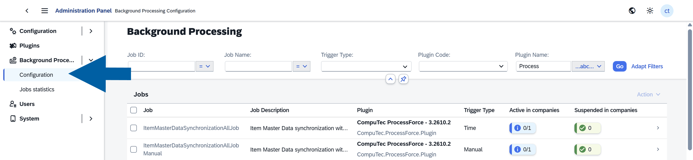

3. In the **Plugin Code** filter, select `CompuTec.ProcessForce.Plugin`, and click **Go**.

   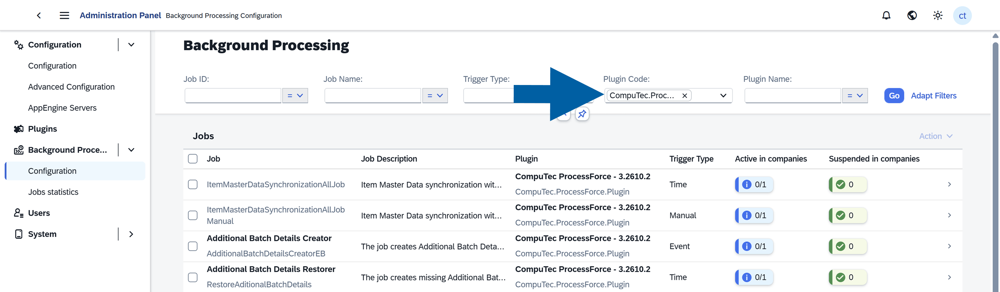

4. Done! The list shows all jobs of the CompuTec ProcessForce plugin.

For each job, the list shows the job name, the job ID, a short description, the plugin version, and the trigger type.

The **Trigger Type** can be:

- **Time** – The job runs on a schedule that you define with a cron expression.
- **Event** – The job runs when a matching event occurs in SAP Business One or CompuTec AppEngine.
- **Manual** – The job runs only when you start it.

## Job details

To open the details of a job, click the job in the list.

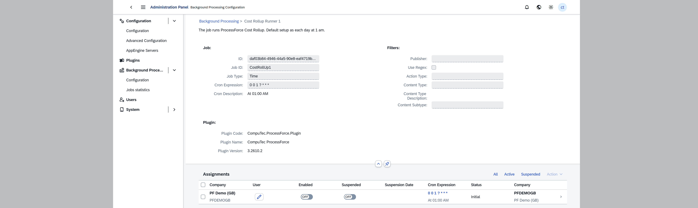

The job details page has four sections:

| Section | What it shows |
| --- | --- |
| **Job** | The job's **ID**, **Job ID**, **Job Type**, **Cron Expression**, and **Cron Description**. |
| **Filters** | The conditions that start an event job: **Publisher**, **Use Regex**, **Action Type**, **Content Type**, **Content Type Description**, and **Content Subtype**. |
| **Plugin** | The plugin that provides the job: **Plugin Code**, **Plugin Name**, and **Plugin Version**. |
| **Assignments** | The companies the job is assigned to, with the **User**, **Enabled**, **Suspended**, **Suspension Date**, **Cron Expression**, and **Status** of the job for each company. |

## Configure a job for a company

You configure a job separately for each company. The settings of a job for one company don't change the same job in another company.

### Open the company page of a job

To open the company page of a job, follow these steps:

1. Go to **Background Processing** > **Configuration**, and then click the job.
2. In **Assignments**, find the company, and click the arrow at the end of its row.

   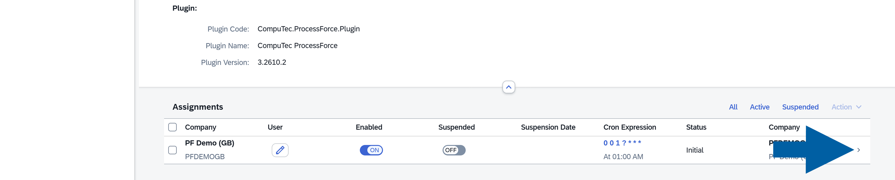

3. The company page of the job opens.

   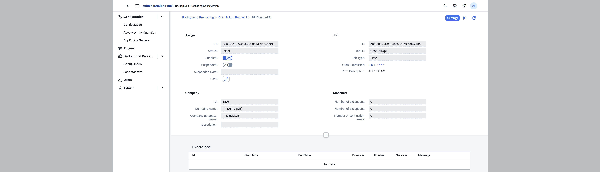

The company page has these sections:

| Section | What it shows |
| --- | --- |
| **Assign** | The assignment's **ID**, **Status**, **Enabled**, **Suspended**, **Suspended Date**, and **User** (the default user of the job for the company). |
| **Job** | The job's **ID**, **Job ID**, **Job Type**, **Cron Expression**, and **Cron Description**. |
| **Company** | The company's **ID**, **Company name**, **Company database name**, and **Description**. |
| **Statistics** | **Started at**, **Last execution**, **Last success execution**, **Number of executions**, **Number of exceptions**, and **Number of connection errors**. |
| **Executions** | A list of job runs with the **Id**, **Start Time**, **End Time**, **Duration**, **Finished**, **Success**, and **Message** of each run. |

In the upper-right corner, the page has three buttons: **Settings**, **Run**, and **Refresh**.

Click **Refresh** to update the statistics and the list of executions.

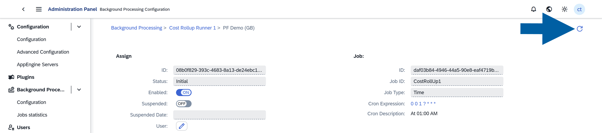

### Assign a default user to a job

To assign the default user of a job for a company, follow these steps:

1. Go to **Background Processing** > **Configuration**, and then click the job.
2. In **Assignments**, click the **pencil icon** in the **User** column of the company row.

   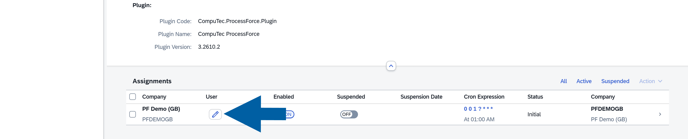

3. In the **Assign Default User for Job** dialog, find the user you want to assign the job to.

   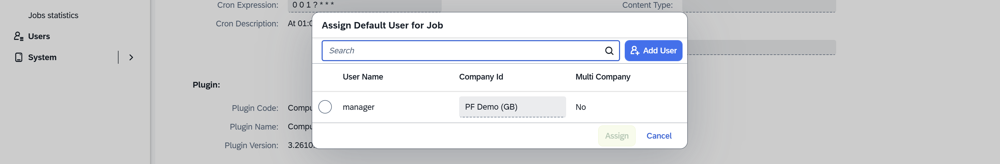

   :::info[note]

   If the user isn’t listed, enter their name in the **Search** field. Find the matching user, then click **Add User** to add them to the list.

   :::

4. Select a user and click **Assign**.
5. Done! The selected user is the default user of the job for the company.

The dialog lists the users with their **User Name**, **Company Id**, and **Multi Company** values. To add a user that isn't on the list, click **Add User**.

### Enable a job for a company

To enable a job for a company, follow these steps:

1. Go to **Background Processing** > **Configuration**, and then click the job.
2. In **Assignments**, find the company.
3. Switch **Enabled** to ON.

   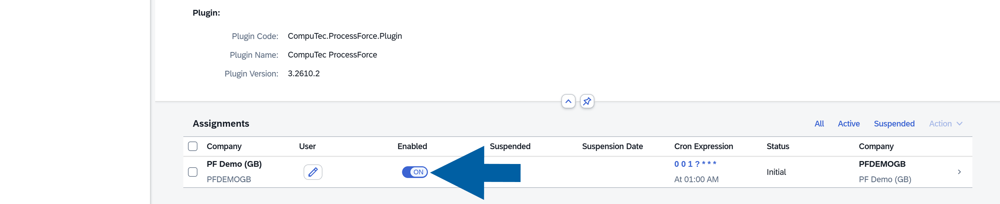

4. Confirm the job activation.

   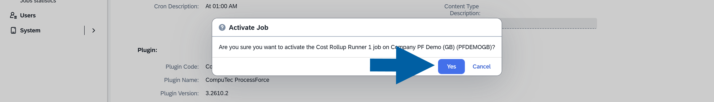

:::note[info]

You can also switch **Enabled** in the company row of the **Assignments** table on the job details page.

:::

### Change the schedule of a job

To change when a Time job runs for a company, follow these steps:

1. Go to **Background Processing** > **Configuration**, and then click the job.
2. In **Assignments**, click the cron expression in the company row.

   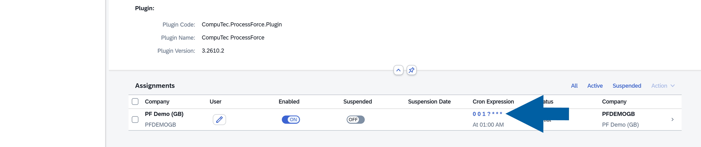

3. Enter a [cron expression](https://www.freeformatter.com/cron-expression-generator-quartz.html) that defines when the job runs.

   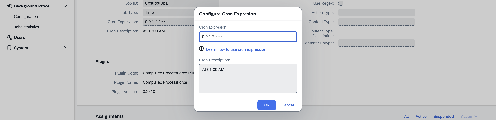

4. Click **Ok**.

### Run a job manually

To run a job for a company manually, follow these steps:

1. Open the company page of the job.
2. Click the **Run** icon (double arrow) in the upper-right corner.

   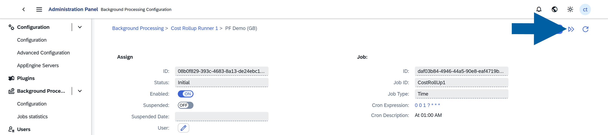

   :::note[info]

   A message confirms that the job started: "The job was started manually on company: PF Demo (GB)."

   

   :::

3. Click the **Refresh** icon.

   

4. Done! **Statistics** shows when the job ran, and **Executions** lists the run with its **Start Time**, **End Time**, **Duration**, **Finished**, and **Success** values.

   

A manual run doesn't change the schedule of the job. A Time job still runs at the time defined by its cron expression.

### Define the settings of a job

Some jobs have settings that you define for each company. To open them, follow these steps:

1. Go to **Background Processing** > **Configuration**, and then click the job.
2. In **Assignments**, find the company, and click the arrow at the end of its row.

   

   The company page of the job opens.

3. Click **Settings**.

   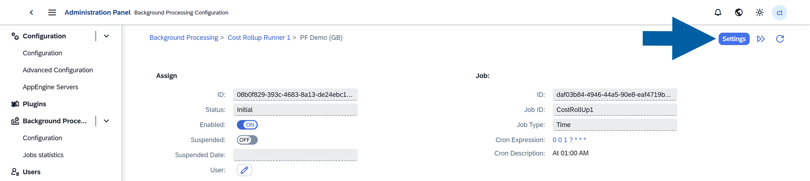

4. The **Settings** dialog opens.

   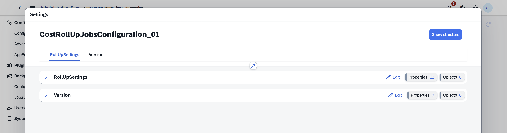

   Here you can define additional settings specific for the chosen job.

## About Cost Roll-Up jobs

The **Cost Rollup Runner 1**, **Cost Rollup Runner 2**, and **Cost Rollup Runner 3** jobs perform Cost Roll-Up for selected items on a schedule. You can configure up to three separate schedules, one for each job. By default, **Cost Rollup Runner 1** runs every day at 1 AM (cron expression `0 0 1 ? * * *`). Each runner also has a **One Time Job** variant with the trigger type **Manual**.

### Configure the Cost Roll-Up settings

To define which items and costs a Cost Roll-Up job processes, follow these steps:

1. Open the **Settings** dialog of the job for the company as described in [**Define the settings of a job**](#define-the-settings-of-a-job).
2. In **RollUpSettings**, set the values.

   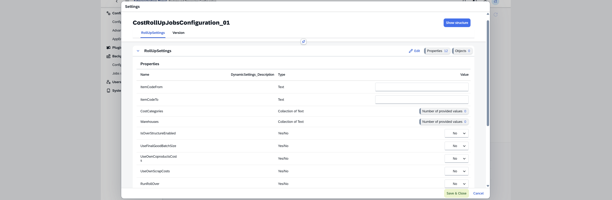

3. Click **Save & Close**.
4. Done! The job uses the new settings the next time it runs.

The **RollUpSettings** section has these settings. They match the options in the [Cost Roll-Up form](/docs/processforce/user-guide/costing-material-and-resources/cost-categories#cost-roll-up).

| Setting | Type | Default | What it controls |
| --- | --- | --- | --- |
| `ItemCodeFrom` | Text | Empty | The first item code of the range of items to roll up. |
| `ItemCodeTo` | Text | Empty | The last item code of the range of items to roll up. |
| `CostCategories` | Collection of text | No values | The cost categories to include. |
| `Warehouses` | Collection of text | No values | The warehouses to include. |
| `IsOverStructureEnabled` | Yes/No | No | Whether the roll-up runs over the product structure. |
| `UseFinalGoodBatchSize` | Yes/No | No | Whether the roll-up uses the batch size of the final good. |
| `UseOwnCoproductsCosts` | Yes/No | No | Whether the roll-up uses the item's own co-product costs. |
| `UseOwnScrapCosts` | Yes/No | No | Whether the roll-up uses the item's own scrap costs. |
| `RunRollOver` | Yes/No | No | Whether the job also runs a cost roll-over. |
| `RollOverCostCategoryFrom` | Text | Empty | The cost category to roll over from. |
| `RollOverCostCategoryTo` | Text | Empty | The cost category to roll over to. |
| `RollOverTheCostsOfResources` | Yes/No | No | Whether the roll-over includes the costs of resources. |

:::warning[Important]

Set **IsOverStructureEnabled** to **Yes** before you use the advanced options, such as **UseFinalGoodBatchSize**.

:::

## Job reference

### Cost Roll-Up, costing, and planning jobs

| Job name | Job ID | Trigger type | What it does |
| --- | --- | --- | --- |
| Cost Rollup Runner 1 | `CostRollUp1` | Time | Runs CompuTec ProcessForce Cost Roll-Up. Runs daily at 1 AM by default. |
| Cost Rollup Runner 1 One Time Job | `CostRollUp1OneTimeJob` | Manual | Runs CompuTec ProcessForce Cost Roll-Up when you run it. |
| Cost Rollup Runner 2 | `CostRollUp2` | Time | Runs CompuTec ProcessForce Cost Roll-Up on its own schedule. |
| Cost Rollup Runner 2 One Time Job | `CostRollUp2OneTimeJob` | Manual | Runs CompuTec ProcessForce Cost Roll-Up when you run it. |
| Cost Rollup Runner 3 | `CostRollUp3` | Time | Runs CompuTec ProcessForce Cost Roll-Up on its own schedule. |
| Cost Rollup Runner 3 One Time Job | `CostRollUp3OneTimeJob` | Manual | Runs CompuTec ProcessForce Cost Roll-Up when you run it. |
| Item Cost in Item Costing Syncer | `UpdateStandardPriceInItemCostingAfterInventoryRevaluationJob` | Event | Synchronizes the item cost in Item Costing. |
| Item Costing Restorer | `RestoreItemCostingEventBusJob` | Event | Creates item costing entries. |
| Item Costing Restorer | `RestoreItemCostingRecurringJob` | Time | Creates missing item costing entries. |
| CTP Scenario Runner | `RunCTPScenarioRecurringJob` | Time | Runs CompuTec ProcessForce CTP scenarios. |
| CTP Scenario Runner One Time Job | `RunCTPScenarioRecurringJobOneTimeJob` | Manual | Runs CompuTec ProcessForce CTP scenarios when you run it. |

### Batch jobs

| Job name | Job ID | Trigger type | What it does |
| --- | --- | --- | --- |
| Additional Batch Details Creator | `AdditionalBatchDetailsCreatorEB` | Event | Creates the related Batch Master Data when you create a new Batch in SAP Business One. |
| Additional Batch Details Restorer | `RestoreAditionalBatchDetails` | Time | Creates missing Batch Master Data. Runs every two hours by default. |
| Batch Details Syncer | `AdditionalBatchDetailsSynchronizerEB` | Event | Synchronizes updates in Batch Master Data with the Additional Batch details in SAP Business One. |
| Batch Status Changer | `ChangeBatchStatusWhenItIsExpiredRecurringJob` | Time | Changes the status of a Batch when it expires. |

:::info[Note]

If you enable **Additional Batch Details Creator**, CompuTec AppEngine handles Batch synchronization. If you don't enable it and you use CompuTec WMS, the CompuTec WMS service handles Batch synchronization.

:::

### Item data and synchronization jobs

| Job name | Job ID | Trigger type | What it does |
| --- | --- | --- | --- |
| Item Master Data Consolidator | `ItemMasterDataSynchJob` | Event | Performs a series of actions on item master data. |
| (no job name) | `ItemMasterDataSynchronizationAllJob` | Time | Synchronizes item master data. |
| (no job name) | `ItemMasterDataSynchronizationAllJobManual` | Manual | Synchronizes item master data when you run it. |
| Bill of Material Syncer | `SynchronizeBillOfMaterialsJob` | Event | Synchronizes updates in CompuTec ProcessForce Bills of Materials with the matching data in SAP Business One. |
| Bill of Material Time Based Syncer | `SynchronizeBillOfMaterialsRecurringJob` | Time | Synchronizes Bills of Materials on a schedule. |
| Manufacturing Order Syncer | `SynchronizeManufacturingOrderJob` | Event | Synchronizes updates in Manufacturing Orders with the matching Production Orders. |
| Manufacturing Order Syncer | `SynchronizeManufacturingOrdersRecursiveJob` | Time | Synchronizes all Manufacturing Orders with Production Orders. Runs every 12 hours by default. |
| Manufacturing Order Status Update | `ManufacturingOrderChangeStatusByQuantityRecurringJob` | Time | Updates the Manufacturing Order status. |
| Manufacturing Order Status Update | `ManufacturingOrderChangeStatusByQuantityEventBusJob` | Event | Updates the Manufacturing Order status. |
| SAP marketing document revision synchronizer | `SapMarketingDocumentLinesRevisionUpdaterJob` | Event | Keeps the revision in SAP Business One marketing documents up to date. |
| Orderless Production Saga Invoker | `OrderlessProductionSagaEventBusJob` | Event | Invokes the steps of the orderless production process. |

### Quality Control jobs

| Job name | Job ID | Trigger type | What it does |
| --- | --- | --- | --- |
| QC Test Creator | `QualityControlTestDocumentsGeneratorJob` | Event | Creates Quality Control Tests when you add documents, based on your Quality Control settings. |
| QC Test Protocol Creator | `QualityControlTestProtocolsGeneratorJob` | Event | Creates Quality Control Test Protocols. |
| QC Test Serial/Batch Syncer | `RefillBatchesAndSerialNumbersInQualityControlTestDocumentsJob` | Event | Adds new Batches and Serial Numbers to existing Quality Control Tests when you add a Goods Receipt. |
| Protocol Template to Test Protocols Synchronizer (Event-Based) | `QualityControlSyncTestProtocolWithProtocolTemplateEventBasedJob` | Event | Synchronizes updates of Quality Control Protocol Templates with Test Protocols. |
| Protocol Templates to Test Protocols Synchronizer (Recurring) | `QualityControlSyncTestProtocolWithProtocolTemplateRecurringJob` | Time | Synchronizes all Quality Control Protocol Templates with Test Protocols. |

## Filter values of event jobs

Event jobs start when an event matches the values in the **Filters** section of the job. These are the values of the main event jobs.

| Job ID | Action Type | Content Type | Publisher | PublisherApp | EventType |
| --- | --- | --- | --- | --- | --- |
| `RefillBatchesAndSerialNumbersInQualityControlTestDocumentsJob` | `A` | `59` | – | – | – |
| `QualityControlTestDocumentsGeneratorJob` | `A` | `*` | `AppEngine` | `SAPB1` | `SAPB1Object` |
| `SynchronizeBillOfMaterialsJob` | `*` | `CT_PF_OBOMCode` | – | – | – |
| `SynchronizeManufacturingOrderJob` | `*` | `CT_PF_ManufacOrd` | – | – | – |
| `AdditionalBatchDetailsSynchronizerEB` | `U` | `CT_PF_AdditonalBatch` | `AppEngine` | `SAPB1` | `SAPB1Object` |
| `AdditionalBatchDetailsCreatorEB` | `*` | `10000044` | `AppEngine` | `SAPB1` | `SAPB1Object` |
