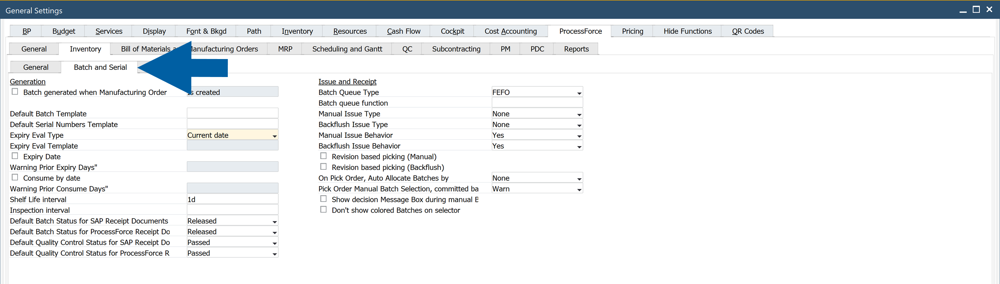
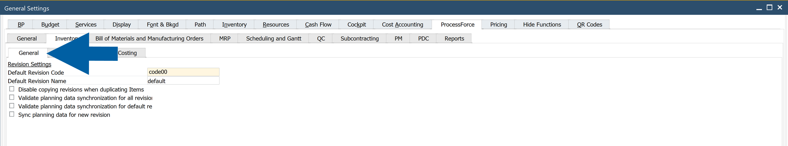
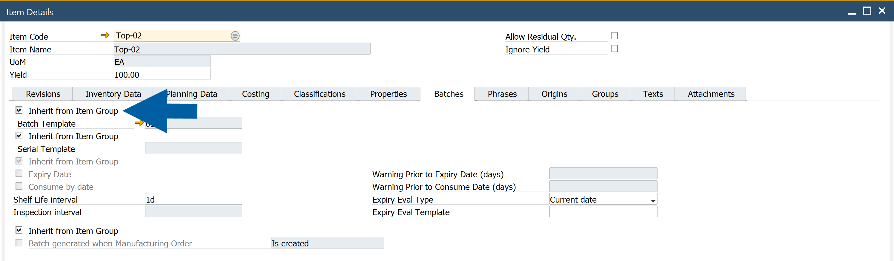

# Batch Control General Settings

Batch control settings define how **CompuTec ProcessForce** manages batches. They include the default batch statuses for document types and batch templates. You can configure the settings at three levels:

- **General Settings** – Apply to all new batches in the company.
- **Item group settings** – Apply to the items of one item group. They replace the General Settings when you clear the **Inherit from General Settings** checkbox.
- **Item details settings** – Apply to one item. They replace the item group settings when you clear the **Inherit from Item Group** checkbox.

:::note[Info]

For an example of batch configuration in General Settings, read [**Batch configuration**](/docs/processforce/user-guide/system-initialization/general-settings/inventory-tab/).

:::

## General Settings

The General Settings apply to all newly created batches.

To access the **Inventory** tab, navigate to: **Administration** > **System Initialization** > **General Settings** > **ProcessForce** > **Inventory**.

:::note[Info]

For details about all settings on this tab, read [**General Settings: Inventory tab**](/docs/processforce/user-guide/system-initialization/general-settings/inventory-tab/).

:::

## Item group settings

To define batch control settings for one item group, clear the **Inherit from General Settings** checkbox. The item group then uses its own settings instead of the General Settings. This gives you more control over batch behavior for each product category.

To access item groups, navigate to: **Administration** > **Setup** > **Inventory** > **Item Groups** > **ProcessForce** > **Batch and Serial**.

 

## Item details settings

To configure batch settings for one item, clear the **Inherit from Item Group** checkbox. This is the most detailed level of configuration. Use it for items that have unique batch control requirements.

To access the **Batches** tab, navigate to: **Inventory** > **Item Details** > **Batches**.

 
