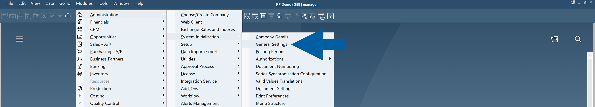
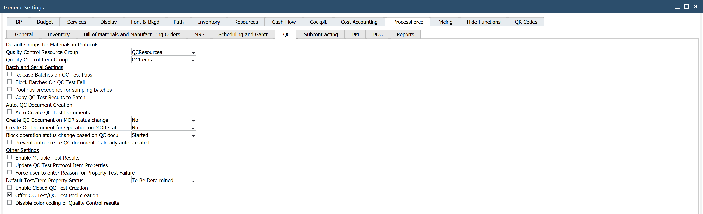

# Batch Status Resolution

**CompuTec ProcessForce** derives the status of a batch from the quality control (QC) results that cover the batch. When a QC test or a QC test pool changes, CompuTec ProcessForce works out the status again. You no longer set the status as a side effect of closing a QC test.

A batch can have one of three statuses:

| Status in the user interface | Meaning |
| --- | --- |
| **Released** | The batch passed quality control and is available. |
| **Not Accessible** | Quality control is not finished or has no clear result. The batch is on hold. |
| **Locked** | The batch failed qua

This article describes how CompuTec ProcessForce derives these statuses, which settings control the result, and what changes for you after an upgrade to CompuTec ProcessForce 3.2609.3 or later.

:::info[note]

Some internal documents call these statuses **Released**, **On Hold**, and **Blocked**. In the user interface, **On Hold** is named **Not Accessible**, and **Blocked** is named **Locked**. These are the only three statuses a batch can have.

:::

## Before you start

Before you begin, make sure that:

- CompuTec QC360 and the required CompuTec ProcessForce 3.2609.3 or later version are installed. [Read more](/docs/appengine/administrators-guide/configuration-and-administration/installation)
- You can open **General Settings** in SAP Business One.
- You know whether your company uses QC test pools for sampling.

## Configure batch status resolution

The behavior depends on four settings. Three of them decide how CompuTec ProcessForce derives the status. The fourth copies QC results to the batch.

To access the settings, follow these steps:

1. Navigate to: **Modules** > **Administration** > **System Initialization** > **General Settings**.

    

2. Go to **ProcessForce** > **QC**.

    

The following settings are available:

- **Release Batches on QC Test Pass** - Allows CompuTec ProcessForce to set the status **Released**.
- **Block Batches On QC Test Fail** - Allows CompuTec ProcessForce to set the status **Locked**.
- **Pool has precedence for sampling batches** - Choose how CompuTec ProcessForce derives the status of a batch that is covered by a QC test pool:

        - **Cleared** (default) – Legacy mode. CompuTec ProcessForce uses the individual QC tests that cover the batch. 
        - **Selected** – Pool Precedence mode. CompuTec ProcessForce uses only the result of the QC test pool. Individual sampling tests do not change the batch status. 

    :::note[info]

    This setting is cleared by default. After an upgrade, your company keeps the Legacy behavior until you select the setting.

    :::

- **Copy QC Test Results to Batch** - Choose whether ProcessForce copies the QC test results to the batch when you close a QC test document. This setting does not decide whether the batch is available. The QC status and the availability status of a batch can be different. For example, when both **Release Batches on QC Test Pass** and **Block Batches On QC Test Fail** are cleared and **Copy QC Test Results to Batch** is selected, the batch gets the QC result, but its availability does not change.

    :::warning[Important]

    Do not rely on the tooltips of Release Batches on QC Test Pass and Block Batches On QC Test Fail to learn how these settings work. The tooltips describe the previous behavior.  

    :::

    :::info[Note]

    The captions of the first two settings depend on the SAP Business One user interface language. This article uses the English (US) captions, Release Batches on QC Test Pass and Block Batches On QC Test Fail. In English (UK), the captions are Release batch when QC Test passed and closed and Block batch when QC Test failed and closed. Other languages show translated captions.

    :::

## How the settings allow a status

ProcessForce first derives a status from the QC results. It then writes the status to the batch only if the matching setting allows it.

| Derived status | Required setting |
| --- | --- |
| **Released** | Release Batches on QC Test Pass is selected. |
| **Locked** | Block Batches On QC Test Fail is selected. |
| **Not Accessible** | At least one of the two settings is selected. |

## How CompuTec ProcessForce derives the status in Legacy mode

In Legacy mode, CompuTec ProcessForce looks at all QC tests that cover the batch, regardless of their age. It checks the following conditions in order. The first condition that matches decides the status.

| Order | Condition | Derived status |
| --- | --- | --- |
| 1 | Any QC test is **Started**, **Reopened**, or **On Hold**. | **Not Accessible** |
| 2 | Any QC test is Closed with the result Failed. | **Locked** |
| 3 | Not every QC test is Completed or Closed. | **Not Accessible** |
| 4 | Every QC test is Closed with the result Passed. | **Released** |

A QC test in progress has a higher priority than a closed failed test. When you reopen a test, the batch does not stay **Locked** because of a result that you are revising.

:::note[Info]

A QC test that is **Completed** but not **Closed** gives **Not Accessible**, because **Released** needs every test to be **Closed** and **Passed**. A **Completed** test with the result **Failed** does not lock the batch either, because **Locked** needs a **Closed** failed test. The batch is **Not Accessible** until you close the test.

:::

A batch that has no QC tests keeps the status it got when you received it, which is the [default batch status from **General Settings**](/docs/processforce/user-guide/inventory/batch-control/batch-control-settings/configuration-batch-and-quality-control-status). CompuTec ProcessForce derives a status only after a QC test or a QC test pool that covers the batch is added or changes its status.

### What you notice after the upgrade

CompuTec ProcessForce derives the status again at every status change of a QC test document, including when you create the QC test. When a **Released** batch gets a new QC test, the batch changes to **Not Accessible**. After every test for the batch is **Closed** and **Passed**, the batch changes back to **Released**.

Before this feature, creating a QC test did not change the batch status. This change applies only if CompuTec ProcessForce is allowed to change the batch status.

### Current limitation: a failed test stays in the history

In Legacy mode, a closed failed QC test keeps the batch out of **Released**. A later passed test does not release the batch.  

To release it, reopen the failed test and correct its result. While the test is reopened, the batch is **Not Accessible**. After you close the test with the result **Passed**, the batch changes to **Released**, if all other tests for the batch are **Closed** and **Passed**.

If your process needs to release a batch after a failed sample, use **Pool Precedence** mode with QC test pools.

## How CompuTec ProcessForce derives the status in Pool Precedence mode

In Pool Precedence mode, the result of the QC test pool alone decides the status of a batch that the pool covers. The individual sampling tests do not change the batch, even when a test fails. The settings in How the settings allow a status apply in the same way as in Legacy mode.

| Pool result | Derived status |
| --- | --- |
| Fail | Locked |
| To Be Determined | Not Accessible |
| Pass | Released |

CompuTec ProcessForce derives the status again when you add the QC test pool and when you close it. The sample tests are created together with the pool, so a new pool has the result **To Be Determined**, and the batch changes to **Not Accessible**. The batch changes again only when someone closes the pool. If the pool calculates its own result (**Pass** or **Fail**) but stays open, the batch does not change. Reopening a pool does not change the batch either.

For example, a QC test pool covers a batch. One sampling test failed and two passed, and you close the pool with the result **Pass**. The table shows the batch status for each combination of settings:

| Release Batches on QC Test Pass | Block Batches On QC Test Fail | Pool has precedence for sampling batches | Batch status |
| --- | --- | --- | --- |
| Cleared | Selected | Cleared | **Locked** – The failed test blocks the batch. |
| Cleared | Selected | Selected | **Not Accessible** – The failed sample does not block the batch but Released needs Release batch when QC Test passed and closed. |
| Selected | Selected | Selected | **Released** |

### When a QC test pool gets its result

A QC test pool decides its own result (**Pass**, **Fail**, or **To Be Determined**) from its sampling tests, using the acceptance (Ac) and rejection (Re) numbers of the test protocol:

- **Ac** is the minimum number of passed samples.
- **Re** is the maximum number of failed samples that the pool allows.

The pool fails when the number of failed samples is greater than Re. The pool passes when the number of passed samples is at least Ac, and the failed samples plus the samples without a result are not more than Re. In other words, the pool passes only when no remaining sample can still push the failures over Re.

The **Ac**, **Re** **Obligatory** setting on the test protocol, quality plan, and QC test controls how long the pool waits:

- **Selected** – Every test in the pool must be done and closed before the pool gets a result.
- **Cleared** – The pool gets a result as soon as the tests that are already decided to settle the outcome. The undecided tests can no longer change it.

When every sample has a result, the pool can stay **To Be Determined** only if Ac plus Re is greater than the number of samples. A QC test that you close with the result **To Be Determined** counts as a sample without a result. If **Ac**, **Re Obligatory** is selected, a pool with such a test never gets a result automatically, and a person must decide.

## When CompuTec ProcessForce changes the status

CompuTec ProcessForce changes the batch status only when something happens to a QC document:

- In **Legacy** mode, when you add a QC test and when the status of its document changes.
- In **Pool Precedence** mode, when you add a QC test pool and when you close it.

CompuTec ProcessForce does not recalculate all batches at once. After an upgrade, batches whose QC documents you do not touch keep their current status. CompuTec ProcessForce updates a batch when its QC documents change. A batch that has no QC tests keeps its current status.

For serial numbers, CompuTec ProcessForce copies QC data only when a QC test is closed, or, in **Pool Precedence** mode, when a QC test pool is closed. It does not update serial numbers at intermediate status changes.

## Upgrade

The upgrade adds the setting **Pool has precedence for sampling batches** with the usual structure update. You do not need to migrate data or perform manual steps. After the upgrade, your company uses **Legacy** mode.

## Next steps

Review the QC test settings in your company and decide whether to use **Pool Precedence** mode. See [Quality Testing Mobile (QC360) Overview](/docs/processforce/processforce-plugins/qc-mob/qc360-mobile-app) to record test results on a tablet or phone.
