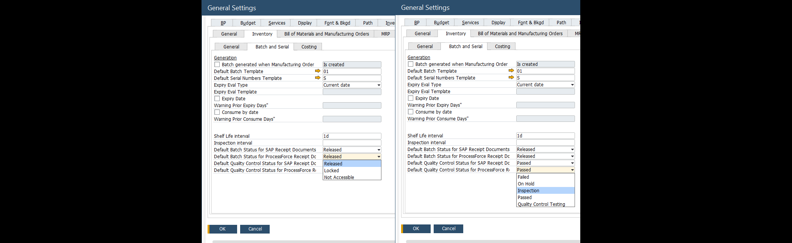
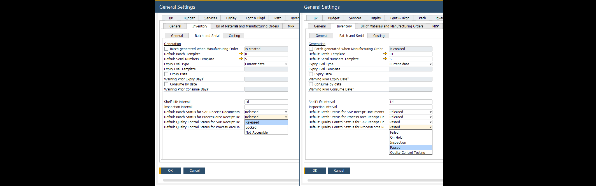
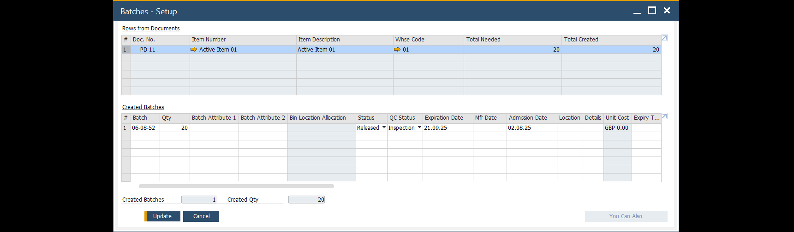
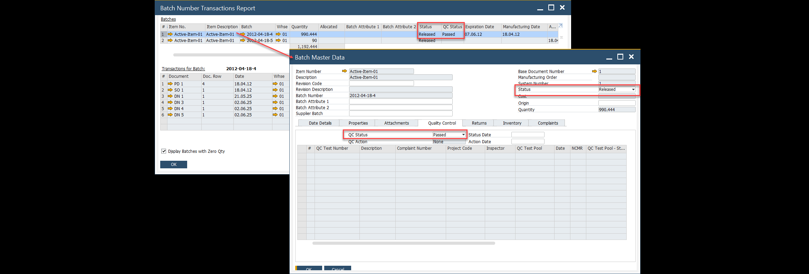

# Configuration Batch and Quality Control Status

You can define the default batch status and the default quality control (QC) status that **CompuTec ProcessForce** assigns when it generates a batch in a receipt document. The defaults keep batch management consistent and let you track quality from the moment items are received. The batch status affects inventory and operations. The QC status is for information only.

## What are batch and QC statuses?

- **Batch status** – Shows whether you can use and process a batch. The batch status directly affects inventory availability and operational workflows.
- **QC status** – Shows the quality condition of a batch. The QC status does not affect inventory processing. You use it as an information flag for reporting and analysis.

The default statuses apply when CompuTec ProcessForce generates batches automatically in receipt documents.

:::note[Info]

For information about how CompuTec ProcessForce changes the batch status after QC tests exist for a batch, read [**Batch Status Resolution**](/docs/processforce/user-guide/inventory/batch-control/batch-control-settings/batch-status-resolution).

:::

## Configure default batch and QC statuses

You can define default statuses that apply automatically to system-generated batches in receipt documents.

To configure the default statuses, follow these steps:

1. Go to **Administration** > **System Initialization** > **General Settings** > **Inventory** > **Batch & Serial No.**
2. Select the default batch status for new system-generated batches.
3. Select the default QC status.

   

4. Click **Update**.
5. Done! CompuTec ProcessForce applies the defaults to new system-generated batches.

:::info[Note]

The defaults apply only to system-generated batches. Manually created batches do not inherit these settings.

:::

## Receipt documents that use the defaults

The default statuses apply to batches that CompuTec ProcessForce generates in the following documents:

- Goods Receipt PO
- Goods Receipt
- Inventory Counting
- A/R Invoice
- A/R Credit Memo
- Reverse Invoice
- Pick Receipt

Pick Receipt follows the same rules as the SAP Business One receipt documents.

## View batch and QC statuses

After CompuTec ProcessForce generates batches, you can check their statuses in the following places:

- **Batch Number Transaction Report** – The report shows both the batch status and the QC status. Click the yellow arrow icon to open the batch in **Batch Master Data**.

  

- **Batch Master Data** – The batch status is in the header of the window. The QC status is on the **Quality Control** tab.

  
  