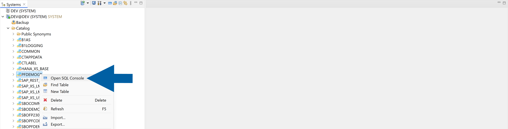
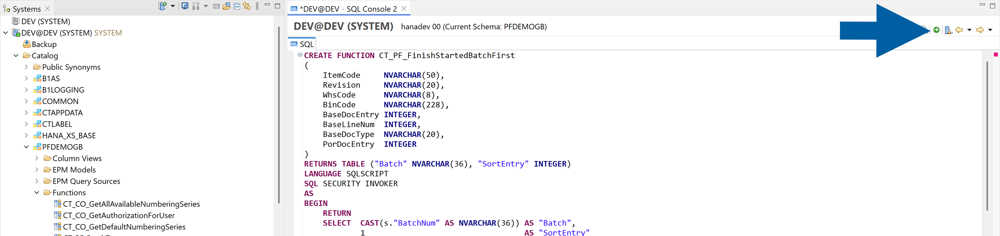
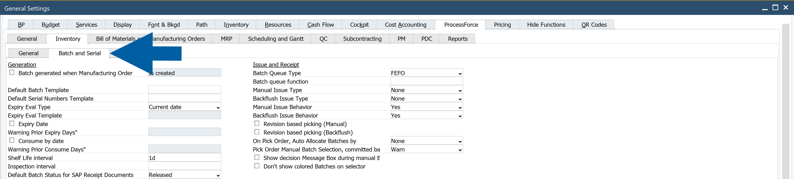
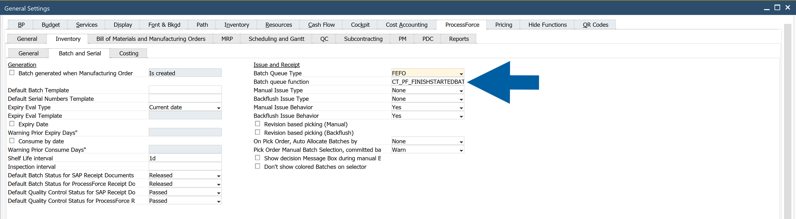
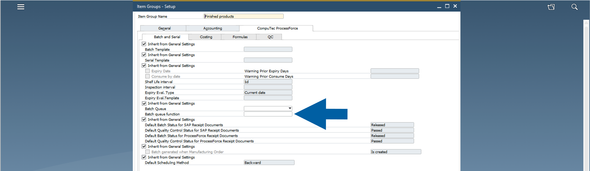
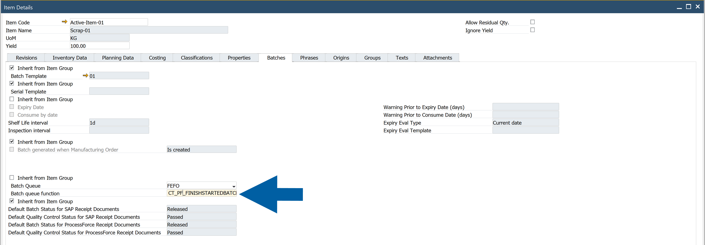

import Tabs from '@theme/Tabs';
import TabItem from '@theme/TabItem';

# Batch Queue Function

**CompuTec ProcessForce** proposes component batches in a fixed order: FIFO, FEFO, or FMFO. The Batch queue function setting lets you replace that order with your own rule. You write a table function in the company database and enter its name in the **Batch queue function** field. Batches that the function ranks move to the front of the queue. All other batches keep the configured order.

If you leave the field empty, nothing changes.

This guide explains what the function changes, and then takes you through the complete setup with an example function, `My_Prefix_FinishStartedBatchFirst`. The example applies this rule: if a component batch is already issued to a manufacturing order, by a **Pick Order** or by backflush, and still has stock in the warehouse, **CompuTec ProcessForce** proposes that batch first. Otherwise, the normal FEFO order applies.

The setup consists of four steps:

1. **Create the function in the company database**: Adds the function to SAP HANA or Microsoft SQL Server.
2. **Test the function**: Checks that the function returns the expected batch.
3. **Enter the function name in CompuTec ProcessForce**: Activates the function for the company, an item group, or an item.
4. **Verify the setup**: Checks the batch order on a Pick Order and on a backflush.

## What can you do with this feature?

With the Batch queue function, you can:

- finish a batch that is already in use on a manufacturing order before CompuTec ProcessForce proposes another batch, even when a newer batch has an earlier expiry date,
- apply a different batch rule to the whole company, to one item group, or to one item,
- switch the rule off at any time by clearing the field.

## What the function changes

The function only decides the order of batches. It cannot make a batch available that CompuTec ProcessForce would not offer anyway. It also does not decide quantities.

The function controls:

- the order of batches in the **Pick Order** batch selector,
- which batches **Auto-Select** takes first,
- which batches backflush (**Pick Receipt**) consumes first.

**CompuTec ProcessForce** still controls:

- batch status filtering (released, not accessible, locked),
- the revision filter,
- the available quantity, including the reduction by open allocations,
- bin restrictions and the bin order inside a batch,
- how much is taken from each batch.

A batch that the function does not mention is not removed from the queue. It moves behind the ranked batches and keeps the configured order (for example, FEFO) among the other batches. When the ranked batches run out of stock, the configured order takes over completely.

The following table shows the example rule with and without the function:

| Situation | Without a function (FEFO) | With the function |
| --- | --- | --- |
| Batch A is open on the order. Batch B arrives with an earlier expiry date. | Batch B moves ahead, and batch A stays partly used. | Batch A stays first. The rank is more important than the date. |
| Batch C arrives with the same expiry date as batch A. | The internal numbering decides, often against batch A. | Batch A stays first. CompuTec ProcessForce never compares the dates. |
| Batch A has 500 pieces left. The line needs 2,000 pieces. | – | CompuTec ProcessForce takes 500 from batch A and the remaining 1,500 from the next batch in FEFO order. |
| Batch A reaches zero stock. | – | The rank ends with the stock, so the queue is plain FEFO again. |

:::note[info]

The example function ranks batches for manufacturing orders only. For Plant Maintenance maintenance orders, CompuTec ProcessForce keeps the configured order.

:::

## Before you start

Before you begin, make sure that:

- CompuTec ProcessForce is installed and licensed for the company. [Read more](/docs/processforce/administrator-guide/installation/first-installation/extension)
- You can log in to the company database with permission to create functions, or a database administrator can create the function for you.
- You have a test company. We recommend creating and testing the function there before you use it in production.

:::warning[important]

The function belongs to your company, not to **CompuTec ProcessForce**.

**CompuTec ProcessForce** does not install, upgrade, or back up the function. The product database scripts deliberately exclude it, so a CompuTec ProcessForce upgrade never overwrites your version. Store the function source with your other customizations. Check the function again after a database migration or after you copy the company to a test company.

:::

## Requirements for the function

CompuTec ProcessForce only calls the function. It never creates or updates it. Create the function in the company database with exactly the signature used in this guide. It must return a table with the two columns Batch and SortEntry.

The function receives these parameters:

- `ItemCode` - The component item.
- `Revision` - The revision in play. `Empty` when no revision is used.
- `WhsCode` - The source warehouse.
- `BinCode` - Reserved. Always `NULL` today.
- `BaseDocEntry` - The `DocEntry` of the base document. `0` when there is none.
- `BaseLineNum` - The line of the base document. `0` when unknown.
- `BaseDocType` - `CT_PF_ManufacOrd` for a manufacturing order or `CT_PF_MainOrder` for a **Plant Maintenance** maintenance order.
- `PorDocEntry` - The `DocEntry` of the **Pick Order**. `0` for backflush.

The function returns these values:

- `Batch` - The batch number, as in the batch master data. **CompuTec ProcessForce** ignores a value that the company does not know.
- `SortEntry` - The rank. A lower number means earlier in the queue. The numbers do not need to be consecutive. If the function returns a batch twice, the lowest rank counts.
- `No row for a batch` - No opinion. The batch keeps the configured queue and moves behind the ranked batches.
- `No rows at all` - The queue stays exactly as it is without the function.

Follow these rules when you write the function:

- **Your own prefix**: Start the function name with your own prefix, for example `My_Prefix_`. Never use `CT_PF`. A function with a `CT_PF` name can be overwritten unexpectedly by a **CompuTec ProcessForce** upgrade.
- **Inline and read-only**: On **Microsoft SQL Server**, use a single `RETURN SELECT` statement without `BEGIN…END`. On **SAP HANA**, use a `TABLE FUNCTION`. The function must not write data or cause side effects.
- **Fast**: **CompuTec ProcessForce** runs the function while it processes a document, once for each component line. A slow function slows down the whole document. In the worst case, the document times out.
- **Plain name**: Use only letters, digits, and underscores. The name must start with a letter or an underscore, and it can have up to 128 characters. **CompuTec ProcessForce** refuses any other name.
- **No quotes around the name on SAP HANA**: Create the function without quotes around its name. If you use quotes, HANA keeps the mixed-case name and **CompuTec ProcessForce** reports that the function does not exist. Keep the quotes around the result columns `"Batch"` and `"SortEntry"`.
- **Check the document type**: The two document types number their documents independently, so `BaseDocEntry` alone is ambiguous. Always test `BaseDocType`. Return no rows for the document types that your rule does not cover.
- **Language of your database platform**: Create the function according to the language rules of your database platform: **T-SQL** for **Microsoft SQL Server** and **SQLScript** for **SAP HANA**.

## Step 1: Create the function in the company database

In this step, you create the function in the company database. The examples use the demo company schema `PFDEMOGB`. Replace it with the schema or database name of your company.

### Open an SQL console for your company

To open an SQL console for your company, follow these steps:

<Tabs groupId="database" queryString>
<TabItem value="hana" label="SAP HANA">

1. Open **SAP HANA Studio**.
2. In the **Systems** view, expand your system, for example `DEV@DEV (SYSTEM)`.
3. Expand **Catalog**.
4. Right-click the schema of your company, for example `PFDEMOGB`, and select **Open SQL Console**.

   

5. Check the title of the console. It must show your company schema, for example **Current Schema: PFDEMOGB**. If you are not sure that this is the schema of your company, see the following note.
6. Done! The SQL console is open and uses your company schema.

:::warning[Important]

Create the function in the schema of the company that you log in to in SAP Business One. **CompuTec ProcessForce** does not find a function in another schema. To check which schema belongs to your company, run the following query. Replace `<SCHEMA>` with the schema name from the **Catalog** list. The result must show the name of your company.

```sql
SELECT "CompnyName" FROM <SCHEMA>.OADM;
```

:::

</TabItem>
<TabItem value="mssql" label="Microsoft SQL Server">

1. Open **Microsoft SQL Server Management Studio**.
2. Log in to your database server.
3. In **Object Explorer**, expand **Databases**.
4. Right-click the database of your company, and select **New Query**.
5. Check the database selector above the query window. It must show your company database, not `master`.
6. Done! The query window is open and uses your company database.

</TabItem>
</Tabs>

### Create the function

To create the function, follow these steps:

<Tabs groupId="database" queryString>
<TabItem value="hana" label="SAP HANA">

1. In the SQL console, paste the following script. Do not put quotes around the function name. HANA then stores the name in upper case, and **CompuTec ProcessForce** finds it.

    ```sql
        CREATE FUNCTION My_Prefix_FinishStartedBatchFirst
        (
            ItemCode     NVARCHAR(50),
            Revision     NVARCHAR(20),
            WhsCode      NVARCHAR(8),
            BinCode      NVARCHAR(228),
            BaseDocEntry INTEGER,
            BaseLineNum  INTEGER,
            BaseDocType  NVARCHAR(20),
            PorDocEntry  INTEGER
        )
        RETURNS TABLE ("Batch" NVARCHAR(36), "SortEntry" INTEGER)
        LANGUAGE SQLSCRIPT
        SQL SECURITY INVOKER
        AS
        BEGIN
            RETURN
            SELECT  CAST(s."BatchNum" AS NVARCHAR(36)) AS "Batch",
                    1                                  AS "SortEntry"
            FROM    "OIBT" s
            WHERE   :BaseDocType = 'CT_PF_ManufacOrd'
                AND   :BaseDocEntry > 0
                AND   s."ItemCode" = :ItemCode
                AND   s."WhsCode"  = :WhsCode
                AND   s."Quantity" > 0
                AND   s."BatchNum" IN
                    (
                        -- issued through a Pick Order
                        SELECT b."U_BatchNo"
                        FROM   "@CT_PF_POR1" l
                        JOIN   "@CT_PF_POR2" b
                                ON  b."DocEntry"  = l."DocEntry"
                                AND b."U_LineNum" = l."U_LineNum"
                        WHERE  l."U_BaseType"   = '999000001'
                        AND  l."U_BaseEntry"  = :BaseDocEntry
                        AND  l."U_ItemCode"   = :ItemCode
                        AND  l."U_SrcWhsCode" = :WhsCode
                        AND  b."U_Issued"     = 'Y'
                        AND  b."U_Quantity"   > 0
                        UNION
                        -- issued by backflush on a Pick Receipt
                        SELECT ib."BatchNum"
                        FROM   "IBT1" ib
                        JOIN   "IGE1" g
                                ON  ib."BaseType"   = 60
                                AND ib."BaseEntry"  = g."DocEntry"
                                AND ib."BaseLinNum" = g."LineNum"
                        JOIN   "@CT_PF_PRE1" p
                                ON  p."DocEntry" = g."U_PickEntry"
                        WHERE  g."U_PickType"  = 'CT_PF_PickReceipt'
                        AND  p."U_BaseType"  = '999000001'
                        AND  p."U_BaseEntry" = :BaseDocEntry
                        AND  ib."ItemCode"   = :ItemCode
                        AND  ib."WhsCode"    = :WhsCode
                        AND  ib."Direction"  = 1
                        AND  ib."Quantity"   > 0
                    );
        END;
    ```

2. Run the script.

   

3. In the **Systems** view, expand your schema and right-click **Functions**. Select **Refresh**.
4. Check that the function appears under **Functions**. HANA shows the name in upper case: `MY_PREFIX_FINISHSTARTEDBATCHFIRST`.
5. Done! The function exists in the company schema.

</TabItem>
<TabItem value="mssql" label="Microsoft SQL Server">

1. In the query window, paste the following script:

    ```sql
        CREATE FUNCTION My_Prefix_FinishStartedBatchFirst
        (
            @ItemCode     NVARCHAR(50),
            @Revision     NVARCHAR(20),
            @WhsCode      NVARCHAR(8),
            @BinCode      NVARCHAR(228),
            @BaseDocEntry INT,
            @BaseLineNum  INT,
            @BaseDocType  NVARCHAR(20),
            @PorDocEntry  INT
        )
        RETURNS TABLE
        AS RETURN
            SELECT  CAST(s.BatchNum AS NVARCHAR(36)) AS "Batch",
                    CAST(1 AS INT)                   AS "SortEntry"
            FROM    OIBT s
            WHERE   @BaseDocType = 'CT_PF_ManufacOrd'
                AND   @BaseDocEntry > 0
                AND   s.ItemCode = @ItemCode
                AND   s.WhsCode  = @WhsCode
                AND   s.Quantity > 0
                AND   s.BatchNum IN
                    (
                        -- issued through a Pick Order
                        SELECT b.U_BatchNo
                        FROM   "@CT_PF_POR1" l
                        JOIN   "@CT_PF_POR2" b
                                ON  b.DocEntry = l.DocEntry AND b.U_LineNum = l.U_LineNum
                        WHERE  l.U_BaseType   = '999000001'
                        AND  l.U_BaseEntry  = @BaseDocEntry
                        AND  l.U_ItemCode   = @ItemCode
                        AND  l.U_SrcWhsCode = @WhsCode
                        AND  b.U_Issued     = 'Y'
                        AND  b.U_Quantity   > 0
                        UNION
                        -- issued by backflush on a Pick Receipt
                        SELECT ib.BatchNum
                        FROM   IBT1 ib
                        JOIN   IGE1 g
                                ON  ib.BaseType = 60 AND ib.BaseEntry = g.DocEntry AND ib.BaseLinNum = g.LineNum
                        JOIN   "@CT_PF_PRE1" p
                                ON  p.DocEntry = g.U_PickEntry
                        WHERE  g.U_PickType  = 'CT_PF_PickReceipt'
                        AND  p.U_BaseType  = '999000001'
                        AND  p.U_BaseEntry = @BaseDocEntry
                        AND  ib.ItemCode   = @ItemCode
                        AND  ib.WhsCode    = @WhsCode
                        AND  ib.Direction  = 1
                        AND  ib.Quantity   > 0
                    );
    ```

2. Press **F5** to run the script.
3. In **Object Explorer**, expand your database, then **Programmability** > **Functions** > **Table-valued Functions**. Refresh the list.
4. Check that `My_Prefix_FinishStartedBatchFirst` appears in the list.
5. Done! The function exists in the company database.

</TabItem>
</Tabs>

:::warning[Important]

The company database user executes the function. Make sure that the privileges of this user do not restrict the execution of functions.

:::

### Change the function later

To change the function after you created it, follow these steps:

<Tabs groupId="database" queryString>
<TabItem value="hana" label="SAP HANA">

1. In the SQL console, run `DROP FUNCTION My_Prefix_FinishStartedBatchFirst;`.
2. Run the changed `CREATE FUNCTION` script.

</TabItem>
<TabItem value="mssql" label="Microsoft SQL Server">

1. In the query window, replace `CREATE FUNCTION` with `ALTER FUNCTION` in the script.
2. Run the changed script.

</TabItem>
</Tabs>

### Write your own rule

To write your own rule, start from the empty template for your database platform. Return a `Batch` and a `SortEntry` for each batch that you want to rank. Return no row for the other batches.

<Tabs groupId="database" queryString>
<TabItem value="hana" label="SAP HANA">

```sql
CREATE FUNCTION My_Prefix_BatchOrder
(
    ItemCode     NVARCHAR(50),   -- component item
    Revision     NVARCHAR(20),   -- revision in play, '' when not used
    WhsCode      NVARCHAR(8),    -- source warehouse
    BinCode      NVARCHAR(228),  -- reserved, always NULL today
    BaseDocEntry INTEGER,        -- base document DocEntry, 0 when there is none
    BaseLineNum  INTEGER,        -- line of the base document, 0 when unknown
    BaseDocType  NVARCHAR(20),   -- 'CT_PF_ManufacOrd' or 'CT_PF_MainOrder'
    PorDocEntry  INTEGER         -- Pick Order DocEntry, 0 for backflush
)
RETURNS TABLE ("Batch" NVARCHAR(36), "SortEntry" INTEGER)
LANGUAGE SQLSCRIPT
SQL SECURITY INVOKER
AS
BEGIN
    RETURN
    SELECT  CAST(NULL AS NVARCHAR(36)) AS "Batch",      -- must match OBTN.DistNumber
            CAST(NULL AS INTEGER)      AS "SortEntry"   -- lower value = earlier in the queue
    FROM    DUMMY
    WHERE   1 = 0;                                      -- replace with your rule
END;
```

</TabItem>
<TabItem value="mssql" label="Microsoft SQL Server">

```sql
CREATE FUNCTION My_Prefix_BatchOrder
(
    @ItemCode     NVARCHAR(50),   -- component item
    @Revision     NVARCHAR(20),   -- revision in play, '' when not used
    @WhsCode      NVARCHAR(8),    -- source warehouse
    @BinCode      NVARCHAR(228),  -- reserved, always NULL today
    @BaseDocEntry INT,            -- base document DocEntry, 0 when there is none
    @BaseLineNum  INT,            -- line of the base document, 0 when unknown
    @BaseDocType  NVARCHAR(20),   -- 'CT_PF_ManufacOrd' or 'CT_PF_MainOrder'
    @PorDocEntry  INT             -- Pick Order DocEntry, 0 for backflush
)
RETURNS TABLE
AS RETURN
    SELECT  CAST(NULL AS NVARCHAR(36)) AS "Batch",      -- must match OBTN.DistNumber
            CAST(NULL AS INT)          AS "SortEntry"   -- lower value = earlier in the queue
    WHERE   1 = 0                                       -- replace with your rule
```

</TabItem>
</Tabs>

## Step 2: Test the function

Test the function with a manufacturing order that already has an issued batch.

To test the function, follow these steps:

1. Find a manufacturing order that has a component with an issued batch. Note the manufacturing order `DocEntry`, the component item code, and the source warehouse.
2. Run the following query for your database platform. Replace the values with your own values. The example uses the manufacturing order `17`, the item `Active-Item-02`, and the warehouse `01` from the demo company.

<Tabs groupId="database" queryString>
<TabItem value="hana" label="SAP HANA">

```sql
SELECT * FROM My_Prefix_FinishStartedBatchFirst
    ('Active-Item-02', '', '01', NULL, 17, 0, 'CT_PF_ManufacOrd', 0);
```

</TabItem>
<TabItem value="mssql" label="Microsoft SQL Server">

```sql
SELECT * FROM dbo.My_Prefix_FinishStartedBatchFirst
    (N'Active-Item-02', N'', N'01', NULL, 17, 0, N'CT_PF_ManufacOrd', 0);
```

</TabItem>
</Tabs>

Check the result:

- A batch that is already issued on the order and still has stock is returned with `SortEntry` `1`. In the example, the result is the batch `2012-04-18-3`.
- A component without a started batch returns no rows. In this case, **CompuTec ProcessForce** uses the configured order, for example FEFO.

Done! The function returns the expected batch.

:::warning[Important]

If the query returns an error, do not enter the function name in **CompuTec ProcessForce** yet. Fix the error first. If the query returns no rows for an order that has a started batch, check that the order, item, and warehouse values are correct.

:::

## Step 3: Enter the function name in CompuTec ProcessForce

Enter the function name in the **Batch queue function** field. The field is directly under **Batch Queue Type** on three forms. You can set it for the whole company, for an item group, or for a single item.

**CompuTec ProcessForce** checks the function when you save the field. If the function does not exist or does not return the `Batch` and `SortEntry` columns, a red message appears in the status bar and **CompuTec ProcessForce** does not accept the name. See [Troubleshoot the function](#troubleshoot-the-function).

### Set the function for the whole company

To set a company-wide function, follow these steps:

1. In SAP Business One, go to **Administration** > **System Initialization** > **General Settings**.
2. Select the **ProcessForce** tab, then the **Inventory** tab, and then the **Batch and Serial** tab.

    

3. In the **Issue and Receipt** group, go to **Batch queue function**.
4. Enter the function name, for example `My_Prefix_FinishStartedBatchFirst`.

   

5. Click **Update**.
6. Done! The function applies to all items that do not have their own function.

### Set the function for an item group

To set a function for an item group, follow these steps:

1. Go to **Administration** > **Setup** > **Inventory** > **Item Groups**.
2. Select the item group.
3. Select the **CompuTec ProcessForce** tab, and then the **Batch and Serial** tab.
4. Clear the **Inherit from General Settings** check box that is above **Batch Queue Type**.
5. In **Batch queue function**, enter the function name.

   

6. Click **Update**.
7. Done! The function applies to all items in this group that do not have their own function.

### Set the function for an item

To set a function for one item, follow these steps:

1. Open the item in **Item Master Data**.
2. Go to **ProcessForce** > **Item Details**, and then select the **Batches** tab.
3. Clear the **Inherit from Item Group** check box that is above **Batch Queue Type**.
4. In **Batch queue function**, enter the function name.

   

5. Click **Update**.
6. Done! The function applies to this item only.

:::info[Note]

On **Item Groups** and **Item Details**, both **Batch Queue Type** and **Batch queue function** are under one **Inherit from…** check box. When you clear the check box, **Batch Queue Type** also stops inheriting its value. Set the batch queue type you want at that level as well.

:::

### How CompuTec ProcessForce selects the function

The three levels work as a ladder. An empty **Batch queue function** field means that **CompuTec ProcessForce** uses the level above. The function has no separate **Inherit** check box. The value itself decides.

| Order | Level | CompuTec ProcessForce uses it when |
| --- | --- | --- |
| 1 | **Item Details** (the item) | The field has a value. This level always wins. |
| 2 | **Item Groups** | The field has a value and **Item Details** is empty. |
| 3 | **General Settings** | The field has a value and both levels above are empty. |
| – | All three levels empty | Batches follow FIFO, FEFO, or FMFO, as they did before. |

:::info[Note]

When you select **Inherit from…** on **Item Details** or **Item Groups**, **CompuTec ProcessForce** removes the function name at that level. The level stops having its own function, and the ladder moves up. Click **Update** to save the change. **General Settings** is the top level and has no check box. To clear the field there, delete the text.

:::

## Step 4: Verify the setup

To verify that **CompuTec ProcessForce** uses the function, follow these steps:

1. Create a **Pick Order** for a manufacturing order that has a started batch of the component.
2. Open the batch selector and check that the started batch is first in the list.
3. Click **Auto-Select** and check that the started batch is allocated first.
4. If the started batch has less stock than the line needs, check that **CompuTec ProcessForce** takes the remaining quantity from the next batch in FEFO order.
5. Post a **Pick Receipt** for the same component and check that backflush consumes the batches in the same order.
6. Clear the **Batch queue function** field, or select **Inherit from…**, and check that the previous order returns.
7. Done! The function works as expected.

## Troubleshoot the function

A problem with the function never blocks a document. **CompuTec ProcessForce** uses the configured queue and writes a warning that names the function to the log. When you save the field, **CompuTec ProcessForce** also checks the function and shows a red message if the check fails. After that, the log is the first place to look.

| What you see | Likely cause | What to do |
| --- | --- | --- |
| A red message says the function does not exist when you save the field. | On SAP HANA, the function was created with quotes around its name. Or the function is in another schema than the company you are logged in to, or it does not return `Batch` and `SortEntry`. | Drop the function and create it again without quotes around its name, in the schema of your company. Check the column names. Run the test query from [Step 2](#step-2-test-the-function) to find an error in the function. |
| The order is unchanged for every item. | The field is empty on all three levels, the name is not a plain identifier, or the function does not exist in the company database. | Check the three levels. Check the log for a line that names the function. |
| The order is unchanged although the function exists. | The function does not return the columns `Batch` and `SortEntry`, it is in another schema, or the database user cannot run it. | Correct the column names or the schema. Check that the privileges of the company database user do not restrict the execution of functions. |
| Only some items follow the rule. | A lower level has a different function name. | On the level that must inherit the value, select **Inherit from…** or delete the text. Then click **Update**. |
| A ranked batch is not offered. | **CompuTec ProcessForce** filtered it out because of batch status, revision, zero available quantity, open allocations, or bin restrictions. | Check the batch itself. A function ranks batches. It cannot bring back a batch that **CompuTec ProcessForce** filtered out. |
| The rule stops applying after a while. | The ranked batch has no stock left. | No action is needed. The configured queue takes over. |
| Documents are noticeably slower. | The function is too heavy for a document. | Simplify the function, or clear the field to switch it off immediately. |

## Before you go live

Make sure that:

- The function exists in the schema or database of the production company, is inline and read-only, and returns `Batch` and `SortEntry`.
- The function tests `BaseDocType` and returns no rows for the document types that the rule does not cover.
- The name is entered at the correct level: company, item group, or item.
- A **Pick Order** shows the expected order, and **Auto-Select** allocates in that order.
- A backflush (**Pick Receipt**) consumes in that order.
- Clearing the field, or selecting **Inherit from…**, restores the previous behavior.
- The function source is stored with your other customizations, so you can create it again after a migration.
