# Orderless Production

**Orderless Production** lets you record production for several finished goods in one document. CompuTec ProcessForce creates the manufacturing orders and processes the related production transactions in the background, so you do not need to create each manufacturing order manually.

## Before you start

Before you begin, make sure that:

- A numbering series is defined for the **Orderless Production** document.
- Items and resources in the bill of materials (BOM) and in the production process are set to **Backflushed**. Backflushing records consumption automatically during processing.
- Item costing is available for the items you want to produce. If an item cost is missing, processing fails.
- (optional) An **Orderless Production Template** exists. A template fills the document for you, but you can also add new items to the list manually.

## Create an orderless production template

A template is a starting list of finished goods. When you select it in an Orderless Production document, CompuTec ProcessForce loads its items together with the related co-product and scrap rows.

To create an orderless production template, follow these steps:

1. Go to **Administration** > **Setup** > **Production** > **Orderless Production Template**.

    

2. Create a new template.

3. Enter the **Code** and **Name** of the template.

4. Add the finished goods you want to include.

    

5. Save the template.

    :::note[Info]
    You can edit finished goods rows in the template. Scrap and co-product rows are added automatically and are read-only, because CompuTec ProcessForce takes them from item costing.
    :::

## Updated workflow

Use this workflow in **CompuTec ProcessForce 3.2610.1** and later.

### Prepare a draft

To prepare a draft, follow these steps:

1. Go to **Modules** > **Production** > **Manufacturing Order** > **Orderless Production**.

    

2. In **Template Code**, select a template.

    

3. Review the loaded items, revisions, routings, and warehouses.

4. (optional) Add the finished goods that are not in the template.

5. Enter the produced quantity for each finished good.

    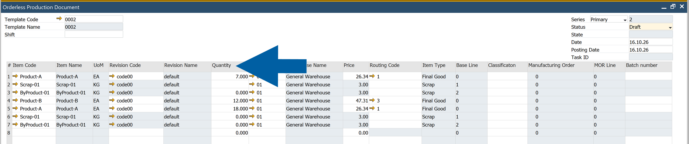

6. Enter the **Posting Date**.

7. (optional) In the **Batch Number** column, enter a batch number for a batch-managed finished good.

    :::info[note]
    If you leave the **Batch Number** field empty, CompuTec ProcessForce creates the batch number from the configured batch numbering. If you enter a number, CompuTec ProcessForce uses it for the new batch when it creates the receipt.
    :::

8. Make sure that in **Status**, you have selected **Draft**.

    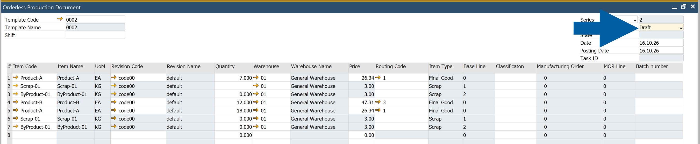

9. Click **Add**.

10. Done! CompuTec ProcessForce saves the document. A draft creates no manufacturing orders and posts no transactions, so you can review the entries before processing.

    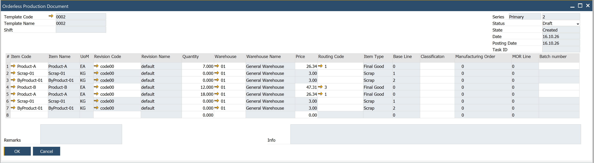

### Start processing

To start processing, follow these steps:

1. Open the draft document.

2. Check the finished goods, quantities, warehouses, posting date, and batch numbers.

3. In **Status**, select **Accepted**.

    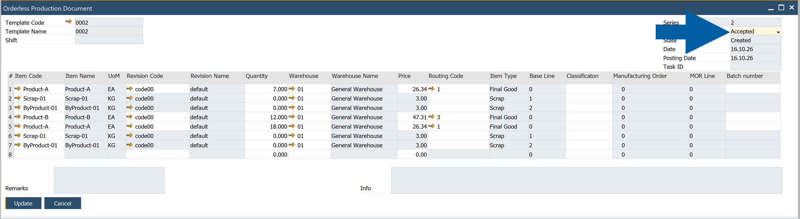

4. Click **Update**.

    CompuTec ProcessForce assigns a **Task ID** and starts processing in the background. When processing succeeds, the manufacturing orders are created, the production issues and receipts are recorded, and the manufacturing orders are finished.

5. To track the progress of processing, click the arrow next to **Task ID**.

   The progress view opens in the CompuTec AppEngine Launchpad.

   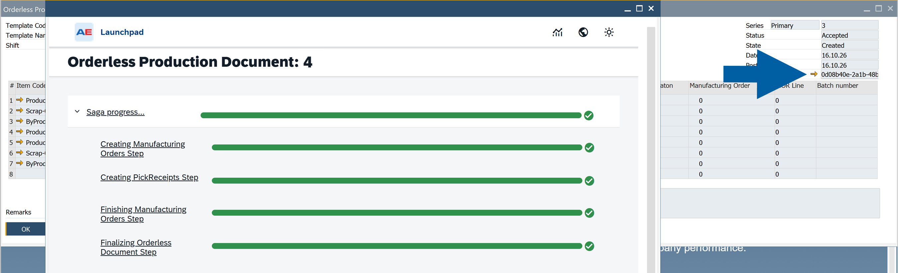

    :::note[info]
    The progress view is labeled **Saga progress**. A saga is the sequence of steps that processes the document and handles failures. The steps are:

    - **Creating Manufacturing Orders Step**
    - **Creating PickReceipts Step**
    - **Finishing Manufacturing Orders Step**

    An exclamation mark next to a step means that the step failed. Refresh the document to see the latest status and error information.
    :::

6. Your document is processed and you can see `Success` in the Status field.

    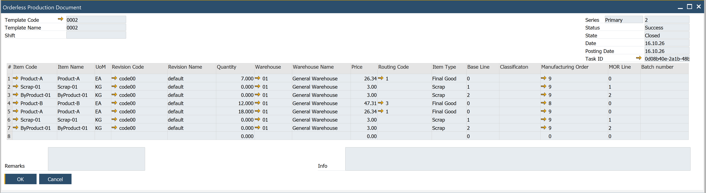

    :::note[info]
    You can also skip the draft creation, and start processing when you create the document: select **Accepted** in **Status** before you click **Add**.  
    :::

### Review the result

The document has the fields **Status**, **State**, and **Task ID**. Use **Status** to see the outcome of the document, and use **Task ID** to see how processing is going.

| Status | Meaning |
| --- | --- |
| **Draft** | The document is saved for review. Processing has not started. |
| **Accepted** | The document is submitted for processing. Open the **Task ID** progress view to see whether processing is still running. |
| **Success** | Processing completed successfully. The manufacturing orders are finished. Review the linked manufacturing orders and their production documents. |
| **Canceled** | Processing failed and the document is canceled. Review the error log before you create a new document. |

### Review linked documents

In the **Manufacturing Order** column, each production row links to the manufacturing order that processing created.

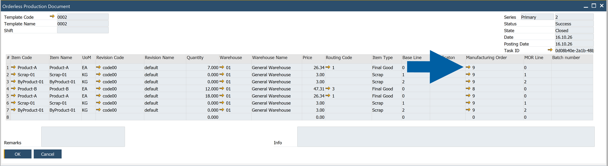

Open a linked order to see its details and related documents.

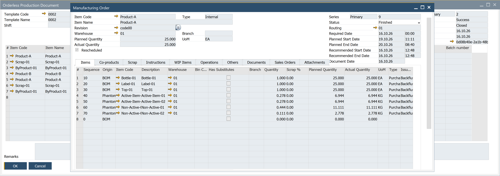

### Resolve a processing error

If an error occurs while processing an Orderless Production document, CompuTec ProcessForce changes its status to **Draft** or **Canceled**, depending on when the error occurs.

    - **Draft**: If the error occurs before any Manufacturing Orders are created, the document returns to Draft. You can correct the error and process the same document again.

        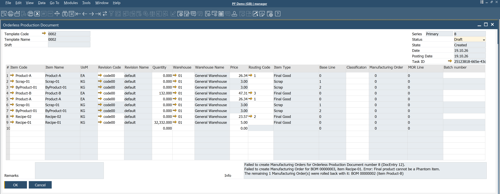

    - **Canceled**: If Manufacturing Orders have already been created when the error occurs, the document is canceled. You cannot edit or process it again.

#### Correct an error in a draft document

If the document returns to Draft, follow these steps:

1. Refresh the **Orderless Production document**.

    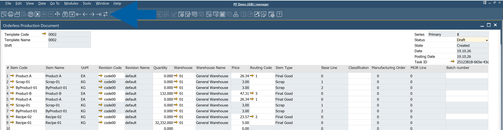

2. Check the **Info** field for details about the error, including the affected document lines and the reasons for the failure.

    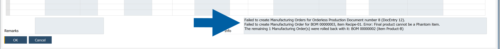

3. Correct the reported errors. For example, if an item has no cost, add the missing cost.

4. Change the document **Status** to `Accepted` to process it again.

### Transactions performed

The following transactions are performed during the **Orderless Production document** creation:

|                           |       Items        | Batch Traced Items (set to backflush) Based on FIFO, FEFO & FMFO rules | Non-Inventory Items (set to backflush) | CoProducts (set to backflush) | Scrap (set to backflush) |   Resource Time    | Finished Products  |
| :-----------------------: | :----------------: | :--------------------------------------------------------------------: | :------------------------------------: | :---------------------------: | :----------------------: | :----------------: | :----------------: |
|         Backflush         |                    |                           :heavy_check_mark:                           |           :heavy_check_mark:           |      :heavy_check_mark:       |    :heavy_check_mark:    | :heavy_check_mark: |                    |
|    Create Batch Number    |                    |                                                                        |                                        |      :heavy_check_mark:       |    :heavy_check_mark:    |                    | :heavy_check_mark: |
|      Create Journals      | :heavy_check_mark: |                           :heavy_check_mark:                           |           :heavy_check_mark:           |      :heavy_check_mark:       |    :heavy_check_mark:    | :heavy_check_mark: | :heavy_check_mark: |
| Create Scrap & ByProducts |                    |                                                                        |                                        |                               |    :heavy_check_mark:    |                    |                    |
|     Create CoProducts     |                    |                                                                        |                                        |      :heavy_check_mark:       |                          |                    |                    |
| Create Finished Products  |                    |                                                                        |                                        |                               |                          |                    | :heavy_check_mark: |

### What happens when a document is canceled?

If processing fails **after** Manufacturing Orders have been created, **CompuTec ProcessForce cancels the Orderless Production document** and rolls back the related production transactions.

    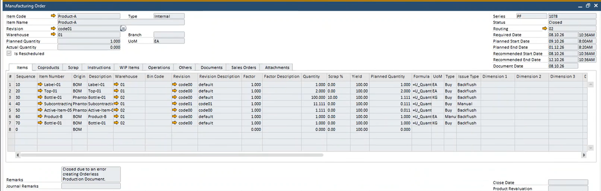

The following information remains available for reference:

    - **Manufacturing Orders** created during the failed process remain in the system with the status `Closed`.
    - Each affected **Manufacturing Order** contains a remark explaining that it was closed because of a processing error, along with details that may help you create a new **Orderless Production** document.
    - Production transactions and related documents created during the failed process are **rolled back**.

:::note[info]
You can find a reference to the original **Orderless Production document** on the **Other** tab of the affected **Manufacturing Orders**.

    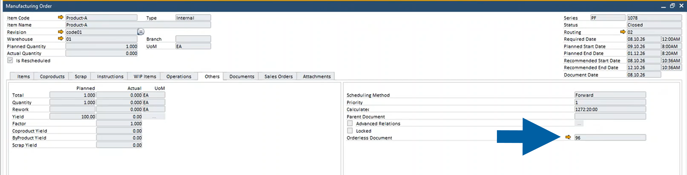
:::

:::info[note]
If the problem continues, visit [**CompuTec Support Portal**](https://support.computec.pl/). Include the Orderless Production document number, Task ID, error details from the Info field, and the numbers of the affected Manufacturing Orders.
:::

## Previous workflow

This section applies to CompuTec ProcessForce 3.0 releases earlier than **CompuTec ProcessForce 3.2610.1** and to CompuTec ProcessForce 2.0. These versions have no **Status**, **Task ID**, or **Batch Number** fields, and no error log.

For CompuTec ProcessForce 2.0, you can also read the [CompuTec ProcessForce 2.0 documentation](/docs/processforce/2.0/user-guide/manufacturing/orderless-production/).

### Configure orderless production

To configure orderless production, follow these steps:

1. Define a document series for the **Orderless Production Document** in the master data.

    

    :::note[info]
    For detailed instructions on setting up a document series, check [our document numbering guide](../system-initialization/document-numbering.md)
    :::

2. In the bill of materials and in the production process, set all items and resources to **Backflushed**.

3. (optional) Create an **Orderless Production Template** that lists the items you want to produce. When you select the template, CompuTec ProcessForce fills the document, including co-products and scrap.

### Run orderless production

To run orderless production, follow these steps:

1. Open the **Orderless Production Document**.

2. Select a template, or enter the items manually. CompuTec ProcessForce adds the related co-product and scrap rows automatically.

    

3. Enter the posting date and the produced quantity.

4. Confirm the document.

    

CompuTec ProcessForce creates a manufacturing order in the background and runs it from release to closure.

:::note[info]
The **Orderless Production Document** serves as the central point for recording production activities. Users can select a predefined template or manually enter items to be produced. When an item has associated CoProducts and Scrap, these are automatically included.

The user inputs the posting date and the quantity produced, then confirms the entry. This action triggers a manufacturing order in the background, executing a complete production cycle from release to closure.
:::

### Transactions performed

The following transactions are performed:

|                           |       Items        | Batch Traced Items (set to backflush) Based on FIFO, FEFO & FMFO rules | Non-Inventory Items (set to backflush) | CoProducts (set to backflush) | Scrap (set to backflush) |   Resource Time    | Finished Products  |
| :-----------------------: | :----------------: | :--------------------------------------------------------------------: | :------------------------------------: | :---------------------------: | :----------------------: | :----------------: | :----------------: |
|         Backflush         |                    |                           :heavy_check_mark:                           |           :heavy_check_mark:           |      :heavy_check_mark:       |    :heavy_check_mark:    | :heavy_check_mark: |                    |
|    Create Batch Number    |                    |                                                                        |                                        |      :heavy_check_mark:       |    :heavy_check_mark:    |                    | :heavy_check_mark: |
|      Create Journals      | :heavy_check_mark: |                           :heavy_check_mark:                           |           :heavy_check_mark:           |      :heavy_check_mark:       |    :heavy_check_mark:    | :heavy_check_mark: | :heavy_check_mark: |
| Create Scrap & ByProducts |                    |                                                                        |                                        |                               |    :heavy_check_mark:    |                    |                    |
|     Create CoProducts     |                    |                                                                        |                                        |      :heavy_check_mark:       |                          |                    |                    |
| Create Finished Products  |                    |                                                                        |                                        |                               |                          |                    | :heavy_check_mark: |
