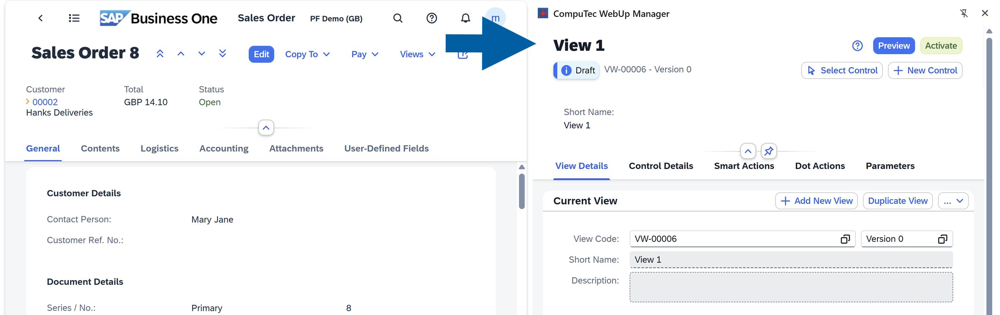
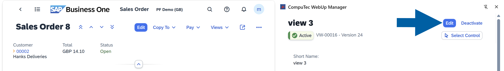

# Overview

This page shows you what you can do with **CompuTec WebUp**, where to do it, and how a typical customization works from start to finish. For background on how **CompuTec WebUp** is built, see the [**Introduction**](/docs/webup).

## What do you want to do?

| I want to… | Use | Example |
| --- | --- | --- |
| Create a view, keep its versions, or go back to an earlier version | [**View Management**](/docs/webup/components/view-management) | Activate version 2 of a view again after version 3 causes problems. |
| Hide, move, or rename fields, tabs, and buttons, or add a new control | [**Control Management**](/docs/webup/components/control-management) | Move the most important fields to the top of the **Sales Quotation** header. |
| Run logic when a user changes a field, clicks a button, or adds, updates, cancels, or closes a document | [**Smart Actions**](/docs/webup/components/smart-actions) | Show "Are you sure you want to change the price?" when a user changes a price field. |
| Show a changing value, such as the document number, in a control | [**Parameters**](/docs/webup/components/parameters) | A button shows the document key of the open **Sales Order**. The text changes when the user opens another order. |
| Start an action from the keyboard | [**Dot Actions**](/docs/webup/components/dot-actions) | A user presses the **.** key and selects your action. |

:::warning[Important]

**View Actions** are not supported in **CompuTec WebUp** 1.2610.2 and later. Use [**Smart Actions**](/docs/webup/components/smart-actions) instead.

:::

## CompuTec WebUp Manager panel

The top of the **CompuTec WebUp Manager** side panel shows the view you work on and the buttons that control it. The buttons you see depend on the status of the view.

- **View name and status** – The name of the view, for example **view 3**, and its status: **Draft** or **Active**. The view code and version number are displayed next to the status.
- **Edit** – Appears when the view is **Active**. Click it to start editing.
- **Activate** – Appears when the view is a **Draft**. Click it to make the draft the active version.
- **Deactivate** – Appears when the view is **Active**. Click it to deactivate the view.
- **Preview** – Appears when the view is a **Draft**. Click it to see your changes in **WebUp Preview Mode**. To leave preview mode, click **Close Preview**.
- **Select Control** – Click it, and then click a control in **SAP Business One Web Client** to select it.
- **New Control** – Click it to add a new control to the screen.
- **Help icon (question mark)** – Click it to show or hide help links next to supported controls and properties.

### Edit mode

:::info[Note]

To create or change views, controls, Smart Actions, Parameters, or Dot Actions, the view must be in edit mode. If the view is **Active**, click **Edit** first. **CompuTec WebUp** creates a new draft version, and the active version stays in use until you click **Activate**.

If the view shows **Draft**, you are already in edit mode.

:::

### Tabs

Below the header, the panel has five tabs:

- **View Details** – Add, duplicate, edit, and delete views, browse their versions, and add Smart Actions to View Events. [Read more](/docs/webup/components/view-management)
- **Control Details** – Select a control and set its properties. [Read more](/docs/webup/components/control-management)
- **Smart Actions** – Create the logic that runs on events of views and controls. [Read more](/docs/webup/components/smart-actions)
- **Dot Actions** – Add your own actions to the command palette that opens when you press the **.** key (dot or full stop). [Read more](/docs/webup/components/dot-actions)
- **Parameters** – Define reusable values and use them in control properties and Smart Actions. [Read more](/docs/webup/components/parameters)

## How a typical customization works

1. Open the screen in **SAP Business One Web Client**.
2. Make sure the view is in edit mode. If the view is **Active**, click **Edit**.
3. Make your changes: add or change controls, Smart Actions, Parameters, or Dot Actions.
4. Click **Save & Preview**, and then check your changes in **CompuTec WebUp Preview Mode**.
5. If you like the results, click **Activate**.
6. Done! Users see your customized view.

If something goes wrong, you can go back to an earlier version of the view. For more information, see [**View Management**](/docs/webup/components/view-management).

## Next steps

See [**View Management**](/docs/webup/components/view-management) to create and manage views, [**Control Management**](/docs/webup/components/control-management) to customize controls, and [**Smart Actions**](/docs/webup/components/smart-actions) to add logic.
