# Control Management

**Control Management** lets you change how a screen in **SAP Business One Web Client** looks and behaves. You select a control, such as a field, a button, or a section, and change its properties. You can also add new controls.

You manage controls in the **Control Details** tab of **CompuTec WebUp Manager**.

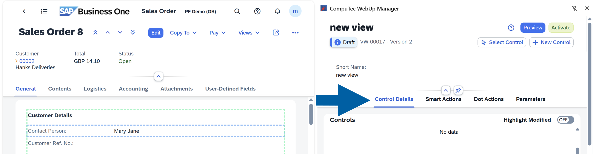

## Key functions of Control Management

With Control Management, you can:

- Select any control on a supported screen and change its properties, such as the label, value, visibility, and position
- Add new controls to the screen
- Set a property to a fixed value (**Basic** mode) or to a value that changes with the document (**Dynamic** mode)
- Use **Parameters** as values of control properties
- Link **Smart Actions** to control events, for example to the **Change** event of a field
- Preview your changes before you activate them
- Use **Help Mode** to read what each property does
- Hide controls you don’t need

## Before you start

Before you begin, make sure that:

- You installed and activated **CompuTec WebUp Manager**. [Read more](/docs/webup/installation-and-activation)
- The screen supports **CompuTec WebUp** extensions.

:::info[Note]

To create or change views, controls, Smart Actions, Parameters, or Dot Actions, the view must be in edit mode. If the view is **Active**, click **Edit** in **CompuTec WebUp Manager** first. **CompuTec WebUp** creates a new draft version, and the active version stays in use until you click **Activate**.

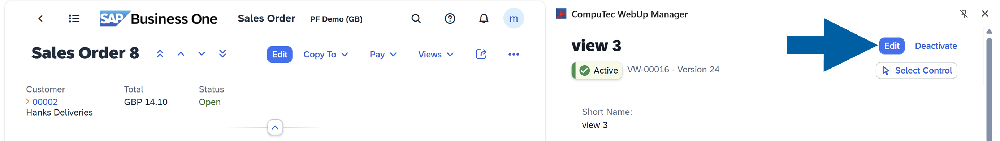

If the view shows **Draft**, you are already in edit mode.

:::

## Control Details tab

The **Control Details** tab has two sections:

- **Controls** – The list of all controls that you added or changed in the current view. For each control, it shows the **Code**, **Title**, **Control Type**, **Active** status, and a **Delete** option. When you turn on **Highlight Modified**, **CompuTec WebUp** highlights the modified controls on the screen.
- **Selected Control** – The properties of the control that you selected. This section appears after you select a control or add a new one.

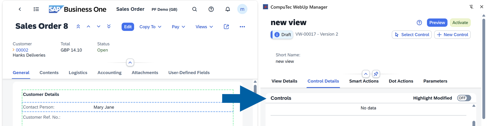

:::info[Note]

The **Controls** list is empty until you change or add a control. In our example, the list shows **No data**.

:::

## Select a control

To edit a control, you select it first.

To select a control, follow these steps:

1. Open your screen in **SAP Business One Web Client**, and then go to the **Control Details** tab in the **CompuTec WebUp Manager** side panel.
2. Make sure the view is in edit mode.

3. Click **Select Control**.

    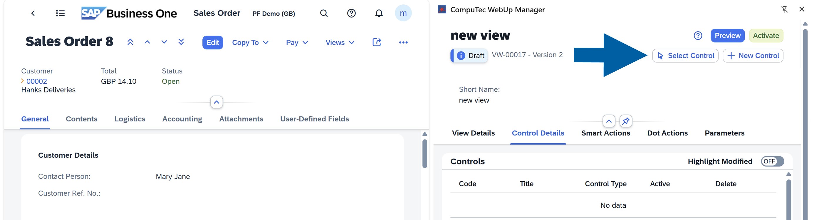

    :::note[info]

    **CompuTec WebUp** switches to select mode and shows the message "You are currently in select mode. Please select any control from WebClient to proceed."

    :::

4. In **SAP Business One Web Client**, click the control that you want to change. In our example, we select the **Contact Person** field on a **Sales Order**.

    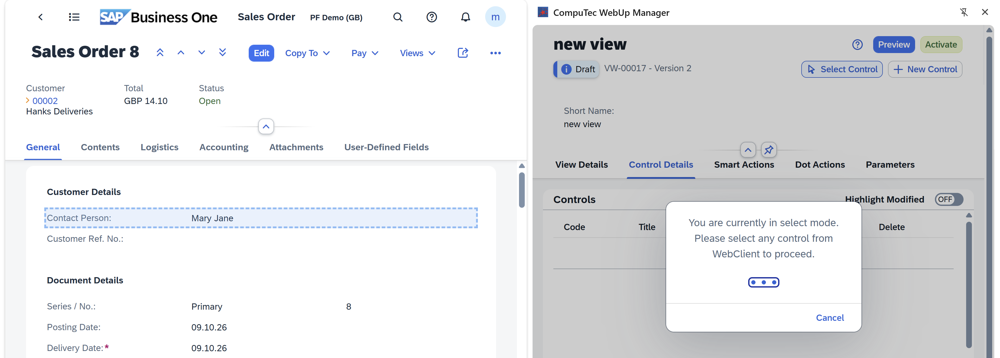

    :::note[info]

    To leave select mode without selecting a control, click **Cancel**.

    :::

5. Done! The **Selected Control** section opens. In **Position**, it shows the path to the control, for example **General > Sub Section (1) > Customer Details**.

    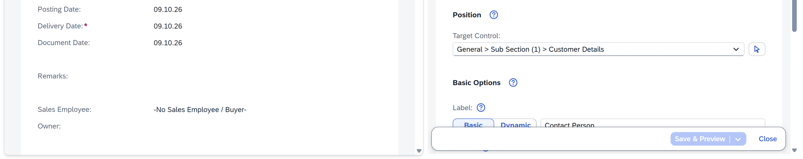

## Add a new control

To add a new control, follow these steps:

1. Open your screen in **SAP Business One Web Client**, and then go to the **Control Details** tab in the **CompuTec WebUp Manager** side panel.

2. Click **New Control**. Make sure you're in the **Edit** mode of the **CompuTec WebUp Manager**.

    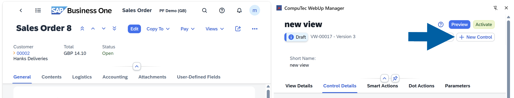

3. Choose **Control Type** from the list.

    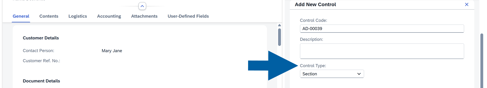

4. In the **Target Control** field, select the position from the list, or click **the pointer icon** to select it on the screen.

    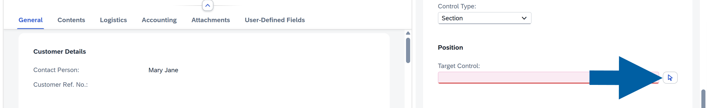

5. In **SAP Business One Web Client**, click the place where you want to add the control.

    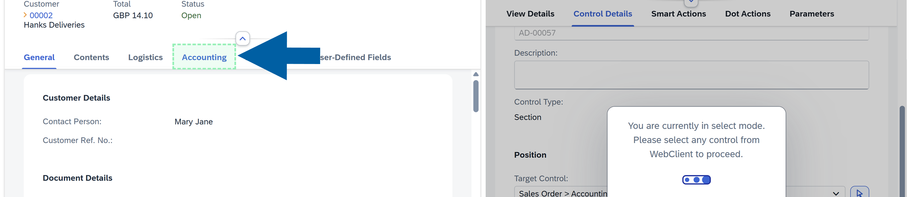

6. In **CompuTec WebUp Manager** side panel, choose the **Relative Position** of the control. In our example, we want to add our control **After** the **Accounting** section.

    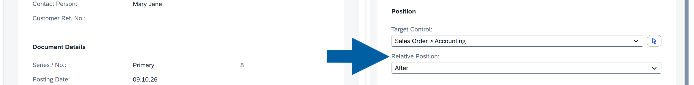

7. In **Basic Options**, define how the control should look and behave.

    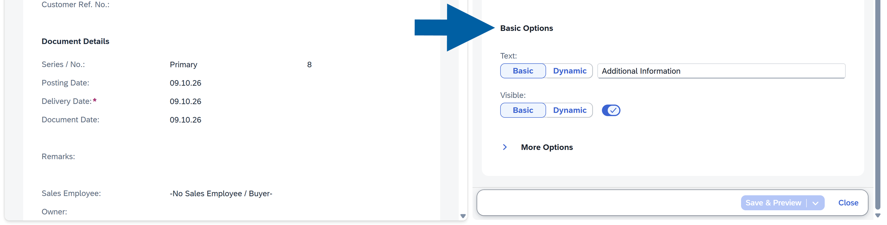

8. Click **Save & Preview**.

9. If you are happy with the results, **Activate** the view.

    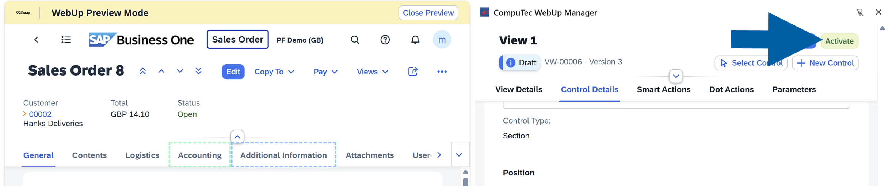

10. Done! The new control is on the **Controls** list.

:::note[info]

▶ **Watch**: [CompuTec WebUp - How to Add Controls](https://www.youtube.com/watch?v=1Veo7yo7pFU)

:::

## Edit a control

After you select a control, the **Selected Control** section shows its properties. Scroll down to see all of them.

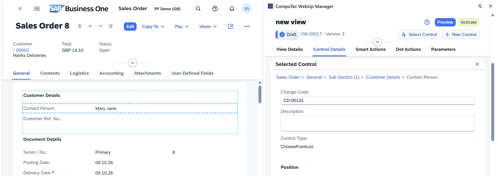

The properties depend on the **Control Type**. In our example, the control is a **ChooseFromList**. The section has the following parts:

- **Change Code** – The code of the change that **CompuTec WebUp** saves for this control.
- **Description** – (Optional) Your description of the change.
- **Control Type** – The type of the selected control, for example **ChooseFromList**. You can't change it.
- **Position** – Where the control appears in the view. In **Target Control**, select the control, tab, or section that holds your control. To pick the target on the screen, click the pointer icon next to the list.
- **Basic Options** – The main properties of the control. In our example: **Label**, **Link To**, **Value**, and **Visible**.
- **More Options** – More properties of the control. Click **More Options** to expand the list.
- **Events** – The events of the control, and the Smart Actions that run on them. In our example, the **Change** event.

:::note[Info]

Required properties are marked and must have a value before you can save the control.

:::

### Basic mode and Dynamic mode

Most properties have two modes:

- **Basic** – You enter a fixed value, for example the text **Contact Person**. The value stays the same for every document.
- **Dynamic** – The value is calculated from the document or from a **Parameter**. The value changes dynamically.

:::info[note]

Some properties are not editable for a given control. In our example, **Link To** is greyed out.

:::

To change the mode of a property, follow these steps:

1. In **Basic Options**, find the property. In our example, we use **Label**.
2. Select **Basic** or **Dynamic**.

    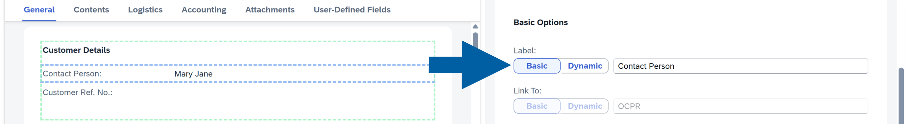

3. If you selected **Dynamic**, **CompuTec WebUp** marks the field red until you give it a value. Enter the value or click the icon at the end of the field to choose a **Parameter**.

    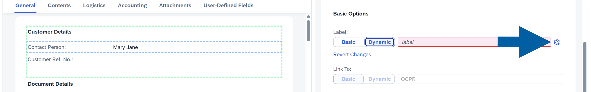

    :::info[Note]

    In **Dynamic** mode, a property can also use a field of the document in curly brackets. In our example, the **Value** property uses `{CntctCode}`.

    :::

4. Select the **Parameter**, and then enter its value if required. [Read more](/docs/webup/components/parameters#use-a-parameter-in-a-control-property)

    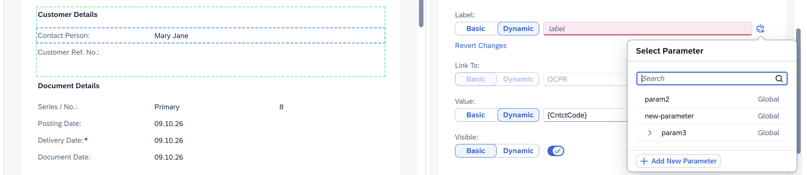

    :::note[Info]

    To go back to the previous value of the property, click **Revert Changes** below the field.

    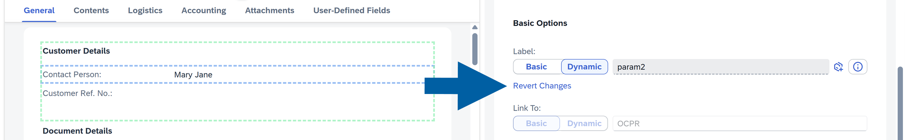

    :::

5. Click **Save & Preview**.

6. If you are happy with the results, **Activate** the view.

:::note[info]

Watch our videos to see how to use the **Dynamic** mode:

- ▶ **Watch**: [CompuTec WebUp - Dynamic Control Configuration](https://www.youtube.com/watch?v=ugpA8rHT2P8)
- ▶ **Watch**: [CompuTec WebUp - Highlighting Fields with Color](https://www.youtube.com/watch?v=ufN3qK_F1aY)

:::

### Add a Smart Action to a control event

In **Events**, you link a **Smart Action** to an event of the control. In our example, the event is **Change**: the **Smart Action** runs when the user changes the value of the field.

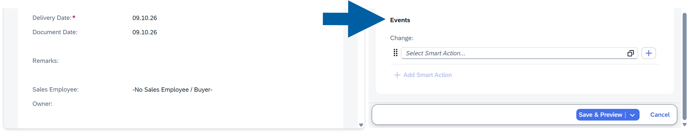

To add a **Smart Action** to an event, follow these steps:

1. In **Events**, find the event. In our example, we use **Change**.
2. In **Select Smart Action…**, select the **Smart Action** that you want to run.

    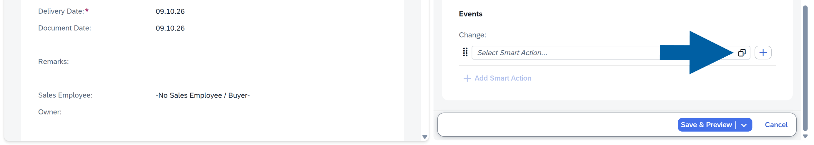

3. If the **Smart Action** has **Action Parameters**, set their **Source** and **Value**.

    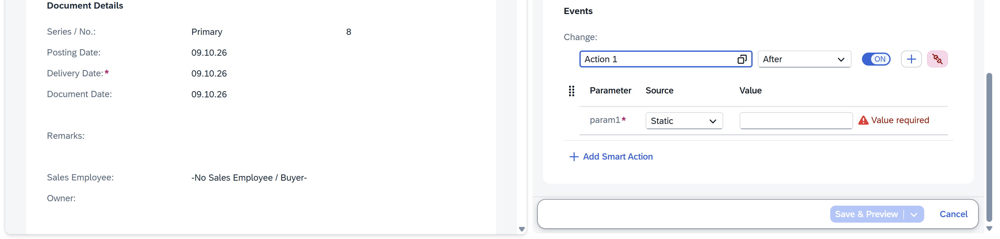

    :::note[info]

    For the full procedure, see [Smart Actions](/docs/webup/components/smart-actions#step-2-assign-the-smart-action-to-a-control). To create a new **Smart Action** from here, click the plus icon next to the field. [Read more](/docs/webup/components/smart-actions#create-a-smart-action-from-a-control-event)

    :::

4. Click **Save & Preview**.
5. If you are happy with the results, **Activate** the view.

## Hide an unused control

If you want to hide an unused control, follow these steps:

1. Log in to **SAP Business One Web Client**.

2. Navigate to the screen you want to edit. In our example it's **Sales Order**.

3. Open **CompuTec WebUp Manager** by clicking on its browser extension icon.

4. In **Control Details** section of **CompuTec WebUp Manager** side panel, click **Select Control**.

    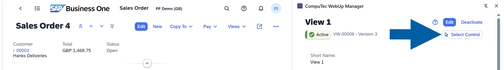

5. On the **SAP Business One Web Client screen**, click the control you want to hide. In our example, we want to hide the **Additional Information** section.

    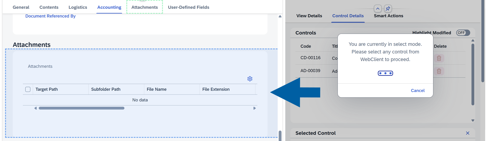

6. In **CompuTec WebUp Manager** side panel on the right, find **Visible** option, and click the toggle to turn it off.

    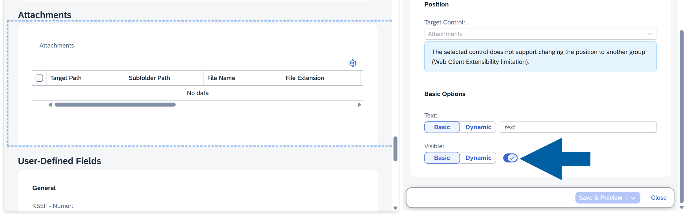

7. Click **Save & Preview**.

    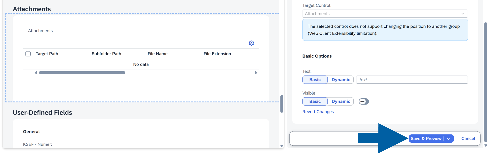

8. Click **Activate** when you are satisfied with the result.

9. Done! Your control is hidden.

:::note[info]

▶ **Watch**: [CompuTec WebUp - How to Hide Controls](https://youtu.be/HBFxPcV0ris)

:::

## Use Help Mode

**Help Mode** shows help icons next to the controls and properties that **CompuTec WebUp** supports. You use it to learn what each setting does.

To use Help Mode, follow these steps:

1. In the **CompuTec WebUp Manager** header, click the **help icon** (question mark) next to **Preview**.

    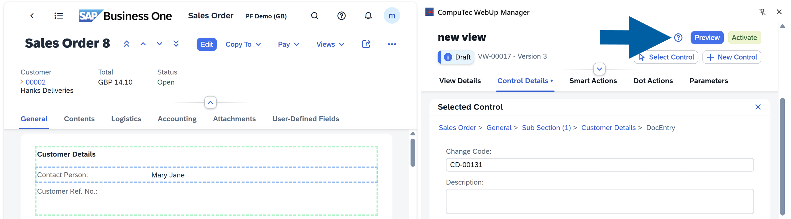

2. Click **a help icon** next to the setting that you want to know more about. For more details, click **Read more**.

    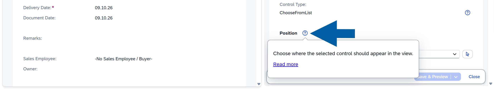

3. To hide the help icons, click **the help icon** next to **Preview** again.

:::note[info]

▶ **Watch**: [CompuTec WebUp - Help Mode](https://www.youtube.com/watch?v=DBv20ifpcCY)

:::

## Preview and activate your changes

To preview and activate your changes, follow these steps:

1. At the bottom of the **Selected Control** section, click **Save & Preview**.

    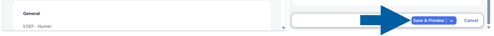

2. In **WebUp Preview Mode**, check how the control looks and works.
3. If you like the results, click **Activate** in the header of **CompuTec WebUp Manager**.

    

4. Done! Users see your change.

To close the **Selected Control** section without saving, click **Close**.

## Control Management best practices

- Use **Basic** mode for values that never change, and **Dynamic** mode for values that depend on the document
- Use a **Parameter** instead of repeating the same value in many controls
- Use **Help Mode** when you are not sure what a property does
- Give each change a **Description**, so other consultants know why you made it
- Always test using **Preview** before activation

## Next steps

See [**Smart Actions**](/docs/webup/components/smart-actions) to add logic to control events, [**Parameters**](/docs/webup/components/parameters) to use reusable values in control properties, and [**View Management**](/docs/webup/components/view-management) to manage versions of your view.
