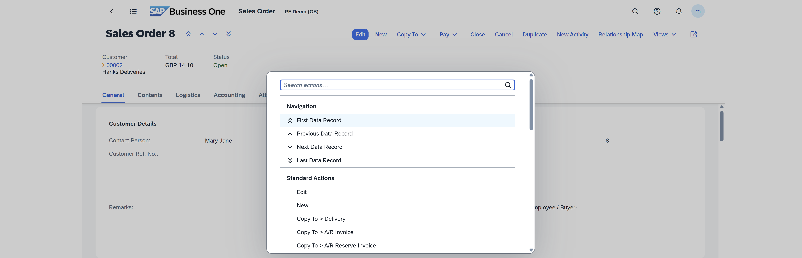
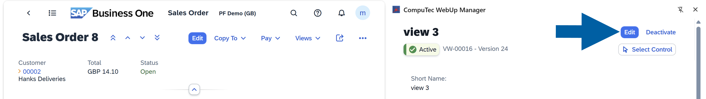
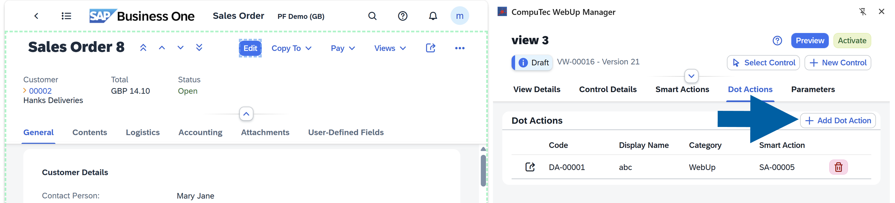
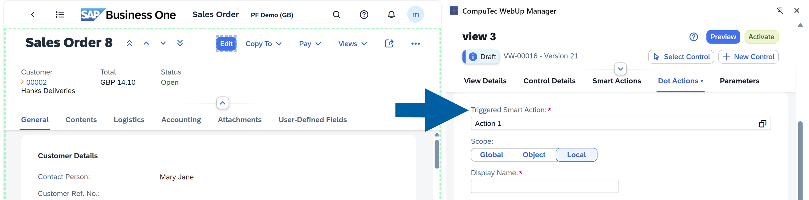
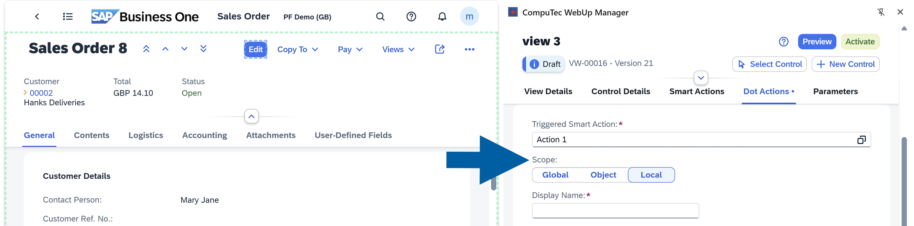
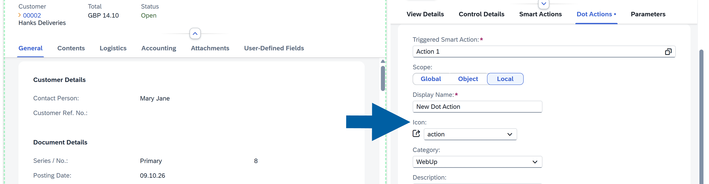

# Dot Actions

In **SAP Business One Web Client**, you press the **.** (dot or full stop) key to open the command palette. It lists the standard SAP Business One actions for the current screen. **Dot Actions** in **CompuTec WebUp** add your own actions to this list. Each **Dot Action** runs a **Smart Action**, so users can start it from the keyboard without leaving the document.

You create Dot Actions in the **Dot Actions** tab of **CompuTec WebUp Manager**.

## Key functions of Dot Actions

With Dot Actions, you can:

- Run a **Smart Action** from the command palette
- Choose the name, icon, and category of the action
- Place the action in the correct group of the command palette
- Enter values for the **Action Parameters** of the **Smart Action** once, when you create the **Dot Action**

## Before you start

Before you begin, make sure that:

- You created the **Smart Action** that the **Dot Action** runs. [Read more](/docs/webup/components/smart-actions)
- The screen supports **CompuTec WebUp** extensions.
- You are in edit mode. If the view is **Active**, click **Edit** first.

    

:::info[Note]

**Global Dot Actions** are available only on views that support **CompuTec WebUp** extensions.

:::

## Add a Dot Action

To add a Dot Action, follow these steps:

1. Open your screen in **SAP Business One Web Client**, and then go to the **Dot Actions** tab in the **CompuTec WebUp Manager** side panel.
2. Click **Add Dot Action**.

    

3. In **Smart Action**, select the **Smart Action** that the Dot Action runs.

    

4. Select the **Scope**. You can choose from:

    - **Global** : Available across all views and all document types, for example, a reusable validation used in **Sales Orders**, **Purchase Orders**, and **Business Partners**.
    - **Object**: Available for all **CompuTec WebUp** views (e.g., **Sales Order**), across all its view versions.
    - **Local**: Available only in the current view version. Use **Local** for temporary or highly customized behavior.

    

5. In **Display Name**, enter the name that users see in the command palette.
6. In **Icon**, choose an icon from the list of predefined icons.

    

7. In **Category**, choose the group in which the action appears. **CompuTec WebUp** suggests categories that you saved before.
8. (Optional) In **Description**, enter a description.
9. If the **Smart Action** has an **Action Parameter** with **Default** set to **None**, enter a value for it.
    

10. Click **Add & Preview**.
11. If you like the results, click **Activate**.
12. Done! **CompuTec WebUp** adds the Dot Action to the command palette.

:::note[Info]

If you select **Required** for an **Action Parameter** and the **Action Parameter** has no value, **CompuTec WebUp** doesn't activate the **Smart Action**. For more information, see [Create a new Smart Action](/docs/webup/components/smart-actions#step-1-create-a-new-smart-action).

:::

## Run a Dot Action

To run a Dot Action, follow these steps:

1. Click anywhere on the **SAP Business One Web Client** page, outside the **CompuTec WebUp Manager** side panel.
2. Press the **.** key (dot or full stop).

    The command palette opens.

        

3. Find your Dot Action in its category.
4. Select the Dot Action.
5. Done! The **Smart Action** runs.

## Dot Actions best practices

- Give each Dot Action a short name that describes the result, because users find it by name in the command palette
- Use categories to group related actions
- Always test using **Preview** before activation

## Next steps

See [**Smart Actions**](/docs/webup/components/smart-actions) to create the logic that a Dot Action runs, and [**Parameters**](/docs/webup/components/parameters) to share values between controls and Smart Actions.
