# Parameters

**Parameters** in **CompuTec WebUp** are reusable values that you define once and use in many places in your customized view. For example, you can show the document number as the text of a button. The text changes when the user opens another document.

You create Parameters in the **Parameters** tab of **CompuTec WebUp Manager**. There are two Parameter types: **Binding Expression** and **Custom Model**.

:::info[Note]

A **Parameter** is not the same as an **Action Parameter**. An Action Parameter belongs to one **Smart Action**, and you define it in the **Smart Actions** tab. For more information, see [Create a new Smart Action](/docs/webup/components/smart-actions#step-1-create-a-new-smart-action).

:::

## Key functions of Parameters

With Parameters, you can:

- Define a value once and reuse it in many controls and Smart Actions
- Show dynamic values, such as the document number, in control properties
- Combine static values and document fields in one model
- Change a Parameter once and update every control that uses it

## Parameter types

- **Binding Expression** – A value built from document data. You build the expression from ready-made blocks, so you don't write code. The value changes with the document that the user opens.
- **Custom Model** – A group of named properties. Each property has a static value or a dynamic value from the document. Use a Custom Model to share several values together.

## Create a Parameter

The **Parameters** tab lists all Parameters with their **Code**, **Name**, **Parameter Type**, **Description**, and **Update Date**.

### Create a Binding Expression Parameter

To create a Binding Expression Parameter, follow these steps:

1. Open your screen in **SAP Business One Web Client**, and then go to the **Parameters** tab in the **CompuTec WebUp Manager** side panel.

    :::info[Note]

    You must be in edit mode. If the view is **Active**, click **Edit** first.

    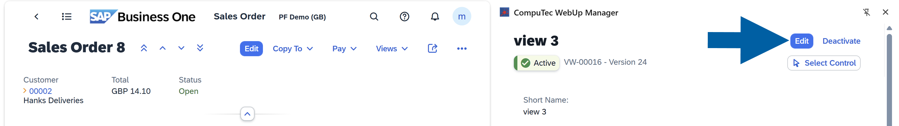

    :::

2. Click **Add Parameter**.

    

3. Select the **Scope**. You can choose from three types:
    - **Global** – Available in all views and all document types.
    - **Object** – Available in all views of one object, for example **Sales Order**, across all its view versions.
    - **Local** – Available only in the current view version.

    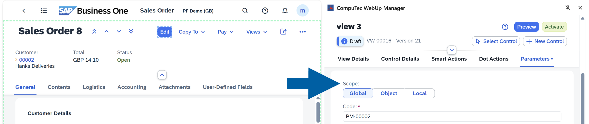

4. Check the **Code**. **CompuTec WebUp** fills it in automatically, but you can edit it.
5. In **Name**, enter a name for the Parameter.
6. In **Parameter Type**, select **Binding Expression**.
7. (Optional) In **Description**, enter a description.
8. Choose the **Parameter Type**. In our example, we choose **Binding Expression**. [Read more](#parameter-types)

    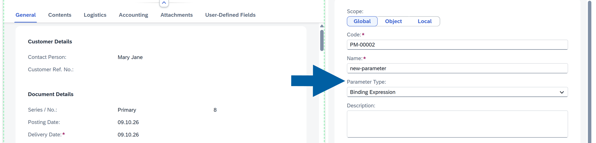

9. In **Binding Expression**, build the expression:

    1. Find the element you need. Expand **Data** or **Templates**, or use the search box.
    2. Drag the element to the expression area. In our example, we drag `DocEntry` from **Data**.

    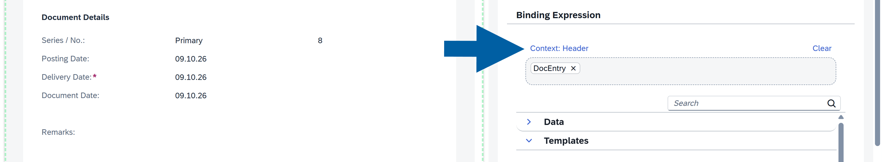

    :::note[Info]

    The expression editor shows the data context of the expression, for example **Header**. To remove one element, click **x** next to it. To remove the whole expression, click **Clear**.

    :::

10. Click **Add**.

    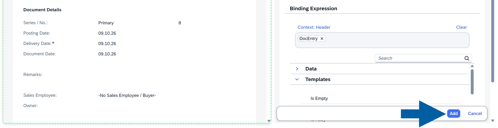

11. Done! The new Parameter is on the list in the **Parameters** tab.

### Create a Custom Model Parameter

To create a Custom Model Parameter, follow these steps:

1. Open your screen in **SAP Business One Web Client**, and then go to the **Parameters** tab in the **CompuTec WebUp Manager** side panel.

    :::info[Note]

    You must be in edit mode. If the view is **Active**, click **Edit** first.

    

    :::

2. Click **Add Parameter**.

    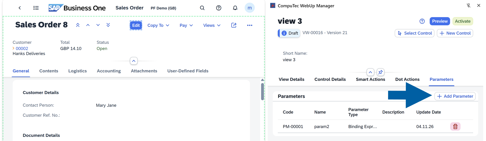

3. Select the **Scope**.You can choose from three types:
    - **Global** – Available in all views and all document types.
    - **Object** – Available in all views of one object, for example **Sales Order**, across all its view versions.
    - **Local** – Available only in the current view version.

    

4. In **Name**, enter a name for the Parameter.
5. In **Parameter Type**, select **Custom Model**.
6. In **Property**, enter the name of the first property.

    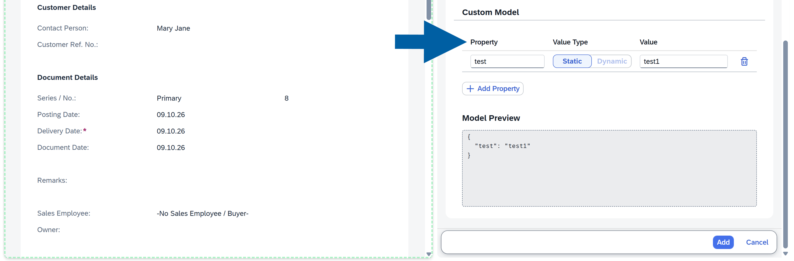

7. In **Value Type**, select **Static** or **Dynamic**.
8. In **Value**, enter the value:

    - If you selected **Static**, enter a fixed value. The value can be empty.
    - If you selected **Dynamic**, choose a field from the document.

9. (Optional) To add more properties, click **Add Property**, and then repeat steps 6 to 8.

    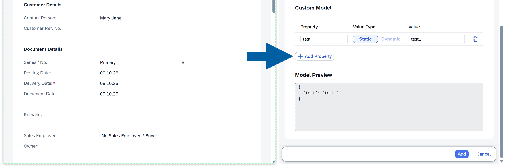

10. Check **Model Preview**. It shows the properties with their current values.
11. Click **Add**.
12. Done! The new Parameter is on the list in the **Parameters** tab.

## Use a Parameter in a control property

You can use a Parameter as the value of a control property. In this example, a button shows the document key of the open **Sales Order** as its text.

To use a Parameter in a control property, follow these steps:

1. In the **CompuTec WebUp Manager** side panel, go to **Control Details**.

    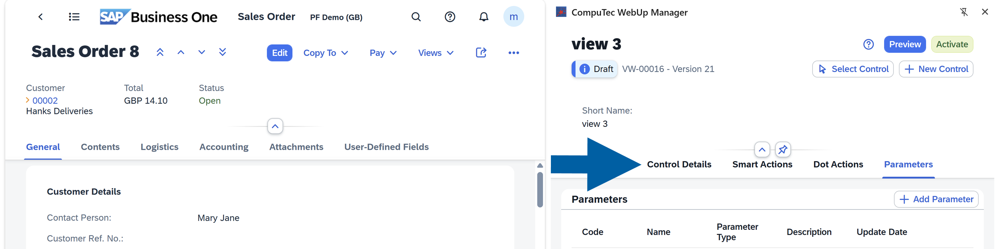

2. Select a control from the list, or click **Select Control** and select it in **SAP Business One Web Client**. In our example, we select a button.

    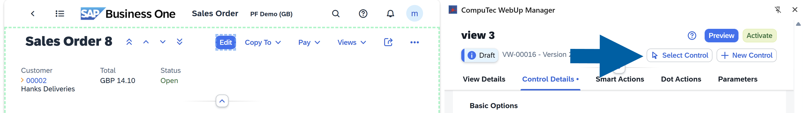

    :::info[Note]

    You must be in edit mode. If the view is **Active**, click **Edit** first.

    

    :::

3. Scroll down to **Basic Options** of the selected control.
4. For **Text**, select **Dynamic**.

    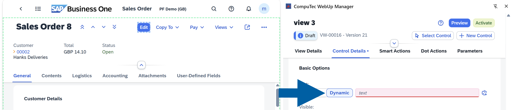

5. Click the icon at the end of the **Text** field to open **Select Parameter**.

    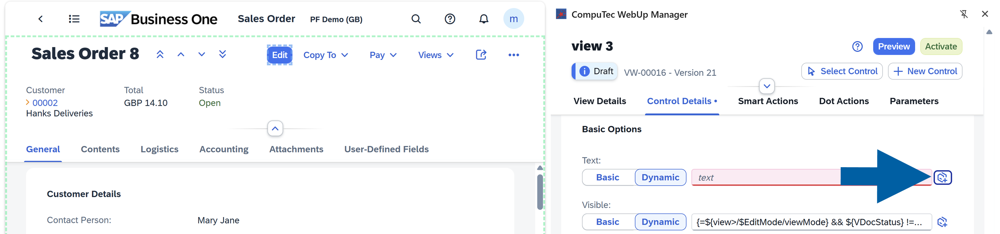

6. Select your Parameter from the list. The list shows the scope of each Parameter.

    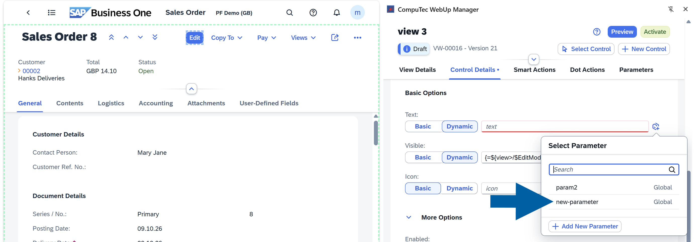

7. Click **Save & Preview**.

    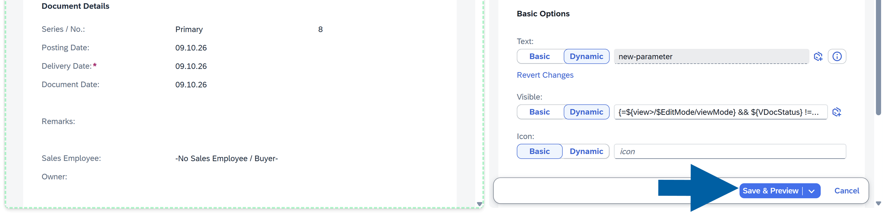

8. In preview mode, check the button text. In our example, the button shows the `DocEntry` value of the open **Sales Order**.

    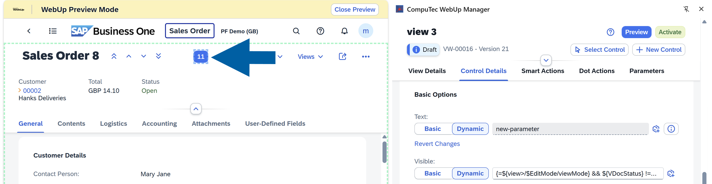

9. If you like the results, click **Activate**.
10. Done! The control uses the Parameter. When the user opens another document, the text changes with it.

:::note[Info]

Required control properties are marked and must have a value before you can save the control.

:::

### Create a Parameter from a control property

You can create a new Parameter while you edit a control property, so you don't leave the control.

To create a Parameter from a control property, follow these steps:

1. In **Control Details**, select the control and go to **Basic Options**.
2. For the property, select **Dynamic**, and then click the icon at the end of the field.

    

3. In **Select Parameter**, click **Add New Parameter**.

    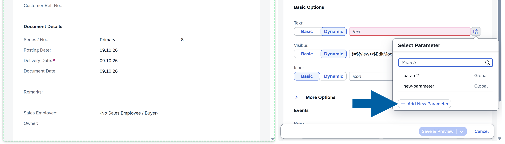

4. Define the Parameter. For details, see [Create a Parameter](#create-a-parameter).

    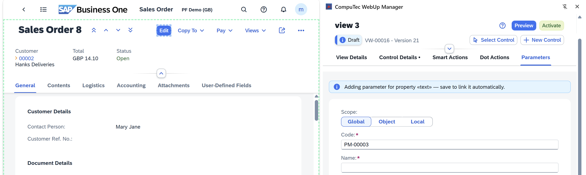

5. Click **Add**.
6. Done! **CompuTec WebUp** links the new Parameter to the property automatically.

:::note[Info]

If you leave the editor with unsaved changes, **CompuTec WebUp** warns you. You can keep editing or discard the changes. If you discard them, the connection to the original field is not lost.

:::

## Use a Parameter in a Smart Action

You can use a Parameter as the **Source** of an **Action Parameter** when you assign a **Smart Action** to an event.

To use a Parameter in a Smart Action, follow these steps:

1. Assign the **Smart Action** to a control event. For details, see [Assign the Smart Action to a Control](/docs/webup/components/smart-actions#step-2-assign-the-smart-action-to-a-control).

    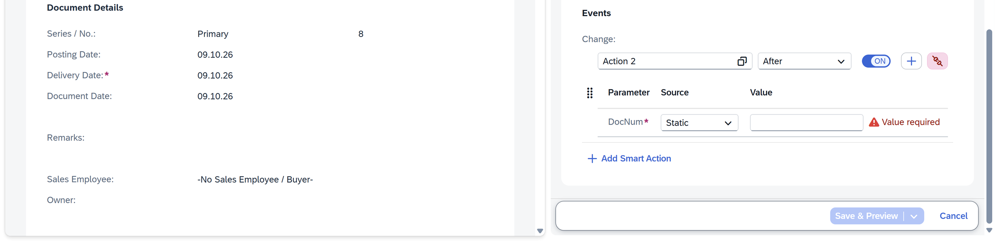

2. In the **Source** column, select **Parameter** for the **Action Parameter**.

    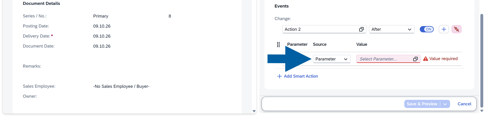

3. Select your Parameter from the list.

    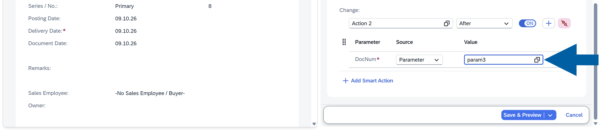

4. Click **Save & Preview**.

:::info[Note]

You can't use every Parameter type in every place. For example, a **Binding Expression** Parameter is not supported as the **Source** of an **Action Parameter**. In this case, **CompuTec WebUp** shows an error that says you can use only a **Data Model**. Custom Model Parameters can be used in Smart Action event bindings.

:::

## Parameters best practices

- Give each Parameter a descriptive **Name** and a **Description**, so other consultants know what it does
- Use a Parameter instead of repeating the same expression in many controls
- Always test using **Preview** before activation

## Next steps

See [**Smart Actions**](/docs/webup/components/smart-actions) to use Parameters as sources for Action Parameters, and [**Dot Actions**](/docs/webup/components/dot-actions) to run Smart Actions from the command palette.
