# Smart Actions

**Smart Actions** in **CompuTec WebUp** add reusable logic to the **SAP Business One Web Client**. You define a **Smart Action** once and run it in many places: when a form or data loads, when a user changes a field, or when a user clicks a button.

**Smart Actions** replace **View Actions**, which are not supported in **CompuTec WebUp 1.2610.2 and later**. You link a **Smart Action** to a **View Event**, such as form loading or data loading, or to the event of a control. Each link is called a binding. For each binding, you choose when the **Smart Action** runs, turn the binding on or off, and set the order in which actions run.

:::info[Note]
If you already use **View Actions**, you can convert them to **Smart Actions**. The conversion creates **Local** **Smart Actions** and their bindings for you. See [Convert View Actions to Smart Actions](/docs/webup/components/view-actions).
:::

## Key functions of Smart Actions

With **Smart Actions** in **CompuTec WebUp**, you define an action once and reuse it in multiple places.

**Smart Actions** can be used in many scenarios. For example, they allow you to:

- Trigger logic when a user edits a field
- Run actions when a button is pressed
- Display confirmations or validations at the exact moment of interaction
- Run logic when a form or data loads
- Validate a document with a read-only SQL query before it is saved
- Open a document, a document list, or a CompuTec AppEngine application from a **Smart Action**
- Improve user experience without modifying SAP core functionality

This results in faster processes, fewer user errors, and better control over how users interact with business data.

### Example

You can create a **Smart Action** that shows a confirmation message: ``Do you want to save changes for document number 234?``

Instead of hardcoding ``234``, you define an Action Parameter (e.g., ``DocNum``). This Action Parameter can dynamically pull the current document number from SAP Business One.

## Add and activate Smart Action

To add and activate a new **Smart Action**, follow these steps:

### Step 1: Create a new Smart Action

To create a Smart Action, follow these steps:

1. Open **CompuTec WebUp Manager**.
2. Navigate to **Smart Actions** tab.

    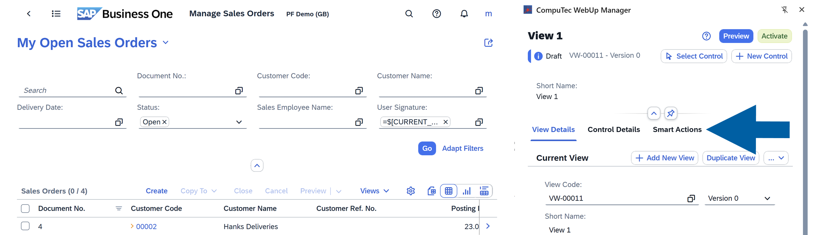

3. Click **Edit** to enable the edit mode.

    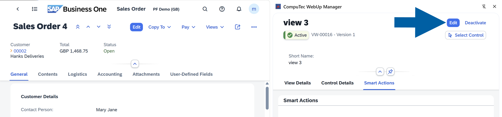

4. Click **Add Smart Action**.

    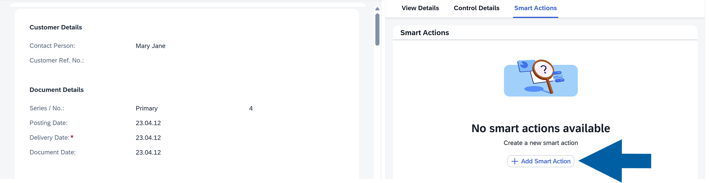

5. Define the **Action** scope. You can choose from:

    - **Global** : Available across all views and all document types, for example, a reusable validation used in **Sales Orders**, **Purchase Orders**, and **Business Partners**.
    - **Object**: Available for all **CompuTec WebUp** views (e.g., **Sales Order**), across all its view versions.
    - **Local**: Available only in the current view version. Use **Local** for temporary or highly customized behavior.

    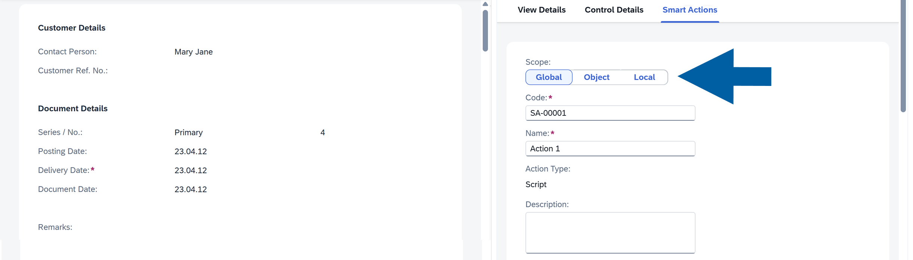

    :::note[Info]
    When you convert **View Actions** to **Smart Actions**, **CompuTec WebUp** creates them with the **Local** scope.
    :::

6. Enter the action **Name**. Optionally, you can also change the action **Code**.

    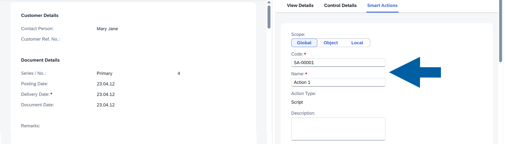

7. (Optional) Add a **Description** of the action.

    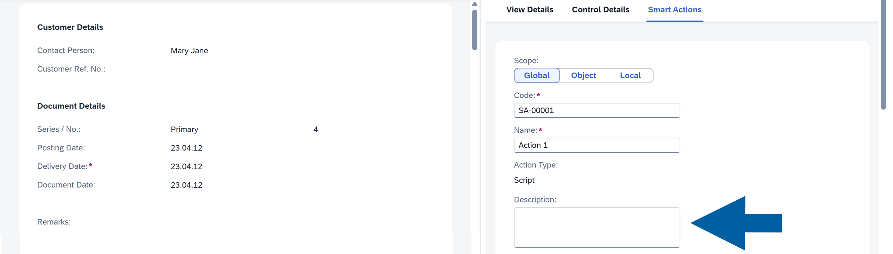

8. In **Action Parameters**, click the **plus (+)** icon to add an **Action Parameter**, and then:

    - In **Parameter Name**, enter the name.
    - (Optional) Select **Required**.
    - In **Default**, select **None** or **Static**.
    - If you selected **Static**, enter the value in **Default Value**.

    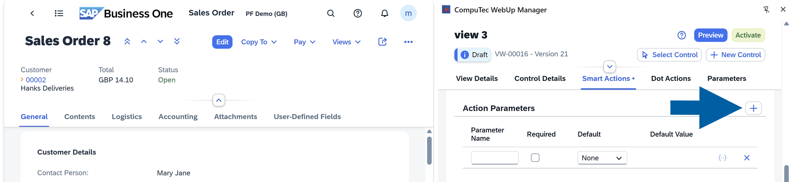

    :::note[info]
        If you select **Required** and the **Action Parameter** has no value, **CompuTec WebUp** doesn't activate the **Smart Action**.

        If you select **None** in **Default**, the value is empty. You enter it when you assign the **Smart Action** to an event. If you select **Static**, the value from **Default Value** is used.

    An **Action Parameter** is not the same as a **Parameter** in the **Parameters** tab. For more information, see Parameters. <!-- TODO: add a link -->

    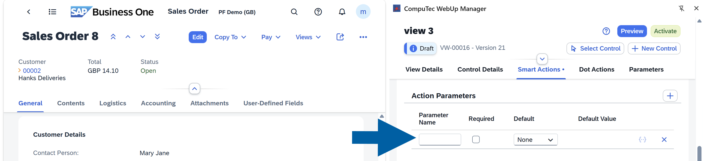
    :::

9. Enter your **Script**.

    Click a line in the script editor, type `actionParameters.`, and select your Action Parameter from the list.

    :::note[info]
    You can use the **Parameter Helper** or **right-click inside the script** editor to insert ready-made snippets such as ``Show confirmation``, ``Create activity``, or ``Get table row by key``.

    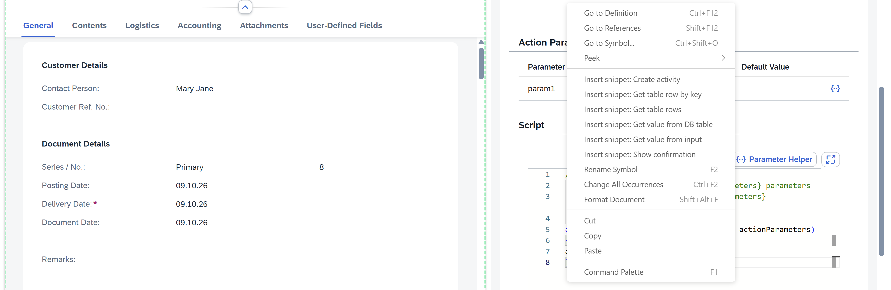

    :::

10. Click **Add**.

11. Done! Now you can see your **Smart Action** on the list.

    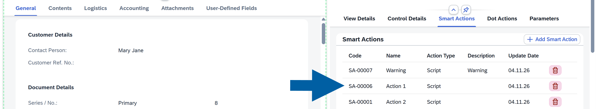

### Step 2: Assign the Smart Action to a Control

To assign the **Smart Action** to a control, follow these steps:

1. Open your screen in **SAP Business One Web Client**. In our example, we want our Smart Action to trigger a confirmation window after making changes in ``Contact Person`` field of the **Sales Orders**, so we open **Sales Order 8** in SAP Business One Web Client.

2. In the **CompuTec WebUp Manager** side panel, click **Select Control**.

    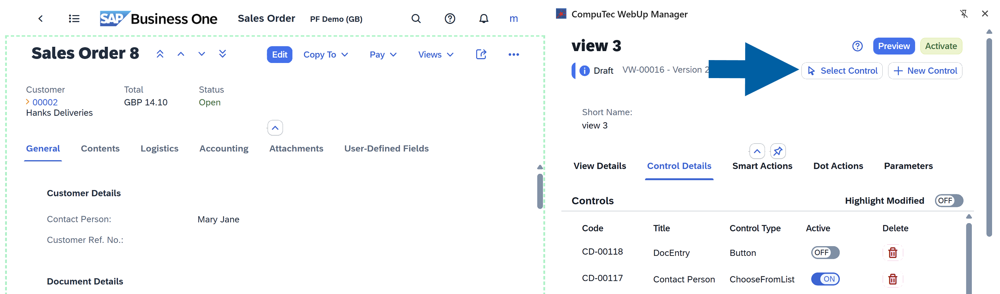

3. In **SAP Business One Web Client**, click a field, button, or UI element to select it.

4. In **CompuTec WebUp Manager** side panel on the right, go to **Control Details** > **More Options** > **Events**.

5. Next to the event your **Smart Action** should react to, for example **Press**, click the **Select Smart Action** field to open the list of available **Smart Actions**.

    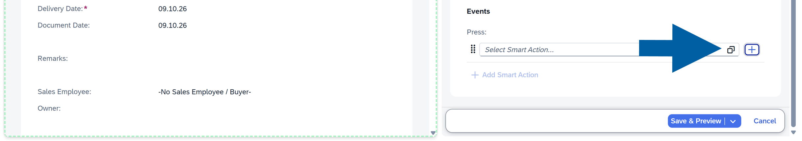

6. Choose your **Smart Action** from the list.

    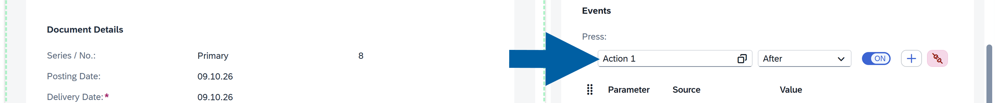

7. In the drop-down list next to the **Smart Action** name, choose when your action runs: ``No Trigger``, ``After``, or ``Before`` the event occurs.

    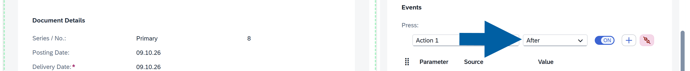

8. In the **Source** column of the Smart Action Parameters, select the source for each **Action Parameter**:

    - **Static**: A fixed value. Enter the static value in **Value**.
    - **Data Model**: A dynamic value from SAP Business One, for example ``DocEntry`` or ``CardCode`` as in our example. You can choose any element that the document has. Click the **collection icon** to see the list of available values, and choose your value from the list, for example ``CardCode``, and click **Confirm**.
    - **Parameter**: A **Parameter** from the **Parameters** tab. Select it from the list. For details, see Parameters. <!-- TODO: add a link -->

    :::info[Note]
    You can't use every **Parameter** type as a **Source**. For example, a **Binding Expression** **Parameter** isn't supported here, and **CompuTec WebUp** shows an error that says you can use only a **Data Model**.
    :::

    :::note[info]
    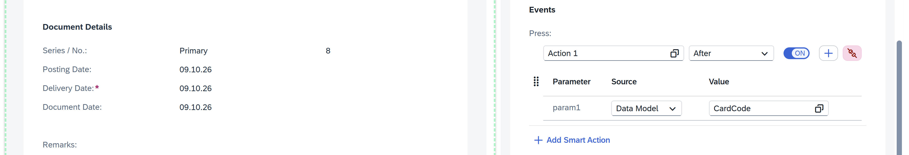

    In our example, we added Smart Action to the **Press** **Event** and selected **Data Model** as a **Source** with `CardCode` value.  Now the **Action Parameter** is now linked dynamically to the document.
    :::

9. Click **Save & Preview** to save your changes.

10. In preview mode, test your action.
11. If you like the results, click **Activate**.

    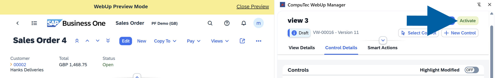

12. Done! You’ve added and activated your Smart Action.

#### Video walkthrough

▶ **Watch**: [CompuTec WebUp - Smart Actions](https://youtu.be/iAWFLTRgvGk)

### Create a Smart Action from a control event

You can create a **Smart Action** directly from an event. The new **Smart Action** is linked to the event when you save it.

To create a **Smart Action** from a control event, follow these steps:

1. In the **CompuTec WebUp Manager** side panel, go to **Control Details**.

    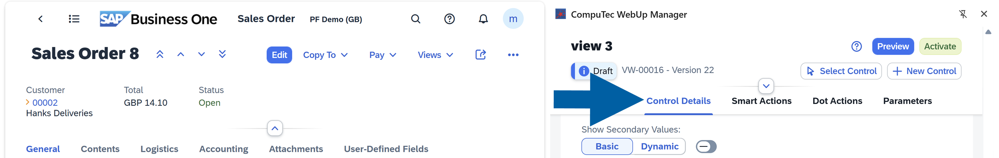

2. Select the control from the list, or click **Select Control** and select it in **SAP Business One Web Client**.
3. Scroll down to **Events**.

    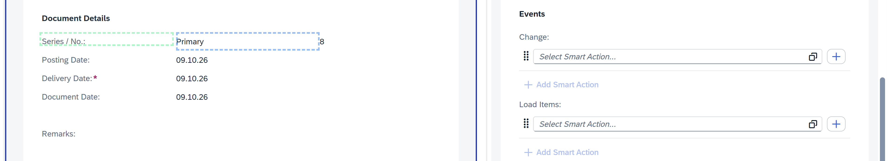

4. Next to the event, for example **Press**, click the **+** button.

    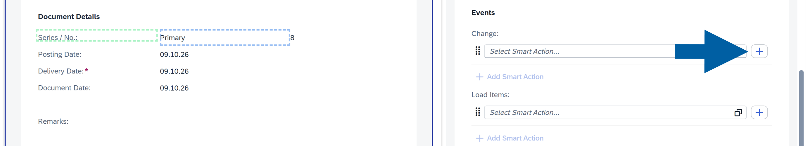

5. Define the **Smart Action**: choose the scope, enter the name, add the **Action Parameters**, and enter the script. For details, see [Step 1: Create a new Smart Action](#step-1-create-a-new-smart-action).

    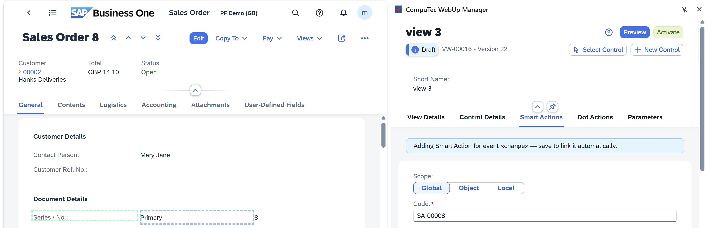

6. Save the **Smart Action**.
7. Done! **CompuTec WebUp** links the new **Smart Action** to the event.

:::note[Info]
If you leave the editor with unsaved changes, **CompuTec WebUp** warns you. You can keep editing or discard the changes. If you discard them, the connection to the original control is not lost.
:::

## Event bindings

When you select a **Smart Action** for an event, **CompuTec WebUp** creates a binding between them. A binding connects one **Smart Action** to one event, for example **Press** on a button.

For each binding, you can:

- **Choose when the Smart Action runs** – In the drop-down list next to the **Smart Action** name, select ``No Trigger``, ``After``, or ``Before``.
- **Enable or disable the binding** – Use the **ON/OFF** toggle. A disabled binding stays in your configuration but doesn't run.
- **Set the execution order** – Click **+ Add Smart Action** to link more than one **Smart Action** to the same event. Drag the handle to change the order in which they run.
- **Remove the binding** – Click the red unlink icon.

    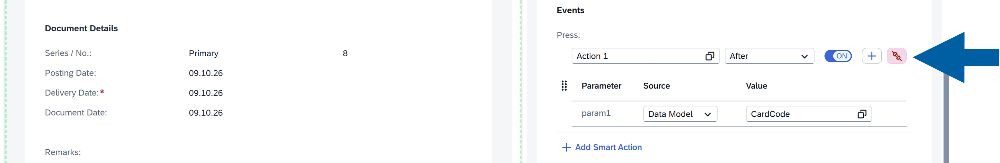

## Smart Actions use cases

- Prevent accidental data changes:  
    Sales teams may unintentionally update pricing fields. You can trigger a confirmation popup when a user changes a price field (for example: ``Are you sure you want to change the price?``).

- Improve data quality:  
    Users may forget to complete required fields such as ``Project`` or ``Cost Center``. You can attach a Smart Action to the field’s ``On Change`` event to validate input immediately and display a warning if the field is empty.

- Trigger actions from buttons:  
    Companies may need a quick way to log activities directly from a document. You can create a custom button and attach a Smart Action to trigger an action on button press (for example, ``create an activity via Service Layer``).

- Show context-aware confirmations:  
    Users may need additional clarity before saving important documents. You can use Action Parameters to display dynamic confirmation messages (for example: ``Do you want to save changes for document 10567?``).

## Debug Smart Actions

When developing or troubleshooting **Smart Actions**, you can use the standard **JavaScript** ``debugger`` statement to pause script execution and inspect the action in your browser's developer tools.

The ``debugger`` statement tells the browser to stop execution at a specific line and allows you to examine variables, parameters, and script behavior step by step.

### Use the debugger statement

To debug a **Smart Action**, follow these steps:

1. In **CompuTec WebUp Manager**, open your **Smart Action** **Script**.

    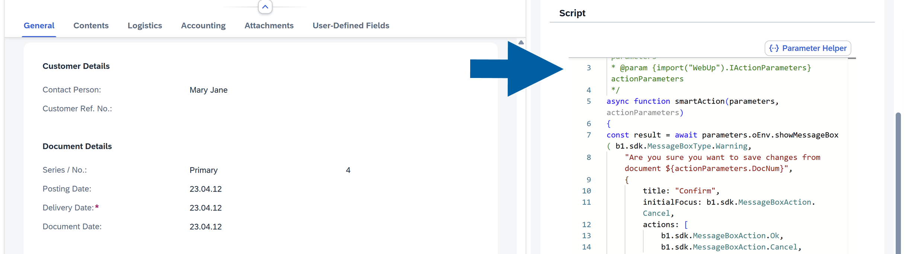

2. Navigate to action **Script** and add the following statement where you want execution to pause:

    ```javascript
    debugger;
    ```

    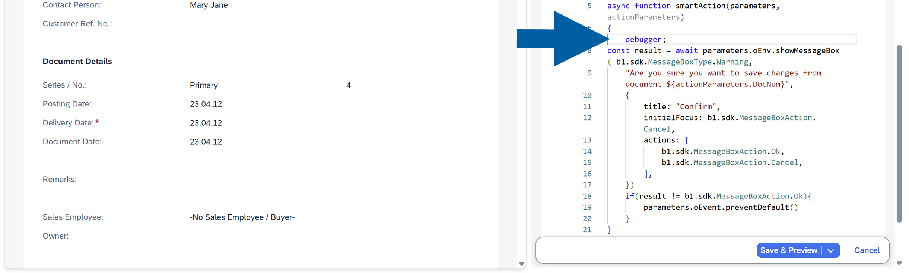

    :::note[info]
    You can add a single or multiple ``debugger`` statements throughout the script.

        Example:

        ```javascript
        {
            debugger;
        const result = await parameters.oEnv.showMessageBox( b1.sdk.MessageBoxType.Warning,
            "Are you sure you want to save changes from document ${actionParameters.DocNum}",
            {
                title: "Confirm",
                initialFocus: b1.sdk.MessageBoxAction.Cancel,
                actions: [
                    b1.sdk.MessageBoxAction.Ok,
                    b1.sdk.MessageBoxAction.Cancel,
                ],
            })
            if(result != b1.sdk.MessageBoxAction.Ok){
                parameters.oEvent.preventDefault()
            }
            debugger;
        }
        ```
    In this example, the script pauses twice, allowing you to inspect the execution flow at different stages.
    :::

3. Click **Save & Preview**.

    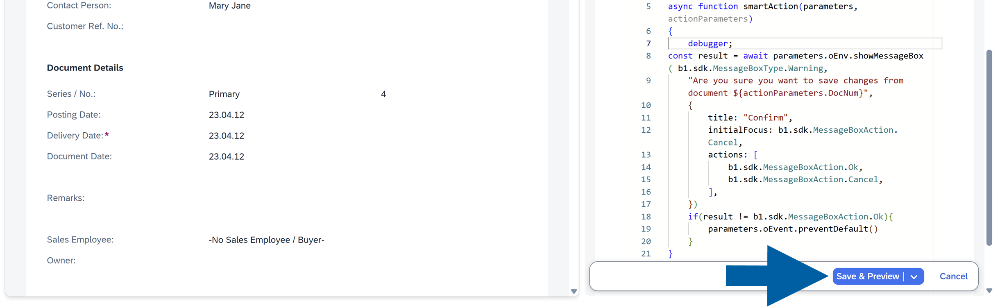

4. (optional) Assign the **Smart Action** to a control or event if it is not already assigned, and then click **Save & Preview**.
5. Open your browser's developer tools:
    - Right-click anywhere in the **WebUp Preview Mode** screen.
    - Select **Inspect**.

    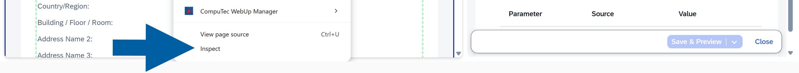

6. Go to the **Sources** tab in the developer tools.
7. Trigger the **Smart Action**, for example, click a button or modify a field that runs the action.
8. Done! When execution reaches a ``debugger`` statement, the browser automatically pauses the script.

    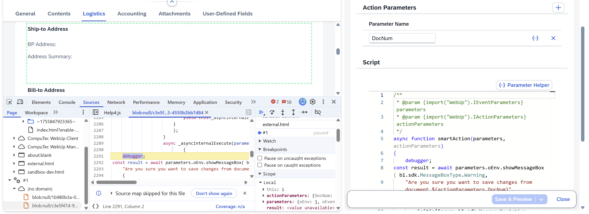

    While the script is paused, you can:

    - Review variable values.
    - Inspect Smart Action parameters.
    - Check the call stack.
    - Evaluate expressions in the console.
    - Step through the code line by line.
    - Identify script errors and unexpected behavior.
    - Continue execution

9. After reviewing the paused state, click **Resume** script execution in the developer tools.

    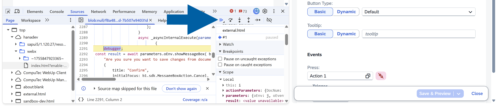

    :::info[note]
    The script continues running until it finishes execution, or it reaches another ``debugger`` statement.

    If multiple ``debugger`` statements are present, execution pauses at each location, allowing you to inspect the script step by step.
    :::

### Common debugging scenarios

Use the ``debugger`` statement to:

- Verify that Action Parameter values are passed correctly.
- Confirm that conditional logic behaves as expected.
- Troubleshoot validation rules.
- Inspect data returned from SAP Business One.
- Identify the source of script errors.

## Smart Actions best practices

- Use **Global** scope for reusable business logic
- Keep scripts modular and simple
- Use **Action Parameters** instead of hardcoding values
- Always test using **Preview** before activation

**Smart Actions** in **CompuTec WebUp** give you precise control over user interactions, helping you build more intuitive, reliable, and efficient processes in **SAP Business One Web Client**.
