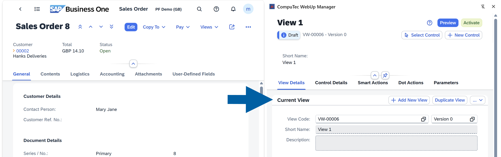
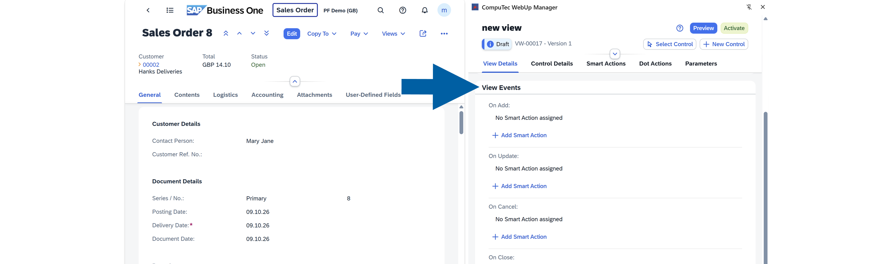
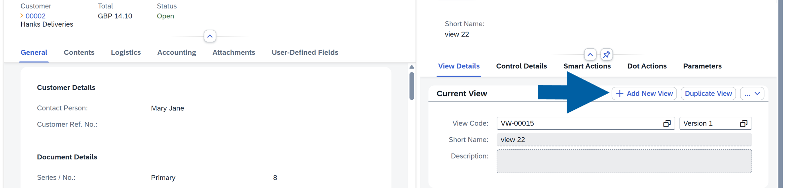
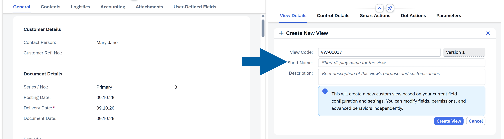
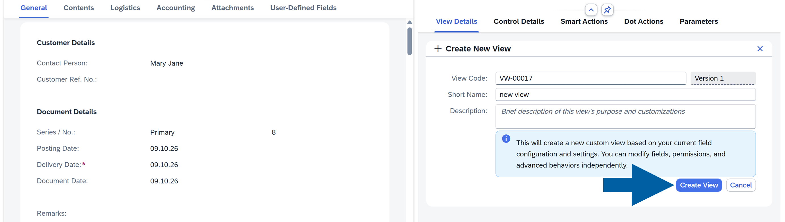
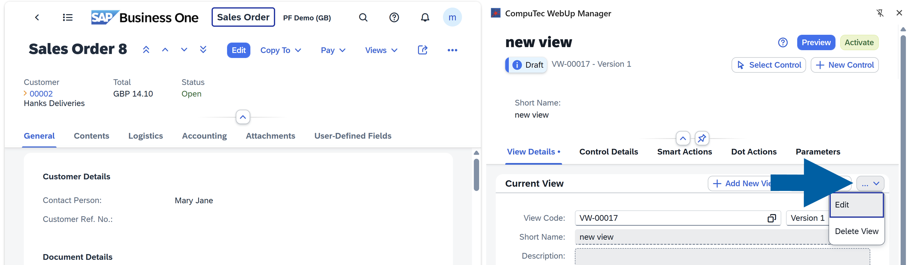
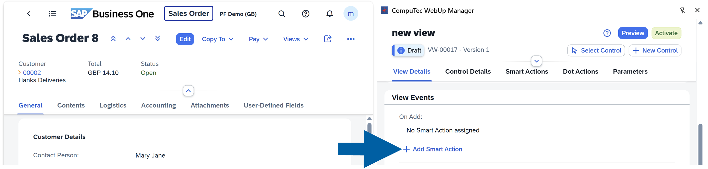
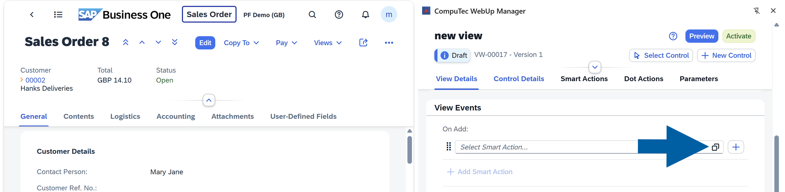
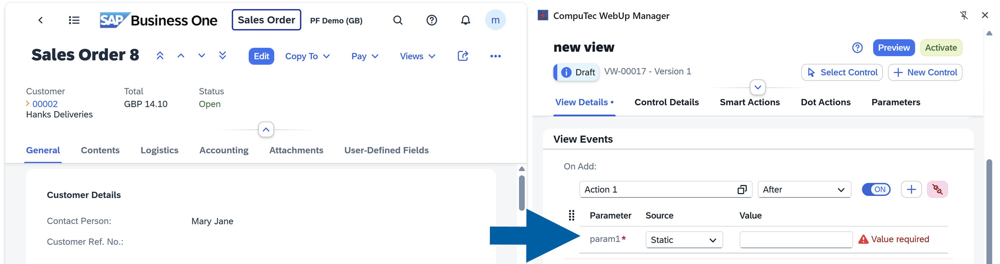
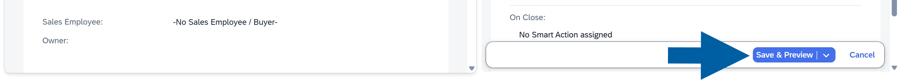

# View Management

CompuTec WebUp saves all your settings, such as layouts, actions, and bindings, inside **Views**. All your saved views are kept in the company database, and if a setting is supported by the **SAP Business One Web Client Extensibility Framework**, it is automatically deployed as a standard **SAP Business One Web Client** extension using the **SAP Business One Extension Manager**.

Each **View** can have several **Versions**. This lets you make changes safely, test them, and go back to older versions if needed.

This setup keeps everything traceable, organized, and secure.

:::info[Note]
You can access each **CompuTec WebUp** function from the **CompuTec WebUp Side Panel** inside the **SAP Business One Web Client**. Features open only if the current **SAP Business One** screen supports extensibility.
:::

## View Details tab

The **View Details** tab shows the settings of the view that you work on. It has two sections: **Current View** and **View Events**.

The **Current View** section contains the following elements:

- **Add New View** – Creates a new view.
- **Duplicate View** – Creates a copy of the current view.
- **... (more actions)** – Opens a menu with **Edit** and **Delete View**.
- **View Code** – The unique code of the view, for example `VW-00006`. Click the icon at the end of the field to browse the existing views.
- **Version** – The version number of the view, for example **Version 1**. Click the icon at the end of the field to browse the saved versions of the view.
- **Short Name** – The name of the view. The name is also displayed at the top of the panel.
- **Description** – A description of the purpose and customizations of the view.

The **View Events** section lists the events of the view. For more information, see [View Events](#view-events).

## Key functions of view management

A view stores the customizations of one SAP Business One screen. With view management, you can:

- **Add a new view** – Click **Add New View** to create a view from your current field configuration and settings. **CompuTec WebUp** fills in the view code and version. You enter a short name and an optional description. The new view starts as a **Draft**. You can change its fields, permissions, and advanced behaviors independently of other views. [**Read more**](#add-a-new-view).

- **Duplicate a view** – Click **Duplicate View** to create a copy of the current view. The copy keeps the names of your Smart Actions and Parameters, and the definitions of your Binding Expressions and Custom Models.

- **Edit a view** – Click **...** > **Edit** to change the settings of a view. When the view is **Active**, click **Edit** at the top of the panel. **CompuTec WebUp** keeps your changes in a draft until you activate it. [Read more](#edit-or-delete-a-view)

- **Delete a view** – Click **...** > **Delete View** to delete the view. [Read more](#edit-or-delete-a-view)

- **Browse existing views and versions** – Click the icon at the end of **View Code** to open the list of existing views. You can search the list. Click the icon at the end of **Version** to open the list of saved versions of the selected view. You can search this list too, and you can't select a version that doesn't exist.

- **Activate a view** – Click **Activate** to make a draft the active version. **CompuTec WebUp** archives the previously active version automatically. You will need to enter your SAP Business one credentials as a confirmation.

- **Deactivate a view** – Click **Deactivate** to deactivate an active view. You can then activate another version or another view, and repeat this as often as you need.

- **Return to a previous version** – **CompuTec WebUp** saves the version of a view automatically each time you activate it. To go back, browse the saved versions, select the older one, and activate it.

:::info[Note]

- Only one view version can be active at a time.
- All inactive versions remain archived for auditing, rollback, and troubleshooting purposes.

:::

### Add a new view

To add a new view, follow these steps:

1. Open your screen in **SAP Business One Web Client**, and then go to the **View Details** tab in the **CompuTec WebUp Manager** side panel.
2. In **Current View**, click **Add New View**.

   

3. In **Create New View**, check **View Code** and **Version**. **CompuTec WebUp** fills them in automatically.
4. In **Short Name**, enter a name for the view.

   

5. (Optional) In **Description**, enter a short description of the purpose and customizations of the view.
6. Click **Create View**. To close the form without creating a view, click **Cancel**.

   

7. Done! The new view is displayed with the status **Draft** and **Version 1**.

:::note[Info]

The new view is based on your current field configuration and settings. You can modify fields, permissions, and advanced behaviors of the new view independently.

:::

### Edit or delete a view

To edit or delete a view, follow these steps:

1. In **Current View**, click **...**.

   

2. Select **Edit** to change the view, or **Delete View** to delete it. 

#### Video walkthrough

▶ **Watch**: [CompuTec WebUp - Views & Versioning](https://youtu.be/bPbxhZFqdh4)

## View Events

**View Events** are the events of the whole view, for example when a user adds or updates a document. They are not tied to a single control. You can link Smart Actions to a View Event. **CompuTec WebUp** runs the **Smart Action** when the event occurs. For example, to warn users before they save a document, link a **Smart Action** to **On Update** and set the trigger to **Before**.

**View Events** belong to the current view. A **Smart Action** that you link to a View Event runs only on the screen that the view customizes.

You find **View Events** on the **View Details** tab, under **Current View**:

- **On Add** – When a user adds a document.
- **On Update** – When a user updates a document.
- **On Cancel** – When a user cancels a document.
- **On Close** – When a user closes a document.

:::note[info]

An event that has no **Smart Action** shows **No Smart Action assigned**.

:::

### Add a Smart Action to a View Event

To add a Smart Action to a View Event, follow these steps:

1. Open your screen in **SAP Business One Web Client**, and then go to the **View Details** tab in the **CompuTec WebUp Manager** side panel.
2. Scroll down to **View Events**.
3. Under the event you want to use, for example **On Add**, click **+ Add Smart Action**.

   

4. Click the icon at the end of the **Select Smart Action** field, and select your **Smart Action** from the list.

   

5. In the drop-down list next to the **Smart Action** name, choose when your action runs: ``No Trigger``, ``After``, or ``Before`` the event occurs.
6. If the **Smart Action** has **Action Parameters**, set a value for each one in the table with the **Parameter**, **Source**, and **Value** columns. Select the **Source**, and then enter or choose the value. For details, see [Assign the Smart Action to a Control](/docs/webup/components/smart-actions#step-2-assign-the-smart-action-to-a-control).

   

   :::info[Note]

   Required **Action Parameters** are marked with an asterisk (*). If the **Value** of a required **Action Parameter** is empty, **CompuTec WebUp** shows **Value required** and doesn't activate the **Smart Action**.

   :::

7. (Optional) To disable the binding without removing it, use the **ON/OFF** toggle.
8. (Optional) To run more than one **Smart Action** for the event, click **+ Add Smart Action** again, and drag the handle to change the order.
9. Click **Save & Preview**.

   

10. In preview mode, test your action. For example, add a document to check an **On Add** event.
11. If you like the results, click **Activate**.
12. Done! The **Smart Action** runs when the event occurs.

:::note[Info]

For more information about the controls of a binding (trigger, **ON/OFF** toggle, order, and the detach icon), see [Event bindings](/docs/webup/components/smart-actions#event-bindings).

:::

## Next steps

See [**Control Management**](/docs/webup/components/control-management) to add and customize controls in your view, and [**Smart Actions**](/docs/webup/components/smart-actions) to create the logic that runs on View Events and control events.
