--- 

sidebar_position: 4 

--- 
import Tabs from '@theme/Tabs';
import TabItem from '@theme/TabItem';

# Installation and Activation

This guide walks you through installing and activating the **CompuTec WebUp extension** within the **CompuTec AppEngine Framework**.

## Overview

The **CompuTec WebUp** solution is made up of three key components:

- **CompuTec WebUp App**: Handles customization and automation logic, and stores configuration settings.
- **CompuTec WebUp Manager**: Provides a user interface for creating, editing, and testing configurations.
- **CompuTec WebUp Client**: Extends the SAP Business One Web Client where the standard extensibility framework is limited.

## Before you start

Before installing CompuTec WebUp, make sure the following prerequisites are met:

- Check if **CompuTec AppEngine** is installed and configured. Follow the [CompuTec AppEngine installation and configuration guide](/docs/appengine/administrators-guide/configuration-and-administration/installation) for detailed instructions.
- Make sure that the company is **active in CompuTec AppEngine**, and the **SAP Web Client is configured**. For full instructions, [see the configuration guide.](/docs/appengine/administrators-guide/configuration-and-administration/working-with-sap-business-one-web-client)

:::note[Video (optional)]
▶︎ **Watch**: [CompuTec WebUp Installation Step by Step](https://www.youtube.com/playlist?list=PLtT6kgaz5Ynf3ng3AKiiYoZ00_8eGH9_C)  
These short videos will walk you through the whole CompuTec AppEngine and CompuTec WebUp installation process.
:::

## Step 1: Install the CompuTec WebUp App

To install the **CompuTec WebUp App** directly from the CompuTec AppEngine Store, follow the [installation instructions](/docs/appengine/plugins-user-guide/install-plugin).  
The installation process is fully automated and managed within CompuTec AppEngine.

## Step 2: Enable Developer Mode

If you plan to customize the user interface using **CompuTec WebUp Manager**, you must enable **Developer Mode** in the SAP Web Client.

1. Click on your **profile icon** in the upper right corner of the SAP Web Client interface and choose **Settings**.  

    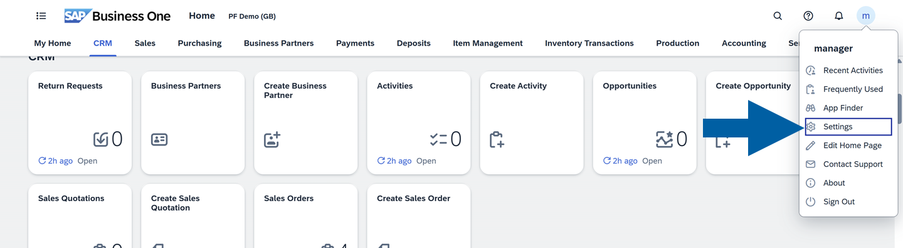

2. Go to **Extensibility**.  

    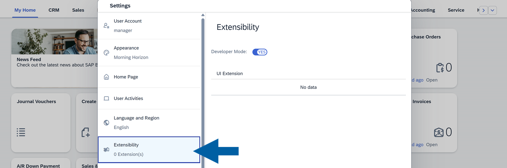

3. Turn on the **Developer Mode** toggle.  

    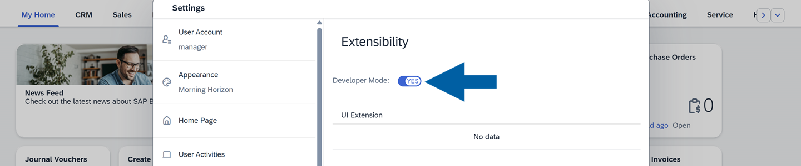

4. Click **Save**.

## Step 3: Install browser extensions

To use CompuTec WebUp, install the following browser extensions:

- **CompuTec WebUp Manager** – a browser extension used to create, edit, and test CompuTec WebUp configurations.
- **CompuTec WebUp Client** – a browser extension that extends the SAP Business One Web Client where the standard extensibility framework is limited.

:::info[Note]
On SAP Business One Web Client 2602 and later, CompuTec WebUp extensions use the Web Client's authentication to communicate with CompuTec AppEngine. For these requests, you don't need the **CompuTec WebUp Client** browser extension. The extension is still required for other scenarios.
:::

:::info[note]
The extensions are available in the **Chrome Web Store** and **Firefox Browser ADD-ONS** store under the **CompuTec S.A.** publisher. This is the recommended method for Firefox, Google Chrome and Chromium-based browsers, such as Microsoft Edge. Developer mode is not needed for this method. Before you install an extension, check that the publisher is **CompuTec S.A.**

**CompuTec WebUp Manager** is **not available** for **Mozilla Firefox**. For consultant or key-user functionality, use **Google Chrome** or **Microsoft Edge**.

Manual installation using CompuTec installation packages is still available when required. For instructions, see [**Manual Browser Extension Installation**](/docs/webup/other/extension-manual-installation).
:::

To install CompuTec WebUp browser extensions, follow these steps:

<Tabs>
  <TabItem value="chrome" label="Google Chrome" default>

1. Open the **CompuTec WebUp Manager** and **CompuTec WebUp Client** listings in the **Chrome Web Store**, and check that the publisher is **CompuTec S.A.**:
    - [**CompuTec WebUp Manager**](https://chromewebstore.google.com/detail/computec-webup-manager/agdmmdghpkllidfeajciepkcchlijpmf)
    - [**CompuTec WebUp Client**](https://chromewebstore.google.com/detail/computec-webup-client/mgglbjhibagmkneodlhinpelnpdedfgi)

2. Click **Add to Chrome**.

    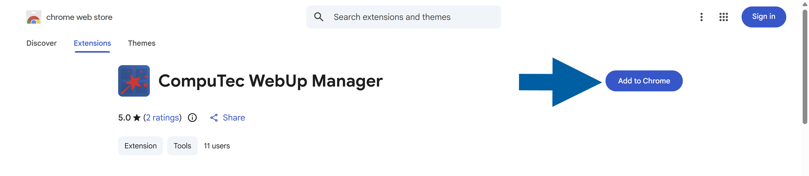

3. Review the requested permissions and confirm the installation.

    

4. Repeat these steps for both the **CompuTec WebUp Client** and **CompuTec WebUp Manager** extensions.

5. Click the **Extensions icon** and verify that both **CompuTec WebUp Manager** and **CompuTec WebUp Client** are installed and enabled.

    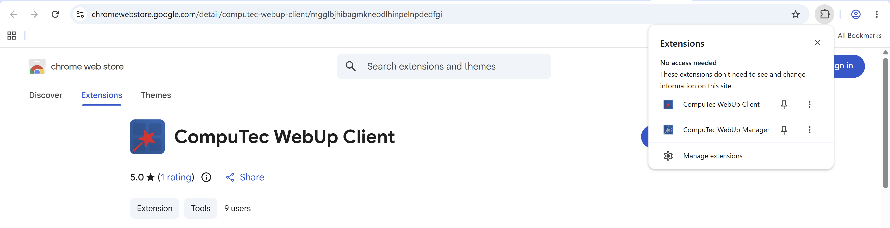

  </TabItem>

  <TabItem value="edge" label="Microsoft Edge">

1. Open the **CompuTec WebUp Manager** and **CompuTec WebUp Client** listings in the **Chrome Web Store**, and check that the publisher is **CompuTec S.A.**:
    - [**CompuTec WebUp Manager**](https://chromewebstore.google.com/detail/computec-webup-manager/agdmmdghpkllidfeajciepkcchlijpmf)
    - [**CompuTec WebUp Client**](https://chromewebstore.google.com/detail/computec-webup-client/mgglbjhibagmkneodlhinpelnpdedfgi)

2. Click **Get**.

    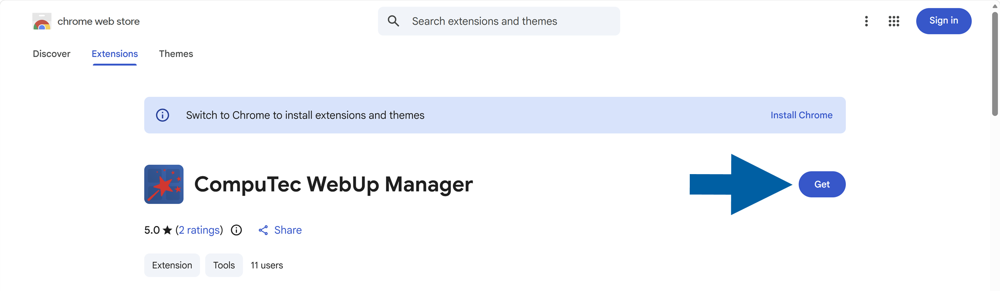

3. Review the requested permissions and confirm the installation.

    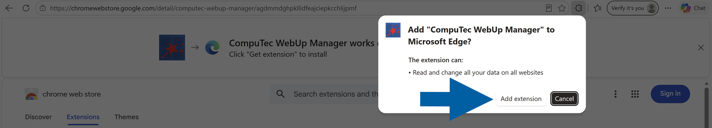

    :::info[note]
    Microsoft Edge supports extensions from the **Chrome Web Store**. If prompted, allow extensions from other stores before installing the WebUp extensions.

    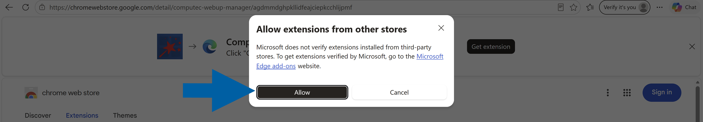
    :::

4. Repeat these steps for both the **CompuTec WebUp Client** and **CompuTec WebUp Manager** extensions.

5. Click the **Extensions icon** and verify that both **CompuTec WebUp Manager** and **CompuTec WebUp Client** are installed and enabled.

    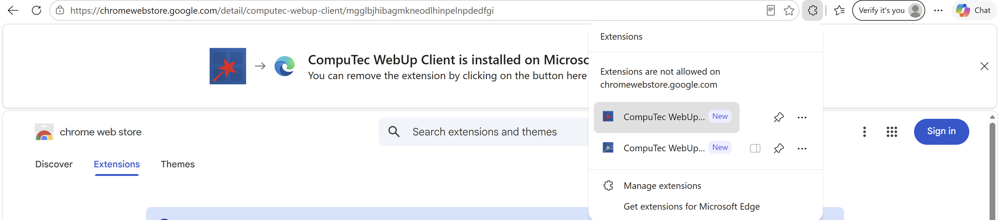

  </TabItem>

  <TabItem value="firefox" label="Mozilla Firefox">

    1. In **Mozilla Firefox**, open the Firefox Add-ons page for [**CompuTec WebUp Client**](https://addons.mozilla.org/en-US/firefox/addon/computec-webup-client/). 
    2. Check that the author is **CompuTec S.A.**
    3. Click **Add to Firefox**.

        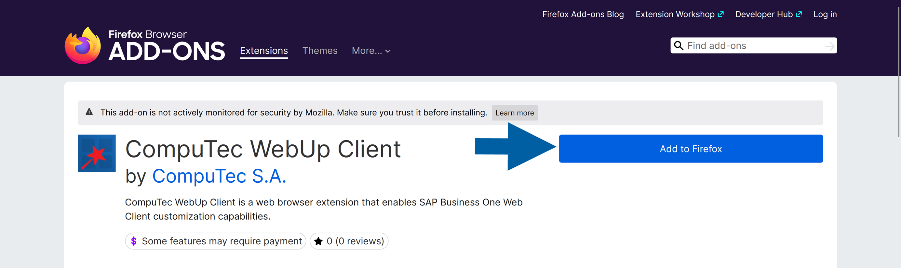

    4. Review the requested permissions, and then click **Add**.

        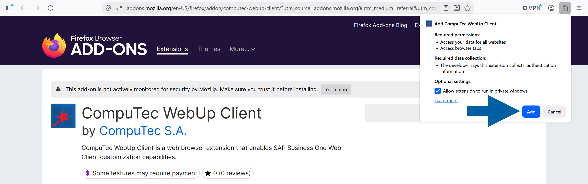

    5. Check **Pin extension to toolbar** option, and then click **OK**.

        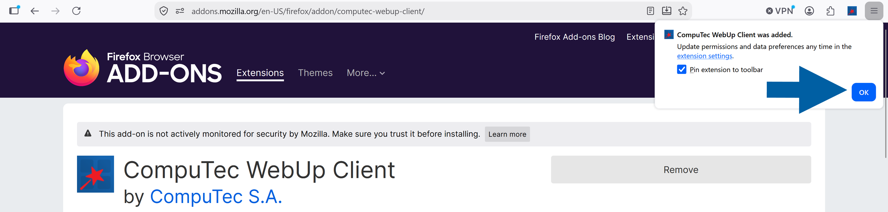

    6. Click the extensions icon and verify that **CompuTec WebUp Client** is in the list and enabled.

        

    7. Done! **CompuTec WebUp Client** is installed in Mozilla Firefox.

    :::info[Note]
    **CompuTec WebUp Manager** is not available for Mozilla Firefox. Use Google Chrome or Microsoft Edge to create and edit configurations.
    :::

  </TabItem>
</Tabs>

## Step 4: Verify the integration

After installation, confirm that both the CompuTec AppEngine plugin and the browser extension are active and communicating.

1. Pin the **CompuTec WebUp Manager extension** to your browser toolbar for easy access.
2. Navigate to the **SAP Web Client** page.
3. Click the **CompuTec WebUp extension** icon to activate the integration.  

    

:::info[Note]
If you were already on the SAP Web Client page before installing the CompuTec WebUp browser extension, refresh the page before activating the extension.
:::

:::note[Info]

When you click **Save & Preview** in **CompuTec WebUp Manager**, only the preview refreshes. The SAP Business One Web Client doesn't reload, so your current Web Client state is preserved.

:::

## Updates

- Updates are delivered automatically via the CompuTec AppEngine Store.  
- All configuration profiles and assignments are preserved during updates.  
- If a new version of the browser extension is available, you’ll be prompted to update it after installation.
- Browser extensions installed from the Chrome Web Store or the Firefox Add-ons store are updated through the store.
- Maintain your CompuTec AppEngine and CompuTec WebUp versions up to date to ensure compatibility.

:::info[Note]
For technical issues or feature requests, contact us via the [CompuTec Support Portal](https://support.computec.pl/servicedesk/customer/portals?q=webUp). Feedback on usability and performance is always welcome.
:::
