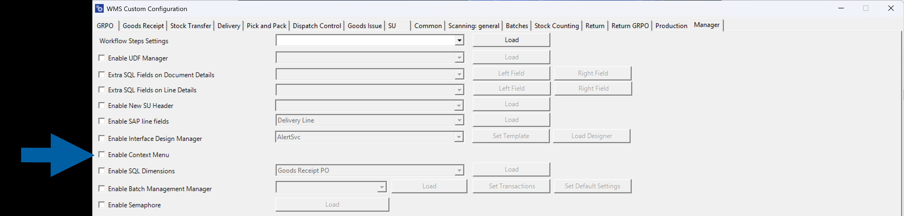

import Tabs from '@theme/Tabs';
import TabItem from '@theme/TabItem';

# Enable Context Menu

The **Enable Context Menu** option in **WMS Custom Configuration** adds a menu of actions to the item and storage unit rows in CompuTec WMS Client. Users open the menu with a right-click on a desktop computer, or with a long press or swipe on an Android device. This saves them from leaving the document screen to run an action.

## How the context menu works

The context menu opens on a row in a document. The actions in the menu depend on the row type and on the screen you are on.

| Screen | Row type | Actions in the menu |
| --- | --- | --- |
| **Document details** | Item | **Pick All**, **Clear Picks**, **Print**, **Line fields**, **Remove Item**, **Copy text** |
| **Document details** | Storage unit (SU) | **Unpin SU**, **SU Fields**, **Add a child SU**, **Add SU by Wizard**, **Add a new Item**, **Print**, **Remove SU**, **Copy text** |
| **Line details** | Item (batch) | **Batch fields**, **Pick All**, **Clear Picks**, **Print**, **Remove batch**, **Copy text** |

The **Line details** screen has a menu for items only. Storage units have no menu on that screen.

The examples in this article use the **Goods Receipt PO** transaction.

## Enable the context menu

To enable the context menu, follow these steps:

1. Open **WMS Custom Configuration**.
2. Go to the **Manager** tab.
3. Select **Enable Context Menu**.

   

4. Click **Save**.
5. Done! The context menu is enabled.

## Open the context menu

Choose the steps for your device:

<Tabs groupId="client" queryString>
<TabItem value="desktop" label="Desktop Client">

To open the context menu on a desktop computer, follow these steps:

1. Open a document, for example a **Goods Receipt PO**.
2. Right-click an item or a storage unit.

   The context menu opens with the actions for that row.

3. Select an action, or click **Cancel** to close the menu.

   

   

4. To open the menu for a batch, go to **Line details** and right-click the batch row.

   

</TabItem>
<TabItem value="android" label="Android Client">

On an Android device, you choose the gesture that opens the context menu. To choose the gesture, follow these steps:

1. In CompuTec WMS Client, open the settings and go to the **Options** tab.
2. Find the **Context Menu** setting at the bottom of the list.

   

3. Select the current value, and then select the gesture you want:

   - **Long press** – Opens the menu when you press and hold a row.
   - **Swipe left** – Opens the menu when you swipe a row to the left.
   - **Swipe right** – Opens the menu when you swipe a row to the right.
   - **Long press or swipe** – Opens the menu with either a long press or a swipe.

   

4. Click **Save**.

To open the context menu, use the gesture you chose on an item or storage unit row.

</TabItem>
</Tabs>

## Next steps

See [**Manager**](./overview) for the other settings in **WMS Custom Configuration**.
