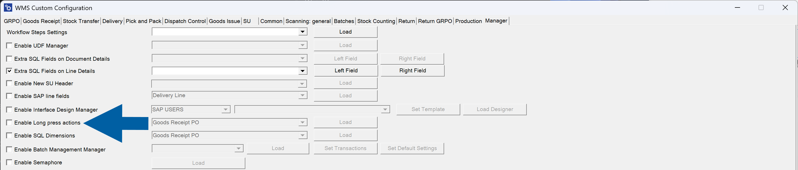
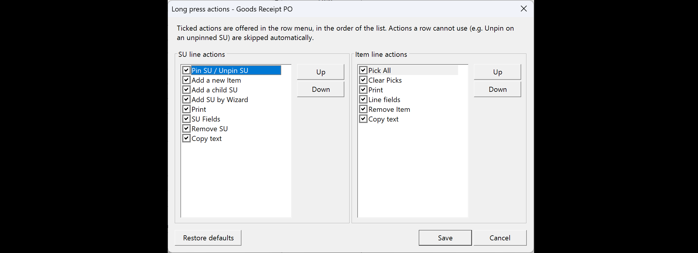

# Enable Long Press Actions

Use **Enable Long Press Actions** to configure the actions available in the row menu for **Items** and **Storage Units (SUs)**. For each transaction, you can choose which actions appear and change their order.

:::note[info]
Long press is supported only in the **Android** version of **CompuTec WMS**. In the **Windows** version, right-click a row to open its action menu.
:::

## Configure row actions

1. Open **Custom Configuration**.
2. Select the **Manager** tab.
3. Select **Enable Long Press Actions**.

   

4. Select the transaction from the drop-down list.
5. Click **Load**.
6. In **SU line actions**, select the actions to show for storage unit rows. In **Item line actions**, select the actions to show for item rows.

   

7. To change the menu order, select an action and click **Up** or **Down**.
8. Clear the checkbox next to any action you want to hide.
9. Click **Save** in the action settings window.
10. Click **Save** in **Custom Configuration**.

:::info[note]
The row menu displays the selected actions in the configured order. Actions that do not apply to the selected row are omitted automatically. For example, **Unpin SU** is not offered for an SU that is not pinned.
:::

To return to the default configuration, click **Restore defaults** in the action settings window and save the changes.

## Open a row action menu

1. Open the transaction in **CompuTec WMS**.
2. On **Android**, press and hold an item or storage unit row. On **Windows**, right-click the row.
3. Select an action from the menu.

### Item row actions

For **Goods Receipt PO**, you can configure the following item actions:

- **Pick All**
- **Clear Picks**
- **Print**
- **Line fields**
- **Remove Item**
- **Copy text**

## Storage unit row actions

For **Goods Receipt PO**, you can configure the following storage unit actions:

- **Pin SU / Unpin SU**
- **Add a new Item**
- **Add a child SU**
- **Add SU by Wizard**
- **Print**
- **SU Fields**
- **Remove SU**
- **Copy text**

The menu shows the pin or unpin action that applies to the selected storage unit. The example below shows **Unpin SU** for a pinned storage unit.

