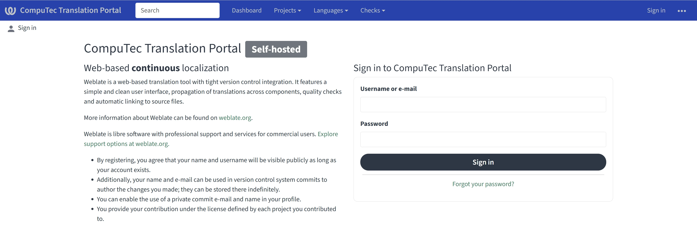
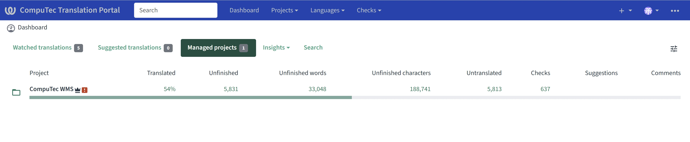
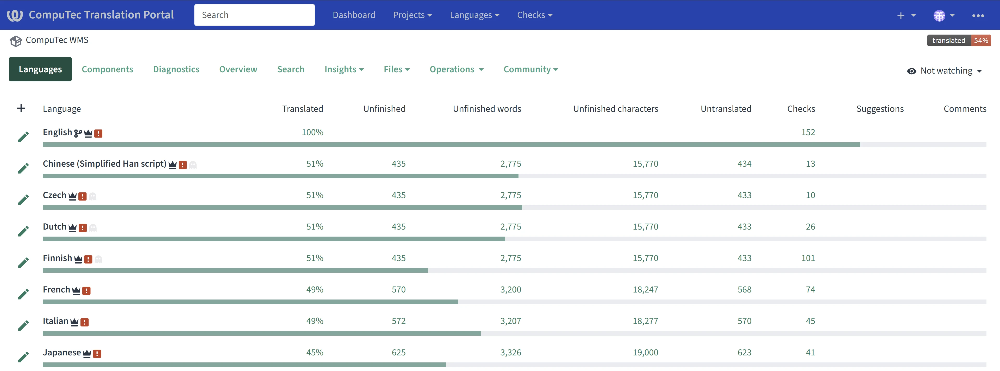
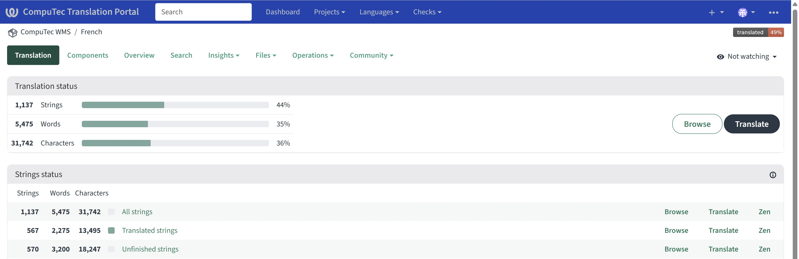
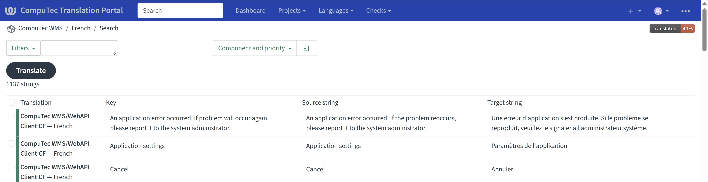
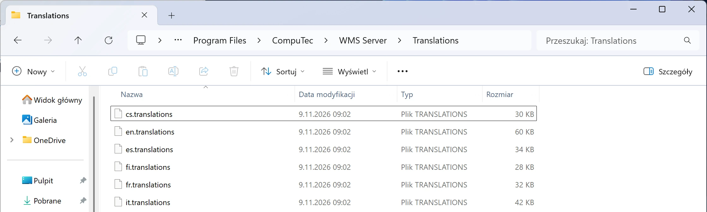
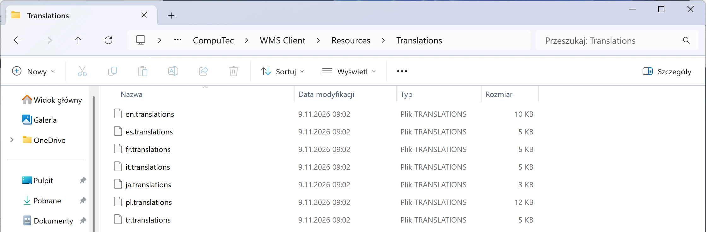
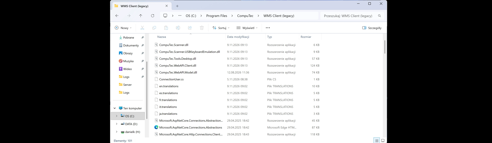

# CompuTec WMS Translator

This guide explains how to use the **CompuTec Translation Portal** to translate **CompuTec WMS**. The default language of CompuTec WMS is American English. With the CompuTec Translation Portal, you can translate the CompuTec WMS interface into any other language, so users who don't speak English can work in their own language.

The CompuTec Translation Portal is useful for international organizations and for businesses that need a different interface language for each region. You can translate for a specific locale or test a new language version.

:::warning[Important]

If you create a translation for a language, send the translation files to CompuTec so we can add them to the next CompuTec WMS installer release. If you don't, CompuTec WMS reverts to American English after a system upgrade, and you lose your changes.

:::

## Before you start

Before you start, make sure that you have:

- **Credentials**: You have a user name and password for the CompuTec Translation Portal. CompuTec provides them.
- **Installation access**: To test a translation, you can write to the installation folders of CompuTec WMS Server and CompuTec WMS Client.

## CompuTec Translation Portal address

To access the CompuTec Translation Portal, navigate to: [https://translate.computec.one](https://translate.computec.one).

The CompuTec Translation Portal is based on Weblate, a web-based translation tool. To learn more about Weblate, go to [weblate.org](https://weblate.org).

## Log in

Log in with the credentials that CompuTec provided.

1. Go to the CompuTec Translation Portal address.
2. In the **Username or e-mail** field, enter your user name or e-mail address.
3. In the **Password** field, enter your password.
4. Click **Sign in**.

:::note[Info]

If you forgot your password, click **Forgot your password?** on the sign-in page.

:::

:::info[note]

When you register, your name and user name are visible publicly as long as your account exists. The portal can also use your name and e-mail address in version control system commits. To use a private commit e-mail address and name instead, enable this option in your profile.

:::

## Dashboard

After you log in, the **Dashboard** opens.

The **Managed projects** tab lists the projects you manage. For each project, it shows the percentage of translated strings and the numbers of unfinished and untranslated strings.

To open the project, click **CompuTec WMS**.

## Select a language

On the **Languages** tab of the **CompuTec WMS project**, you can see every language and its translation progress. English is the source language, and you can't change it.

To translate a language, click its name, for example, **French**. The **Translation** tab of that language opens.

## Translate strings

The **Translation** tab shows the **Translation status** of the language: the number of strings, words, and characters, and the percentage translated. The **Strings status** section lists strings by state, for example **All strings**, **Translated strings**, and **Unfinished strings**.

To work on strings, use one of the following options:

- Click **Translate** to translate strings one by one.
- Click **Browse** to view strings in a list.
- Click **Zen** next to a string group to translate in a simplified editor.

To find specific strings, use the **Search** field in the top menu. In the search results, you can use **Filters** to limit the list. The list shows the **Translation** (the component), the **Key**, the **Source string**, and the **Target string** for each string.

When you change a translation, the portal stores it on the server. CompuTec adds stored translations to the next official CompuTec WMS release.

:::note[Info]
The **Translation** column shows the component that a string belongs to, for example **CompuTec WMS/WebAPI Client CF**.
:::

## Download a translation

To test a translation before an official release, download the translation files for the selected language. Then update your CompuTec WMS installation with the downloaded files.

To download the files, open the **Files** menu on the language page and select the download option.

:::warning[Important]
When you upgrade to an official release, the latest translation files overwrite your translation files.
:::

## Update your installation with a translation

CompuTec WMS stores each language in a translation file. The file name is the language code followed by `.translations`. For example, `fr.translations` is the French translation file, and `pl.translations` is the Polish one.

To use a downloaded translation, copy the translation file to each of the following folders. If a file for the language already exists in a folder, replace it.

| Component | Folder |
| --- | --- |
| CompuTec WMS Server | `C:\Program Files\CompuTec\WMS Server\Translations` |
| CompuTec WMS Client | `C:\Program Files\CompuTec\WMS Client\Resources\Translations` |
| CompuTec WMS Client (legacy) | `C:\Program Files\CompuTec\WMS Client (legacy)` |

If you installed CompuTec WMS in a different location, use the folders in your installation path.

:::note[Info]

The CompuTec WMS Server, CompuTec WMS Client, and CompuTec WMS Client (legacy) use separate translation files. The files for the same language have different sizes. Copy each downloaded file to the folder of the component that it belongs to.

:::

1. Go to the CompuTec WMS Server `Translations` folder. The folder contains one `.translations` file for each language.

    

2. Copy the downloaded translation file to this folder. If the file for the language exists, replace it.
3. Go to the CompuTec WMS Client `Resources\Translations` folder.

    

4. Copy the downloaded translation file to this folder. If the file for the language exists, replace it.
5. If you use CompuTec WMS Client (legacy), go to its installation folder. The translation files are in the main folder, next to the application files.

    

6. Copy the downloaded translation file to this folder. If the file for the language exists, replace it.

## Next steps

When your translation is complete, save your changes to send the translation files to CompuTec. We add them to the next CompuTec WMS installer release, so your translation stays after an upgrade.
